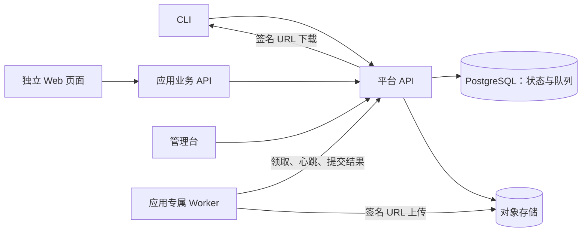

# 共享应用平台详细设计（建议基线）

本文细化 [总体方案](./index.md)。标为“首版”的能力对应总体方案第一阶段；后续能力保留接口和数据模型上的扩展空间，但不提前实现完整功能。具体框架、云产品仍可替换，以下选择用于形成可实施、可验证的一条路径。

## 1. 目标、边界与技术选择

### 目标与规模假设

- 初期为单用户、少量独立应用和少量并发 Worker；任务可能运行数分钟至数小时。
- 平台统一处理登录、任务记录和调度、产物访问、审计；应用拥有自己的页面、业务 API 和任务代码。
- 应用与平台通过版本化 HTTP/JSON API 通信。Worker 不直接访问平台数据库。
- 首版只运行由项目代码部署的任务处理器；任务输入是数据，不能作为脚本执行。
- 任务历史需可追溯，平台以可靠性和清楚的失败语义优先，不追求极高吞吐量。

### 建议技术基线

| 部分 | 选择 | 理由 |
| --- | --- | --- |
| 平台 API、Worker SDK、CLI | TypeScript + 当前受支持的 Node.js LTS | 共享协议类型，符合总体方案方向 |
| HTTP API | Fastify + JSON Schema | 输入输出校验、接口文档和插件化较直接 |
| 数据库与持久化队列 | PostgreSQL | 任务创建和入队可在同一事务完成，首版少一种基础设施 |
| 数据访问 | `pg` + 显式 SQL 迁移；可加类型安全查询层 | 队列租约与状态迁移需要清楚的事务边界 |
| 产物 | S3 兼容对象存储 | 本地可用 MinIO，部署时可更换服务商 |
| 日志与指标 | 结构化日志、OpenTelemetry 指标/追踪 | 串联 API、任务和 Worker 的运行记录 |
| 本地开发 | pnpm workspace + Docker Compose | 统一运行 API、PostgreSQL、对象存储和示例 Worker |

PostgreSQL 队列是首版决策，不额外引入 Redis。若任务量增长到数据库轮询成为瓶颈，再评估专用队列；外部 API、任务状态和 Worker SDK 不依赖队列实现。

### 进程与边界



平台 API 可以多实例运行；应用 Worker 独立部署和扩缩容。调度器、租约回收器在早期可作为 API 进程中的后台循环，后期拆成独立进程。无论部署方式如何，同一时刻只有一个实例能凭数据库锁处理同一条记录。

## 2. 仓库与模块

建议在开始编码时建立以下结构；这是目标结构，不表示目前已经存在：

```text
apps/
  platform-api/           # HTTP API、身份认证、任务服务
  cli/                    # platform 命令
  admin-console/          # 第二阶段建设
  example-app/            # 示例任务与独立 Worker
packages/
  protocol/               # JSON Schema、API 类型、错误码
  worker-sdk/             # 领取任务、心跳、事件、产物、检查点
  client-sdk/             # 应用调用平台 API
  db/                     # SQL 迁移与持久化访问
docs/
  index.md
  detailed-design.md
```

`protocol` 定义稳定的网络契约；不要让独立应用直接依赖平台的数据库包。所有 API 使用 `/v1` 前缀。响应错误统一为 `{ "error": { "code", "message", "request_id" } }`，列表使用游标分页；时间统一为 UTC ISO 8601，ID 使用不含业务含义的 UUID。

## 3. 身份、权限与凭据

### 主体

| 主体 | 认证方式 | 权限范围 |
| --- | --- | --- |
| 用户 | 首版 CLI Token；第二阶段增加 Web 密码会话 | 首版唯一用户为平台所有者；后续可细化资源权限 |
| 应用 Worker | 绑定应用的服务令牌 | 只能领取和更新本应用、匹配发布版本的任务 |
| webhook 来源 | 每个端点独立签名密钥 | 只能触发端点配置的任务；第二阶段启用 |

- 首版用成熟认证库管理密码哈希，密码哈希选 Argon2id。第二阶段启用 Web 会话时，使用 `HttpOnly`、`Secure`、合适的 `SameSite` Cookie，并对改变状态的请求使用 CSRF 防护。
- `yuxu login` 在终端安全提示输入密码，经 HTTPS 换取有期限的 CLI Token；服务端只保存令牌哈希，明文只返回一次。CLI 优先放入系统凭据库；文件回退时限制为当前用户可读。
- Worker 服务令牌由部署配置注入，绑定一个 `app_id` 和允许的 `release_digest`，不可用于用户 API。轮换令牌时允许短暂并存，日志不得记录令牌。
- 首次部署通过一次性初始化命令创建所有者账号并设置密码，不提供默认账号或默认密码。首版部署脚本从受信的示例应用声明文件同步任务版本并签发 Worker 令牌；第四阶段再建设通用应用注册和发布入口。
- 每次请求先认证主体，再按 `app_id`、任务、数据资源和产物归属授权。浏览器中的应用页面不持有 Worker 服务令牌；跨域登录方案留到独立 Web 应用接入时确定。
- 对登录、令牌管理、任务取消/重试、webhook 和下载入口做速率限制；密钥、密码和敏感任务输入不进入普通日志。

## 4. 应用与任务声明

每个应用有稳定 `app_id`（如 `example-app`），任务有稳定 `task_key`（如 `report/build`）。声明文件包含：显示名称、输入/输出 JSON Schema、超时、最大尝试次数、是否支持检查点、产物类型和发布摘要 `release_digest`。

```json
{
  "app_id": "example-app",
  "release_digest": "sha256:<构建产物摘要>",
  "tasks": [{
    "task_key": "report/build",
    "input_schema": { "type": "object", "required": ["title"], "properties": { "title": { "type": "string" } } },
    "output_schema": { "type": "object", "required": ["artifact_id"], "properties": { "artifact_id": { "type": "string" } } },
    "timeout_seconds": 3600,
    "max_attempts": 3,
    "checkpointable": true
  }]
}
```

部署流程将声明写入平台。声明的每个版本不可变；同一版本摘要对应的 schema 和执行配置不得被覆盖。首版一个应用只设一个当前版本，部署时显式切换；第四阶段再增加多版本并存、发布健康检查和回滚。任务创建时固定 `task_version_id`，后续发布不会改变已提交任务的执行代码。Worker 启动时上报自身 `app_id` 和 `release_digest`，只领取匹配版本的任务。未部署对应 Worker 的任务保留在队列中并显示“等待匹配 Worker”。首版升级应用时，应让旧版本 Worker 处理完已提交任务，再下线旧 Worker；第四阶段再支持常态化多版本并行。

## 5. 任务生命周期

### 状态与语义

| 状态 | 含义 | 下一步 |
| --- | --- | --- |
| `queued` | 已持久化，等待可用 Worker 或重试时间 | `running`、`cancelled` |
| `running` | 当前尝试持有有效租约 | `succeeded`、`failed`、`recovering`、`cancelling` |
| `recovering` | 上次尝试中断，等待重新领取 | `running`、`failed`、`cancelled` |
| `cancelling` | 已请求取消，等待 Worker 确认或租约到期 | `cancelled` |
| `succeeded`、`failed`、`cancelled` | 终态 | 无；手动重试会创建新任务并关联原任务 |

平台提供**至少一次执行**。Worker 中断后，平台可重新领取任务；这并不保证处理器的外部副作用只发生一次。处理器对外部写入应使用稳定幂等键；支持检查点的处理器应将可重用的阶段结果写入平台。首版验收中的“恢复”定义为：Worker 重启后，平台识别过期租约并重新执行；示例任务从已确认的检查点继续。对没有检查点的处理器，允许从头重跑。

### 提交与幂等

1. 平台按任务版本的 JSON Schema 校验输入和输入文件归属。
2. 在同一 PostgreSQL 事务中写入 `tasks`、初始状态事件和幂等索引。事务提交即完成入队，不存在“任务已创建但未进入队列”的双写窗口。
3. 客户端可传 `Idempotency-Key`。同一来源主体、应用、任务键和幂等键重复提交相同规范化输入时返回原任务；输入或输入资源 ID 不同返回 `409 IDEMPOTENCY_CONFLICT`。未传键则每次创建新任务。来源主体可以是用户、定时任务或 webhook 端点。
4. 任务保存输入、输入摘要、来源、创建者、版本和时间；大文件只通过输入资源 ID 引用，不塞入 JSON 字段。

### 领取、心跳与完成

- Worker 空闲槽位调用领取接口。平台按 `app_id`、`release_digest`、到期时间筛选 `queued/recovering` 任务，使用短事务中的 `FOR UPDATE SKIP LOCKED` 锁定一条，创建新的 `task_attempt`，设为 `running` 并生成租约。领取响应包含已确认的步骤与检查点。领取顺序先按可运行时间、再按创建时间。
- 建议首版租约为 60 秒、心跳间隔 15 秒、空队列轮询间隔 2 秒，全部可配置。Worker 上报 `attempt_id`、进度与检查点；平台仅接受当前尝试且租约有效的更新。
- 完成时平台在一个事务中验证当前尝试、输出 schema、产物状态，再写入结果和终态事件。旧 Worker 的迟到心跳、日志或完成请求返回冲突，不能覆盖新的尝试。
- 进度为 0–100 的展示值，不能替代任务状态；事件按数据库单调 ID 排序，CLI 可从最后收到的事件继续监听。

### 中断、超时、重试与取消

- 回收器扫描过期租约，把原尝试记为 `interrupted`。未超过允许尝试次数则任务转 `recovering` 并等待下一次领取；次数用尽则转 `failed`。首版的尝试上限用于中断恢复；处理器主动报错时直接失败。回收器自身重启不影响结果。
- 任务总超时由平台时间判定，Worker 本地超时只用于尽快停止处理。任务到期后即使收到迟到的成功结果也不接受。
- 第二阶段开放自动重试策略和 CLI 手动重试。自动重试只针对声明为可重试的失败，采用有上限的退避；手动重试创建新任务并设置 `retry_of_task_id`，保留原任务历史。
- 第二阶段开放取消：排队中可直接取消；运行中转 `cancelling`，心跳响应通知 Worker 终止。Worker 确认或租约到期后转 `cancelled`。取消只保证平台不再接受结果，不能撤销已发生的外部副作用。
- 每个任务的并发占一个 Worker 槽位；平台在领取事务中锁定应用的并发计数行，再预留槽位，避免多个 Worker 同时领取时超过应用级上限。任务完成、失败或租约回收时在同一事务中释放该槽位。

### 检查点和步骤

Worker SDK 提供 `step(key, handler)`、`saveCheckpoint(key, value)` 与 `reportProgress(...)`。每个步骤有稳定键，成功步骤及检查点写入 `task_steps`。恢复时 SDK 读取已确认步骤；处理器决定是否复用结果。检查点只保存小体积 JSON，大结果通过产物 ID 引用。步骤状态只代表平台确认，不自动保证外部系统调用幂等。

## 6. 持久化数据模型

下表列出逻辑表与关键约束；具体列类型和索引在迁移时固定。

| 表 | 关键字段与约束 | 用途 |
| --- | --- | --- |
| `users`、`web_sessions`、`api_tokens` | 用户 ID、密码哈希；会话/令牌哈希、过期时间、撤销时间 | 用户认证 |
| `applications` | 唯一 `app_id`、状态 | 应用身份和隔离边界 |
| `task_definitions` | 唯一 `(app_id, task_key)` | 任务稳定名称 |
| `task_versions` | 唯一 `(definition_id, release_digest)`；输入/输出 schema、超时、尝试上限 | 不可变执行契约 |
| `tasks` | ID、应用 ID、任务定义 ID、版本 ID、状态、输入/输出 JSON、当前尝试 ID、计划运行时间、截止时间、来源主体键、创建者、幂等键与输入摘要、原任务 ID | 任务与队列主记录 |
| `task_attempts` | ID、任务 ID、序号、Worker ID、租约到期时间、开始/结束时间、结束原因 | 每次执行的历史与租约 |
| `task_steps` | 唯一 `(task_id, step_key)`；状态、检查点、更新时间 | 恢复点 |
| `task_events` | 自增事件 ID、任务 ID、尝试 ID、类型、内容、时间 | 进度、日志、状态历史和 CLI 续读 |
| `assets` | ID、应用 ID、任务/尝试 ID、输入或产物类型、对象键、大小、校验和、状态 | 文件元数据与授权 |
| `worker_instances` | ID、应用 ID、发布摘要、最近心跳、容量 | Worker 可见性；第四阶段完善健康状态 |
| `audit_events` | 主体、动作、资源、结果、请求 ID、时间 | 第二阶段启用的审计历史 |
| `schedules`、`webhook_endpoints` | 目标任务、触发配置、状态 | 第二阶段的自动触发 |

关键索引包括任务的 `(status, scheduled_at, created_at)`、`(app_id, task_version_id, status)`、尝试的 `(lease_expires_at)` 和事件的 `(task_id, id)`。有幂等键的任务对 `(origin_key, app_id, task_definition_id, idempotency_key)` 设置唯一约束；`origin_key` 为不可空的来源主体标识，无幂等键的任务不受该约束。任务输入若含个人或敏感数据，日志只记录摘要和明确允许展示的字段。日志与产物分别设置保留期限；任务元数据保留更久，实际期限作为部署配置并写入运维说明。

## 7. HTTP API 与 CLI 契约

### 用户 API（首版）

| 方法和路径 | 作用 |
| --- | --- |
| `POST /v1/auth/cli-token` | 密码换取有期限的 CLI Token |
| `GET /v1/apps`、`GET /v1/apps/{app_id}/tasks` | 应用和可运行任务发现 |
| `POST /v1/tasks` | 提交任务，支持 `Idempotency-Key` |
| `GET /v1/tasks/{id}` | 获取状态、进度、结果与产物引用 |
| `GET /v1/tasks/{id}/events?after={event_id}` | 分页读取事件 |
| `GET /v1/tasks/{id}/stream` | SSE 实时事件；断线按事件 ID 续接 |
| `POST /v1/uploads`、`POST /v1/uploads/{id}/complete` | 上传任务输入文件 |
| `GET /v1/artifacts/{id}/download` | 授权后取得短期下载地址 |

提交示例：

```json
{
  "task": "example-app/report/build",
  "input": { "title": "月度报告" },
  "input_asset_ids": []
}
```

响应使用 `202 Accepted`，返回 `task_id`、状态、版本和状态查询地址。校验失败返回 `400`，无权限返回 `403`，幂等冲突返回 `409`；错误码稳定，文字可调整。`yuxu task watch` 先读取快照，再订阅事件；SSE 不可用时回退到带事件游标的轮询。

### Worker API（首版）

| 方法和路径 | 作用 |
| --- | --- |
| `POST /v1/worker/instances` | 上报实例、发布摘要和容量 |
| `POST /v1/worker/instances/{id}/heartbeat` | 空闲时也能上报实例存活状态 |
| `POST /v1/worker/leases` | 为一个空闲槽位领取一项匹配任务；无任务返回 `204` |
| `POST /v1/worker/tasks/{id}/heartbeat` | 续租并获取是否需要停止 |
| `POST /v1/worker/tasks/{id}/events` | 批量上报日志、进度和步骤事件 |
| `POST /v1/worker/tasks/{id}/complete` | 提交输出和已就绪产物 |
| `POST /v1/worker/tasks/{id}/fail` | 提交结构化失败原因 |

所有修改某个任务执行状态的 Worker 请求携带 `attempt_id`。服务端从凭据确定 `app_id`，不信任请求体中的应用身份。请求使用可重试语义：事件批次有幂等批次 ID，完成/失败重复提交同一结果返回原结果，冲突结果返回 `409`。上传接口也接受限定应用范围的 Worker 凭据。

### 第二、三阶段扩展

- 第二阶段：`POST /v1/tasks/{id}/cancel`、`POST /v1/tasks/{id}/retry`、定时任务和 webhook 管理接口、审计查询接口。
- 第三阶段：`/v1/apps/{app_id}/data/{resource}` 的 CRUD、分页和筛选接口。
- 第四阶段：应用发布、版本切换、Worker 健康状态和回滚接口。

## 8. 输入文件与产物

1. 客户端或 Worker 请求上传会话；平台创建状态为 `pending` 的 `asset`，生成不可猜测的对象键和短期签名上传 URL。
2. 调用方直接上传对象，携带限定的内容类型、大小和校验信息。对象存储或平台校验实际大小与校验和。
3. 调用方确认上传，平台核对对象后将其标记为 `ready`。任务输入只能引用所属应用且 `ready` 的输入资源；任务完成只能引用当前尝试产生且 `ready` 的产物。
4. 下载时平台先授权，再签发短期只读 URL；不公开存储桶。失败尝试的未引用对象和过期 `pending` 对象由清理任务回收。

任务输出 JSON 只保存小体积结构化结果，图片、文件和报告进入对象存储。若对象存储暂时不可用，任务不应伪装成功；Worker 可在超时前重试上传，最终按任务策略失败或恢复。

## 9. 定时任务、webhook 与管理台（第二阶段）

- 定时任务保存时区、表达式、目标任务版本选择策略、固定输入和下次触发时间。调度器在事务中锁定到期记录，以 `schedule_id + planned_fire_time` 作为幂等键创建任务，避免多实例重复触发。
- webhook 端点绑定单一应用及允许的任务，验证请求签名、时间窗口和请求 ID；只把通过 schema 校验的数据映射为任务输入。原始请求体不作为执行代码。签名密钥可轮换。
- 管理台复用用户 API，展示队列年龄、任务尝试、步骤、日志、Worker 最近心跳、产物、定时任务与审计事件。管理员的取消和重试走同一任务状态机，不直接改数据库。
- 管理台不存应用业务数据或实现应用的业务页面。

## 10. 通用数据服务（第三阶段）

应用声明资源名、字段类型、必填/默认值、可筛选和可排序字段。平台为每个应用使用独立 PostgreSQL schema，并生成受控迁移；表名、字段名仅来自已验证声明，不能由请求参数直接拼成 SQL。

- 自动迁移首批只允许新增资源、可空字段和带默认值的字段等兼容变更。删字段、改类型和缩小约束需要显式迁移计划与备份确认。
- CRUD 仅支持单资源、单记录事务；分页使用稳定排序和游标，筛选操作符使用白名单，限制返回条数。
- 资源权限按应用和操作（读、写、管理）判定；应用自有 API 负责复杂业务规则和跨资源事务。
- 迁移记录包含声明版本、SQL 摘要、执行时间和结果；失败时阻止应用切换到不匹配的声明版本。

## 11. 部署、可观测性与备份

- 本地 Compose 启动 PostgreSQL、对象存储、平台 API 和示例 Worker；数据库迁移完成后启动 API。配置通过环境变量或部署密钥管理器提供，仓库只提交示例配置。
- 生产环境至少分开 API 与应用 Worker 进程；对外入口使用 HTTPS。数据库和对象存储做定期备份，并验证恢复流程。
- API 请求、任务和尝试都带 `request_id`、`task_id`、`attempt_id`，结构化日志用这些 ID 串联；日志默认过滤凭据和敏感输入。
- 重点指标：排队数与最老排队时间、领取等待时间、任务成功率、租约过期次数、重试次数、Worker 心跳年龄、产物上传失败率。
- 平台启动时检查数据库迁移版本；就绪检查应验证关键依赖。对象存储故障时明确返回不可用，不让完成状态与实际产物脱节。

## 12. 分阶段交付与验收

### 第一阶段：任务闭环

交付 CLI 登录、应用/任务发现、提交和查看、事件监听、输入/产物上传下载、PostgreSQL 队列、Worker SDK、示例任务和检查点。示例任务至少包含两个可复用步骤，并运行足够久以观察进度。

验收用例：

1. 从 CLI 提交任务，返回任务 ID，观察 `queued → running → succeeded` 和连续进度，下载并校验产物。
2. 执行中终止 Worker，等待租约过期，启动 Worker；任务进入 `recovering` 后从已确认步骤继续，最终成功。
3. 同时运行两个 Worker，确认同一时刻同一任务只有一个有效尝试；迟到的旧尝试无法覆盖结果。
4. 重复使用同一幂等键和输入只得到一个任务；改变输入得到明确冲突。
5. 上传未完成、Worker 版本不匹配或对象存储不可用时，状态和错误信息与真实情况一致。

### 第二阶段：管理能力

交付管理台、定时与 webhook、取消、自动及手动重试、审计和更完整的 Worker 状态。验收覆盖重复触发去重、取消中的迟到结果、重试保留历史。

### 第三阶段：数据服务

交付声明式资源、受控迁移、CRUD、分页筛选和应用级授权。验收覆盖兼容迁移、非法筛选拒绝和应用间数据隔离。

### 第四阶段：多应用发布

交付 Git 驱动部署、不可变应用版本、Worker 健康检查、版本切换与回滚。验收覆盖旧任务由匹配旧版本的 Worker 执行、发布失败不影响现有任务。

## 13. 实施前需要确定的配置

首版编码前应把以下值写入部署配置，并在测试中覆盖边界：任务默认超时与最大尝试次数、租约/心跳间隔、应用并发上限、输入与产物大小限制、日志和产物保留期限、备份频率。上述值是可调整的运行参数，不改变 API 和状态机语义。
