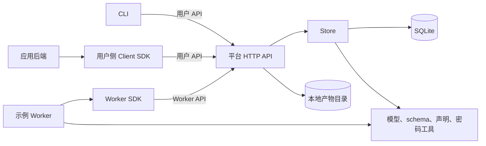

# 现有模块说明

本文描述**当前代码已经实现**的模块，适用于阅读、维护和扩展本地 MVP。总体目标见 [总体方案](./index.md)，未来阶段见 [实现路径](./implementation-plan.md)。当前运行时使用 Node.js 内置 HTTP、SQLite 和本地文件；本文件不把详细设计中的 PostgreSQL、S3、Web 会话等目标能力当作现状。

## 1. 模块关系

平台 HTTP API 是客户端与 Worker 的共同入口。`Store` 是唯一直接读写 SQLite 的模块；Worker SDK 和独立应用通过 HTTP 通信，不接触数据库。产物字节由 API 写入文件目录，文件元数据由 `Store` 保存。

## 2. 源文件一览

| 文件 | 职责 | 主要入口或导出 |
| --- | --- | --- |
| [`apps/platform-api/src/bootstrap.ts`](../apps/platform-api/src/bootstrap.ts) | 一次性初始化所有者和内置示例应用 | `npm run bootstrap` |
| [`apps/platform-api/src/register-app.ts`](../apps/platform-api/src/register-app.ts) | 注册额外应用及其任务声明 | `npm run register-app -- manifest.json` |
| [`apps/platform-api/src/main.ts`](../apps/platform-api/src/main.ts) | 启动和关闭 API 进程 | `npm run server` |
| [`apps/platform-api/src/server.ts`](../apps/platform-api/src/server.ts) | HTTP 路由、认证、参数校验、产物传输和租约扫描 | `createApiServer` |
| [`apps/cli/src/main.ts`](../apps/cli/src/main.ts) | 玉虚 CLI 命令入口：登录、任务操作、事件追踪和下载 | `main` / `yuxu` / `npm run yuxu -- ...` |
| [`apps/cli/src/config.ts`](../apps/cli/src/config.ts) | 个人 CLI 的服务器地址规范化、配置目录、按 origin 隔离的令牌存取 | `resolveServer`、`readToken`、`saveToken` |
| [`apps/cli/package.json`](../apps/cli/package.json) | CLI 的独立 npm 发布元数据、命令入口和包文件白名单 | `npm pack ./apps/cli`、发布工作流 |
| [`apps/cli/README.md`](../apps/cli/README.md) | npm 包安装、基础命令和配置说明 | npm 包首页 |
| [`packages/client-sdk/src/index.ts`](../packages/client-sdk/src/index.ts) | 用户侧 HTTP 客户端，供 CLI 和应用后端提交、查询历史、结果、日志及下载产物 | `PlatformClient`、`PlatformError` |
| [`apps/example-app/src/worker.ts`](../apps/example-app/src/worker.ts) | 示例报告任务及持续领取循环 | `executeLease`、`runOnce` / `npm run worker` |
| [`apps/time-cli/src/main.ts`](../apps/time-cli/src/main.ts) | 独立时间查询客户端，配置服务器并等待 JSON 结果 | `main` / `npm run time-cli -- ...` |
| [`apps/time-worker/src/main.ts`](../apps/time-worker/src/main.ts) | 服务器侧时间任务处理器 | `runTimeTaskOnce` / `npm run time-worker` |
| [`apps/time-worker/manifest.json`](../apps/time-worker/manifest.json) | 时间服务的任务输入/输出声明 | `npm run register-app -- ...` |
| [`packages/core/src/model.ts`](../packages/core/src/model.ts) | 示例任务定义、任务状态类型、输入规范化 | `exampleApp`、`TaskStatus`、`canonicalJson` |
| [`packages/core/src/crypto.ts`](../packages/core/src/crypto.ts) | 随机 Token、摘要、密码哈希 | `newToken`、`sha256`、`hashPassword`、`verifyPassword` |
| [`packages/core/src/schema.ts`](../packages/core/src/schema.ts) | 受控 JSON Schema 子集校验 | `JsonSchema`、`validateJsonSchema` |
| [`packages/core/src/manifest.ts`](../packages/core/src/manifest.ts) | 应用和任务声明结构及注册前校验 | `ApplicationManifest`、`parseManifest` |
| [`packages/core/src/store.ts`](../packages/core/src/store.ts) | SQLite 表、事务、认证、队列、事件、尝试和产物元数据 | `Store`、`AppError` |
| [`packages/worker-sdk/src/index.ts`](../packages/worker-sdk/src/index.ts) | Worker HTTP 客户端、心跳、检查点和错误分类 | `WorkerClient`、`WorkerLease`、`RemoteError` |
| [`test/mvp.test.ts`](../test/mvp.test.ts) | API、CLI、Worker 与恢复流程集成测试 | `npm test` |
| [`test/schema.test.ts`](../test/schema.test.ts) | schema、旧库升级和应用隔离测试 | `npm test` |
| [`test/time-query.test.ts`](../test/time-query.test.ts) | 时间 CLI 到 Worker 的 JSON 结果集成测试 | `npm test` |
| [`test/process-boundary.test.ts`](../test/process-boundary.test.ts) | CLI、API、Worker 三个独立进程的任务闭环测试 | `npm test` |
| [`test/support/ipc-api.ts`](../test/support/ipc-api.ts)、[`test/support/ipc-fetch.ts`](../test/support/ipc-fetch.ts) | 测试专用进程间请求桥接，复用生产 HTTP 路由 | 跨进程测试内部使用 |
| [`scripts/smoke-time-query.sh`](../scripts/smoke-time-query.sh) | 独立进程真实 HTTP 联调脚本 | `npm run smoke:time` |
| [`scripts/pack-cli.ts`](../scripts/pack-cli.ts) | 创建发布目录并生成可全局安装的 CLI npm 包 | `npm run pack:cli` |
| [`scripts/build-cli.ts`](../scripts/build-cli.ts) | 清理并编译 CLI 发布目录、复制许可证 | `npm run build:cli` |
| [`scripts/smoke-cli-package.ts`](../scripts/smoke-cli-package.ts) | 临时全局安装生成的 tarball 并验证入口和配置命令 | `npm run smoke:cli-package` |
| [`.github/workflows/cli-release.yml`](../.github/workflows/cli-release.yml) | Node.js 24 验证、tag/版本校验及 OIDC npm 发布 | `yuxu-cli-v*` 标签 |

### 项目级文件

| 文件 | 说明 |
| --- | --- |
| [`package.json`](../package.json) | Node 版本要求、启动命令、测试和类型检查脚本；运行时无第三方依赖 |
| [`package-lock.json`](../package-lock.json) | TypeScript 与 Node 类型包的锁定版本 |
| [`tsconfig.json`](../tsconfig.json) | 严格类型检查、NodeNext 模块解析和 `.ts` 扩展名导入 |
| [`tsconfig.cli.build.json`](../tsconfig.cli.build.json) | 仅编译 CLI 及用户侧 SDK，并把相对 `.ts` 导入改写为可发布的 `.js` 导入 |
| [`docs/cli-release.md`](./cli-release.md) | CLI npm 包结构、版本、验证、Trusted Publisher 与发布流程 | 发布操作参考 |
| [`docs/cli-installation.md`](./cli-installation.md) | CLI 安装、服务器配置、登录、环境变量与常见问题 | 使用者安装配置参考 |
| [`docs/cli-release-notes.md`](./cli-release-notes.md) | 首个 CLI 预发布版本的能力、限制和验证结果 | `0.1.0-next.0` 发布说明 |
| [`README.md`](../README.md) | 操作者启动、登录、提交与下载步骤 |
| [`AGENTS.md`](../AGENTS.md) | 开发协作约定和文档入口 |

## 3. 核心模型与校验

### `model.ts`

`exampleApp` 固定示例应用 ID、发布摘要、`report/build` 任务键、超时、最大尝试次数、并发上限及输入/输出 schema。内置任务在初始化时写入数据库。`TaskStatus` 目前只包含 `queued`、`running`、`recovering`、`succeeded`、`failed`。

`canonicalJson` 递归排序对象键后生成稳定字符串，`Store.createTask` 对它取 SHA-256 摘要，用于判断同一幂等键是否对应相同输入。数组保留原顺序。此函数处理经过 JSON 请求解析的值；它不是通用的 JavaScript 对象序列化器。

### `schema.ts` 与 `manifest.ts`

`schema.ts` 支持 `type`、`enum`、`required`、`properties`、`additionalProperties`、`items`、字符串长度/正则、数值上下界、数组长度。`validateJsonSchema` 返回 `{ path, message }[]`，没有错误时返回空数组。输入在提交任务时校验；完成任务时校验 `{ artifact_id }` 形式的输出。

`manifest.ts` 检查应用 ID、发布摘要、并发数、任务键、超时、尝试次数和 schema 的基本结构，拒绝不支持的 schema 字段及重复任务键。注册命令仅接收本地部署者提供的声明文件。这里实现的是受控子集，不能把它当作完整 JSON Schema 校验器。

### `crypto.ts`

`newToken` 生成随机 Bearer Token；`sha256` 用于 Token 和任务输入摘要。`hashPassword` 生成随机盐及 Node.js `scrypt` 哈希，`verifyPassword` 使用定时安全比较。SQLite 只保存用户密码哈希及 Token 摘要。成熟认证库和 Argon2id 属于后续迁移工作。

## 4. 存储与任务状态：`Store`

### 数据表

| 表 | 保存内容 |
| --- | --- |
| `users`、`api_tokens` | 所有者密码哈希、CLI Token 摘要与到期时间 |
| `applications`、`task_definitions`、`worker_tokens` | 应用版本、任务 schema 和 Worker 凭据摘要 |
| `tasks` | 输入、幂等键、计划时间、状态、进度、截止时间、当前尝试及最终结果 |
| `task_attempts` | 每次领取的尝试 ID、序号和执行结果 |
| `task_steps` | 按任务和步骤键保存的不可变检查点 |
| `task_events` | 状态、进度、步骤、产物和分级日志事件；自增 ID 用作读取游标 |
| `artifacts` | 产物归属、名称、类型、大小和 SHA-256 校验值；文件内容另存本地目录 |

构造 `Store` 时会创建缺失的表，启用 WAL、外键和忙等待。对于旧版 SQLite 文件，会补齐任务定义的 schema 列及任务计划时间列，并更新内置示例任务的 schema。这是当前本地版本的兼容处理，尚无正式迁移版本表。

### 主要操作

| 方法 | 行为 |
| --- | --- |
| `bootstrap`、`registerApplication` | 分别初始化所有者/示例应用，以及注册一个新应用；均在事务内写入凭据摘要 |
| `login`、`userForToken`、`workerForToken` | 签发和校验不同主体的 Token；Worker 凭据绑定应用及发布摘要 |
| `listApps`、`listDefinitions` | 返回应用和任务声明，供 CLI 发现 |
| `createTask` | 校验输入与计划时间，检查幂等键，原子写入 `queued` 任务及首个状态事件 |
| `getTask`、`getResult`、`listTasks` | 返回快照、结果和按创建时间/ID 游标分页的历史 |
| `getEvents`、`getLogs`、`log` | 按事件 ID 续读；日志由当前有效尝试写入，每页最多 100 条 |
| `lease`、`heartbeat` | 在事务内检查应用并发数和计划时间、领取任务、创建尝试，并延长租约 |
| `progress`、`saveStep`、`createArtifact` | 只接受当前有效尝试的进度、不可变步骤和产物元数据 |
| `complete`、`fail` | 写入终态和事件；成功时校验 JSON 输出，有 `artifact_id` 时校验其尝试归属 |
| `recoverExpired` | 将超时排队任务标记失败；将过期执行尝试转为 `recovering` 或 `failed` |
| `getArtifactForDownload` | 仅返回成功任务最终产物的元数据 |

`BEGIN IMMEDIATE` 让 SQLite 在领取任务之前取得写锁，保证容量检查、状态更新和尝试记录一起提交。`attempt_id` 充当隔离旧 Worker 的凭据：旧尝试在租约过期或新尝试接管后，不能再更新进度、步骤或结果。Worker 中断后可重新执行，因此任务是**至少一次执行**；外部系统写入仍需由任务代码保证幂等。

租约过期但未耗尽尝试次数的任务进入 `recovering`，下一次领取会带回此前确认的步骤。主动报错直接进入 `failed`；当前版本没有自动重试业务失败、手动重试或取消接口。立即任务的总超时包含排队时间；计划任务从 `run_at` 起计算总时限。

## 5. 平台 API 与进程入口

### 初始化和启动

`bootstrap.ts` 从 `PLATFORM_ADMIN_PASSWORD` 读取至少 12 字符的密码，创建所有者与示例应用，并把 Worker Token 写入权限为 `0600` 的 `.local/worker-token`。文件先以排他方式创建，再提交数据库初始化；失败时删除本次创建的文件。初始化只允许一次。

`register-app.ts` 读取不超过 64 KiB 的本地 JSON 声明，校验后将新应用和任务定义写入数据库，并创建 `.local/worker-token-<app_id>`。当前不覆盖已注册应用，也不自动启动该应用的 Worker。

`main.ts` 打开 `.local/platform.sqlite`，调用 `createApiServer`，默认只监听 `127.0.0.1:3333`；`PORT` 可覆盖端口。收到 `SIGINT`/`SIGTERM` 时关闭 HTTP 服务与数据库。`server.ts` 内的定时器每隔 `PLATFORM_SWEEP_MS` 扫描超时任务和过期租约。

### HTTP 路由

| 主体 | 方法与路径 | 功能 |
| --- | --- | --- |
| 无需登录 | `GET /health` | 查询数据库基本可用性 |
| 无需登录 | `POST /v1/auth/cli-token` | 用户名和密码换取 CLI Token |
| 用户 | `GET /v1/apps`、`GET /v1/apps/{app_id}/tasks` | 查看应用及任务定义 |
| 用户 | `POST /v1/tasks` | 提交立即或单次计划任务；可带 `Idempotency-Key` |
| 用户 | `GET /v1/tasks` | 按应用、任务键、状态筛选并游标分页读取历史 |
| 用户 | `GET /v1/tasks/{id}`、`GET /v1/tasks/{id}/result` | 查询快照和结构化结果；未完成结果返回 HTTP 202 |
| 用户 | `GET /v1/tasks/{id}/events?after={id}`、`GET /v1/tasks/{id}/logs?after={id}` | 按事件 ID 续读事件或日志 |
| 用户 | `GET /v1/artifacts/{id}/download` | 下载成功任务的最终产物 |
| Worker | `POST /v1/worker/leases` | 领取任务；空队列返回 `204` |
| Worker | `POST /v1/worker/tasks/{id}/heartbeat` | 当前尝试续租 |
| Worker | `POST /v1/worker/tasks/{id}/progress`、`POST /v1/worker/tasks/{id}/steps` | 上报进度和步骤结果 |
| Worker | `POST /v1/worker/tasks/{id}/logs` | 当前尝试上报分级日志 |
| Worker | `PUT /v1/worker/tasks/{id}/artifacts?name=...` | 上传文本产物 |
| Worker | `POST /v1/worker/tasks/{id}/complete`、`POST /v1/worker/tasks/{id}/fail` | 提交终态；成功可返回 JSON 输出或文件产物引用 |

用户和 Worker 使用不同 Token；Worker 的任务操作还要携带 `X-Attempt-Id`。API 将 `AppError` 映射成 `{ error: { code, message, request_id } }`；未知异常只记录在服务端，客户端收到通用 `500`。每个 HTTP 请求在标准输出产生一条结构化运行日志，不含请求体、查询参数与令牌。JSON 请求体最多 64 KiB，产物最多 5 MiB。登录失败次数限制由 API 进程内存维护，进程重启会清空计数。

上传时 API 先检查当前尝试，再把文件写入以随机 ID 命名的目录文件，随后在数据库登记元数据。如果登记失败会删除文件。下载时再次比对文件大小和 SHA-256。当前文件与数据库不是同一事务；进程在两步之间异常退出时可能留下孤立文件，清理器尚未实现。

## 6. CLI、Worker SDK 与示例任务

### CLI

`apps/cli/src/main.ts` 提供 `config set-server/show`、`login/logout`、`apps list`、`tasks list/history`、`task run/get/result/logs/watch` 和 `artifact download`。终端命令名为 `yuxu`，项目建议仓库名为 `yuxu-platform`。任务输入可来自 JSON 文件、标准输入或 `--input-json`；`--wait` 轮询到终态，等待超时不会取消远端任务。交互登录时终端不回显密码；`PLATFORM_PASSWORD` 可供自动化登录使用。CLI 默认配置在 `~/.config/yuxu`（或 `$XDG_CONFIG_HOME/yuxu`），令牌按服务器 origin 分文件保存并限制为 `0600`。旧 `platform-cli` 配置会在首次访问时按文件迁移。`YUXU_CLI_DIR` 指定单独配置目录，旧变量 `PLATFORM_CLI_DIR` 保持兼容；显式的 `PLATFORM_TOKEN` 可覆盖文件令牌。远端服务器要求 HTTPS。`task watch` 每秒读取事件游标和任务快照，直到成功或失败并打印结果。当前没有 SSE。

开发时由 Node.js 直接运行 TypeScript 源码。`npm run build:cli` 会将 CLI 和它依赖的用户侧 SDK 编译到 `apps/cli/package-dist/`，并把相对导入改写成 `.js`；`npm run pack:cli` 在 `.release/` 生成只包含这些运行文件、许可证和 CLI README 的 npm 安装包。根 package 是私有开发包，不应发布。安装后的 `yuxu` 不依赖 TypeScript 或仓库里的平台服务端源码。发布链路见 [CLI npm 发布流程](./cli-release.md)。

`PlatformClient` 封装用户侧任务提交、历史分页、快照、结果、事件、日志及产物下载。CLI 的用户侧操作调用该客户端；应用后端也可使用同一模块。它接收调用方提供的用户令牌，当前不负责 Web 登录会话或跨用户授权。

### Worker SDK

`WorkerClient` 封装 Bearer Token、请求超时、尝试 ID、领取、心跳、进度、分级日志、步骤、文本产物和终态请求。`completeWithOutput` 可提交不含文件的 JSON 结果。`withHeartbeat` 在任务代码运行期间周期续租；心跳请求失败时中止传给处理器的 `AbortSignal`。`saveStep` 只有在平台确认后才更新本地缓存。`isTransientWorkerError` 将网络故障、超时、服务端 `5xx` 和 `429` 归为基础设施故障，由平台的租约回收处理。

SDK 当前是仓库内的 TypeScript 源码模块，由示例 Worker 使用相对路径导入；还没有单独发布的软件包。`uploadTextArtifact` 只支持文本产物，底层仍走平台 API 和本地文件目录。

### 示例 Worker

`apps/example-app/src/worker.ts` 只处理 `example-app/report/build` 的 `mvp-v1` 版本。`prepare` 步骤整理标题，`render` 步骤生成报告文本，两步结果都保存在 `task_steps`。恢复时从领取响应的 `steps` 读取已确认结果并跳过对应计算；产物仍由当前尝试重新上传。`runOnce` 处理一个领取结果；进程入口不断轮询。业务错误提交 `failed`；网络故障和旧尝试交由租约机制处理。

`apps/time-cli/src/main.ts` 与 `apps/time-worker/src/main.ts` 形成独立的时间查询闭环。CLI 配置服务器地址、登录、提交任务并轮询结构化结果；Worker 在执行时读取本机 UTC 时间，通过 `completeWithOutput` 直接提交 JSON。任务声明见 `apps/time-worker/manifest.json`，完整步骤见 [时间查询闭环](./time-query-flow.md)。

## 7. 测试、配置与当前限制

`test/mvp.test.ts` 用进程内请求驱动真实 API 路由，覆盖登录、幂等提交、两个 Worker 同时领取、租约恢复、旧尝试拒绝、CLI 操作、产物下载、状态持久化、超时和平台连接中断。`test/schema.test.ts` 覆盖输入规则、旧库字段补齐、新应用注册及凭据隔离。`test/time-query.test.ts` 覆盖独立时间 CLI、时间 Worker、无产物 JSON 输出和服务器地址切换时的凭据保护。`test/process-boundary.test.ts` 启动三个独立进程，经测试专用 IPC 桥接生产 HTTP 路由，验证进程边界和 SQLite 持久化。运行 `npm test` 与 `npm run typecheck`。本机真实 HTTP 已由 `npm run smoke:time` 验收；反向代理与跨机器部署尚未验收。

| 配置 | 使用位置 | 默认值或作用 |
| --- | --- | --- |
| `PLATFORM_DATA_DIR` | 初始化、API、Worker、注册命令 | `.local`；数据库、产物和 Worker 凭据目录 |
| `PLATFORM_ADMIN_USER` | 初始化、CLI 登录 | `owner` |
| `PLATFORM_ADMIN_PASSWORD` | 初始化 | 必填，一次性创建所有者 |
| `PLATFORM_PASSWORD` | CLI 登录 | 非交互输入密码的可选方式 |
| `PLATFORM_TOKEN` | CLI | 覆盖本地 CLI Token 文件 |
| `YUXU_CLI_DIR` | CLI | 覆盖默认 `~/.config/yuxu` 配置目录；兼容旧变量 `PLATFORM_CLI_DIR` |
| `WORKER_TOKEN` | 示例 Worker | 覆盖 `.local/worker-token` |
| `PLATFORM_URL` | CLI、示例 Worker | `http://127.0.0.1:3333` |
| `PORT` | API | `3333`；主机固定为 `127.0.0.1` |
| `PLATFORM_LEASE_MS`、`PLATFORM_SWEEP_MS` | API | 分别为 60000、5000 毫秒 |
| `WORKER_HEARTBEAT_MS`、`WORKER_POLL_MS` | 示例 Worker | 分别为 15000、2000 毫秒 |
| `EXAMPLE_TASK_DELAY_MS` | 示例 Worker | 每个示例步骤等待 1500 毫秒 |

当前尚无 PostgreSQL 队列、对象存储、Web 会话、取消/重试、周期性定时任务、webhook、管理台、通用数据服务，以及同一应用的发布版本切换。维护这些模块时，请先区分此处的已实现行为和 [详细设计](./detailed-design.md) 中的目标方案。
