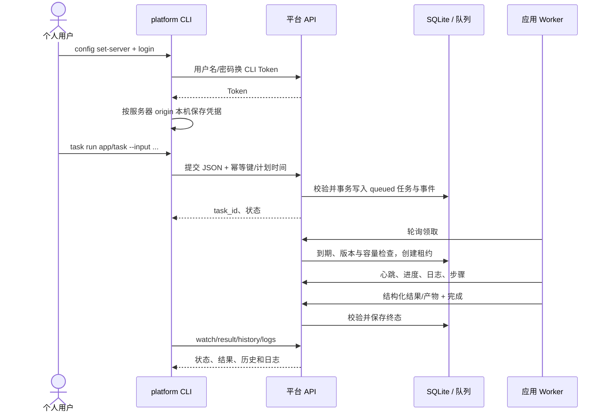

# 玉虚（Yuxu）个人 CLI 设计与开发路径

## 1. 产品定位

`yuxu`（玉虚）是个人操作共享任务底座的终端客户端。整个项目的建议 Git 仓库和文件夹名为 `yuxu-platform`。用户可在本机配置一个或多个平台地址，发现已注册任务，提交立即或单次计划任务，等待或稍后查询执行结果，并下载产物。CLI 只负责平台 API 的客户端体验；任务代码仍在独立 Worker 运行，CLI 不直连 SQLite，也不携带 Worker Token。

第一版面向熟悉命令行的个人开发者，优先保证命令可组合、失败可诊断、凭据不串服务器。默认输出可读 JSON；`task watch` 以易读事件流显示状态和进度。完整任务状态和字段以平台 API 为准，不在 CLI 本地复制任务数据库。

## 2. 核心使用流程

## 3. 命令结构

命令使用 `yuxu <资源> <动作>` 的固定结构。任务定义和运行历史刻意用不同命令区分。

| 命令 | 目的 | 当前状态 |
| --- | --- | --- |
| `yuxu --help` | 查看命令帮助 | 已实现 |
| `yuxu config set-server <URL>` / `show` | 保存或查看默认平台地址 | 已实现 |
| `yuxu login [--username <name>] [--server <URL>]` | 登录所选平台并保存用户令牌 | 已实现 |
| `yuxu logout [--server <URL>]` | 删除一个服务器的令牌；省略则清除本机全部 CLI 令牌 | 已实现 |
| `yuxu apps list` | 查看应用 | 已实现 |
| `yuxu tasks list <app-id>` | 查看该应用已声明的任务定义 | 已实现 |
| `yuxu tasks history [filters]` | 按应用、任务、状态游标分页查看历史实例 | 已实现 |
| `yuxu task run <app/task> [input]` | 创建任务并返回任务 ID | 已实现 |
| `yuxu task run ... --wait [--timeout <seconds>]` | 提交后轮询事件直到终态；本地超时不取消远端任务 | 已实现 |
| `yuxu task get <id>` | 查看当前任务快照 | 已实现 |
| `yuxu task result <id>` | 查看当前结果；运行中返回当前状态 | 已实现 |
| `yuxu task logs <id> [--after <event-id>]` | 读取 Worker 日志 | 已实现 |
| `yuxu task watch <id> [--timeout <seconds>]` | 增量读取事件和终态结果 | 已实现 |
| `yuxu artifact download <id> --out <path>` | 下载最终产物；默认拒绝覆盖已有文件 | 已实现 |

### 任务输入

`task run` 支持三种输入方式，最多 60 KiB，与平台 JSON 请求体上限协调：

- `--input path.json` 从文件读取。
- `--input -` 从标准输入读取，支持 `cat input.json | yuxu task run ... --input -`。
- `--input-json '{"title":"日报"}'` 直接传 JSON。
- 未指定输入时提交 `{}`，适用于无输入任务。

每次只能使用一种显式输入选项。CLI 检查 JSON 语法和输入字节数；平台依据任务声明校验业务 schema，并返回字段错误。

### 提交和等待

提交可附加 `--idempotency-key`，方便调用方在超时或网络中断后安全重试；相同用户、任务、输入和计划时间返回同一任务。`--run-at` 接受带时区的 ISO 8601 时间，仅支持单次计划。`--wait` 的 `--timeout` 只限制本地等待，不取消、删除或重试远端任务；超时错误包含任务 ID，稍后可用 `task result` 或 `task watch` 继续查看。未加 `--wait` 时提交成功即返回，适合 shell 自动化保存 `task_id`。

## 4. 配置和凭据

### 服务器选择优先级

联网命令的地址按以下次序解析：命令级 `--server`、环境变量 `PLATFORM_URL`、本机 `config set-server` 保存值、默认值 `http://127.0.0.1:3333`。`config show` 显示当前地址及其来源。配置操作本身不需要登录。

本机 HTTP 只允许 `localhost`、`127.0.0.1`、`[::1]`；远端服务器必须使用 HTTPS。拒绝 URL 中的用户名、密码、子路径、查询参数和 fragment。CLI 不支持关闭 TLS 校验。

### 文件和权限

- 配置根目录：`$XDG_CONFIG_HOME/yuxu`；未设置 `XDG_CONFIG_HOME` 时为 `~/.config/yuxu`。
- 可用 `YUXU_CLI_DIR` 指定隔离目录，便于测试、便携环境或多套本机配置；`PLATFORM_CLI_DIR` 作为旧变量继续兼容。
- 默认服务器写入 `config.json`。
- 每个服务器凭据写到 `credentials/<sha256(origin)>.json`，文件内容同时保存 origin；读取时再次对比，文件名不承担信任判断。
- 配置目录权限为 `0700`，配置和令牌文件权限为 `0600`，通过临时文件原子替换。
- `PLATFORM_TOKEN` 是显式的临时令牌覆盖；设置时不读本机令牌文件。调用方应确保它对应选中的服务器。
- `PLATFORM_PASSWORD` 仅供自动化登录；交互登录采用不回显密码提示。令牌只写入本机凭据文件，不显示在终端。
- 从旧版升级时，首次读取配置或服务器凭据会将 `platform-cli` 下对应文件迁移到 `yuxu`，并删除旧文件。

服务器凭据独立保存，因此改默认服务器不会把 A 服务器令牌发送给 B，也不会覆盖 A 的登录态。初版不依赖 macOS Keychain、Windows Credential Manager 或 Linux Secret Service，后续可在不改变命令/API 的情况下增加安全存储适配。

## 5. 输出、错误与退出码

- 列表、快照、提交、结果、日志默认输出格式化 JSON，便于人工读取并继续用 `jq` 处理。
- `watch` 输出事件 ID、事件类型和载荷；终结时打印结果。失败任务设置非零退出码。
- 认证、输入错误、API 错误和网络错误都显示可读信息。平台错误优先包含稳定错误码；支持时附 `request_id` 供服务端日志定位。
- 成功退出码为 `0`；用法/本地输入错误、平台请求错误、任务失败和等待超时使用非零退出码。第一轮不承诺每类错误有不同数字。
- `--json`、`--quiet` 和表格输出作为后续体验项，当前 JSON 响应已适合脚本消费。

## 6. 安全和可靠性边界

- CLI 只使用用户 Token；Worker Token 只交给 Worker 进程，不写入 CLI 配置。
- 不把密码、Token、任务输入、完整 URL 查询串写入普通日志。提交的输入和 Worker 日志仍受平台大小及 schema 限制。
- 一个任务提交命令不隐式重试未知网络结果；调用者可显式提供幂等键后再重试。
- `--wait` 超时只结束客户端等待，服务端任务继续排队或运行。
- 产物下载以独占新建方式写文件，防止静默覆盖用户已有文件；将来如支持 `--force`，必须要求用户显式传入。
- API 当前为单用户本地 MVP。CLI 不模拟多用户权限，也不提供本机任务缓存作为权威历史。

## 7. 实现分期与验收

### C1：个人单机可用（本轮）

完成服务器配置、按 origin 隔离凭据、HTTPS 约束、login/logout/help、文件/内联/标准输入任务输入、提交后等待、任务结果、历史、日志、产物下载保护。

验收：

1. 配置两个不同服务器后，只登录其中一个；切换地址调用时不会带错令牌，原服务器登录态仍然可用。
2. 拒绝远程 HTTP、含 URL 凭据或路径的服务地址。
3. 文件、内联和标准输入都能形成符合约束的任务提交；坏 JSON 或过大输入在发送网络请求前失败。
4. `--wait` 成功/失败返回相应退出码；超时提示远端任务仍存在，并给出后续查询命令。
5. 用户令牌和配置文件权限为 `0600`；默认下载不覆盖已有文件。
6. 既有任务查询、历史、日志和产物操作继续通过完整测试。

### C2：日常多平台和可脚本化

增加命名 profile（`config profile add/use/list/remove`）、可选系统凭据库、`--json` 稳定输出、`--quiet`、`--limit`/`--after` 参数完整校验、`yuxu version`、shell completion、每类错误码与进程退出码约定。profile 与当前按 origin 隔离凭据兼容，不共享令牌。

### C3：任务操作增强

等待期间显示节流进度、按事件游标断点续读、下载产物的校验和友好文件名、输入文件附件、服务器任务定义 schema 可读提示。只有平台 API 提供取消/重试后，CLI 才增加对应命令；不在客户端假装提供尚未实现的能力。

## 8. 开发路径

1. 将参数和配置解析从网络操作中拆开，建立稳定命令树和帮助信息。
2. 使用独立配置目录，加入地址规范化和每 origin 凭据文件；为权限、服务器切换和 logout 写测试。
3. 完成安全登录和 Token 获取，HTTP 错误显示 request ID，并统一走 `PlatformClient`。
4. 实现本地输入读取、大小限制、JSON 解析、幂等提交和 `--wait`/超时。
5. 打磨任务定义、历史、结果、日志、watch、产物下载命令及 shell 自动化语义。
6. 更新 README、模块说明和本设计；运行 `npm test` 与 `npm run typecheck`。真实 HTTP 联调在可用本地端口的环境另行执行。

## 9. 明确不纳入个人 CLI 的服务端工作

本轮不引入 cron 服务、取消/手动重试 API、Web 登录、远端任意脚本执行、任务历史本地索引或多租户权限。CLI 只暴露已实现平台能力；相关底座就绪后再扩展命令。
