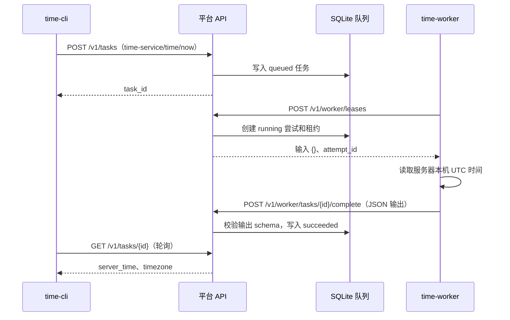

# 时间查询任务：CLI 到服务器的闭环

当前目标是通过独立 CLI 提交“查询服务器当前时间”任务，由服务器侧 Worker 执行，再把结果返回 CLI。首次使用先在本机启动独立的 API 与 Worker 进程；之后只需把 CLI 的服务器地址改成可访问的 HTTPS 地址即可沿用相同 HTTP 协议。服务器部署到其他机器的安装与网络配置尚未自动化。

## 调用链路



CLI 只提交空输入 `{}` 并显示返回值；`server_time` 由 Worker 执行 `new Date().toISOString()` 产生。结果示例：

```json
{
  "task_id": "任务 UUID",
  "server_time": "2026-10-26T01:02:03.000Z",
  "timezone": "UTC"
}
```

## 本机启动

在项目根目录中，先运行一次初始化和应用注册：

```sh
export PLATFORM_ADMIN_PASSWORD='自行设置的至少十二字符密码'
npm run bootstrap
npm run register-app -- apps/time-worker/manifest.json
unset PLATFORM_ADMIN_PASSWORD
```

分别在两个终端运行平台 API 与时间 Worker：

```sh
npm run server
```

```sh
npm run time-worker
```

在第三个终端配置独立客户端、登录并查询：

```sh
npm run time-cli -- config set-server http://127.0.0.1:3333
npm run time-cli -- login
npm run time-cli -- query time
npm run time-cli -- query time --json
```

一次性验证脚本会用临时目录、随机密码启动三个独立进程并打印 JSON 结果：

```sh
npm run smoke:time
```

脚本需要本机允许监听 `127.0.0.1`。自动化执行沙箱禁止监听端口；用户已于 2026-10-26 在普通本机终端运行并回传成功结果（任务 ID `bf116fe5-79d5-483c-927b-aa159491fc75`，UTC 时间 `2026-10-26T06:01:39.577Z`）。仓库测试还会启动 CLI、API、Worker 三个独立子进程，经进程间通道调用生产 HTTP 路由。

## 配置和凭据

- `time-cli config set-server URL` 把服务器根地址存入 `.local/time-cli/config.json`；单次查询可使用 `--server URL` 覆盖。
- 本机回环地址允许 HTTP。其他主机必须使用 HTTPS。CLI Token 与登录时的服务器地址绑定，修改地址后需要重新登录。
- `time-cli login` 默认使用所有者用户名 `owner`。交互式输入密码；脚本可用 `TIME_CLI_PASSWORD`。Token 存入权限为 `0600` 的 `.local/time-cli/token`，也可由 `TIME_CLI_TOKEN` 显式提供。
- CLI 查询默认最多等待 60 秒；`--timeout 秒` 可调整为 1–3600 秒。超时错误会保留任务 ID，可用 `time-cli task get TASK_ID` 重新查询。
- `PLATFORM_URL` 控制 Worker 访问 API 的地址，默认 `http://127.0.0.1:3333`。`TIME_WORKER_TOKEN` 可覆盖注册命令生成的 `.local/worker-token-time-service`。

## 现阶段边界

时间查询返回结构化 JSON，不创建文件产物。平台原有报告任务仍可返回文件产物。时间来源是 Worker 所在机器的系统时钟；若以后把 Worker 部署在另一台机器，“服务器时间”指执行该任务的 Worker 机器时间。当前没有远端部署脚本、TLS 终止、跨机共享存储或网络安全组配置，因此远端部署仍需后续实施。
