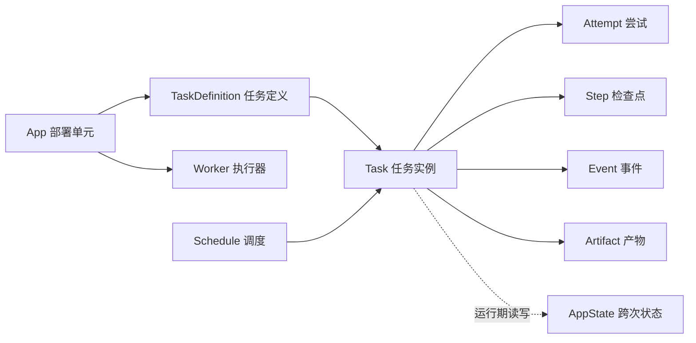

# 个人远程任务平台 需求文档（独立版）

| 项 | 内容 |
| --- | --- |
| 文档版本 | v0.3（决策已收敛） |
| 状态 | 需求与设计基线；剩余待确认项见第 11 章 |
| 最后更新 | 2026-11-05 |
| 适用范围 | 全新平台，独立于任何现有代码仓库 |
| 目标读者 | 平台维护者（单人）、任务开发者、未来的 Web/管理端开发者 |

> **独立性声明**
>
> 本文档不依赖、不引用任何现有工程的文件、代码、模块名或既有设计结论，也不要求复用现有实现。它可以作为新项目的需求起点，也可以作为跨项目参考。文中出现的平台名、路径、技术选型均为建议基线，不等于已实现能力。
>
> **v0.3 变更摘要**：确认平台内置调度 + cron、平台统一跨次状态存储、排队与执行超时默认各 1 小时（上限 6 小时）、重叠按 Schedule 判断并直接跳过、漏跑不补、任务定义更新无版本/无快照（随部署执行）、失败/超时/关闭均有任务记录、运行中任务关闭不做取消握手、失败不自动重试、重试创建新任务、产物支持任意类型、平台后台管理归入运维侧后续建设。

---

## 目录

1. [背景与目标](#1-背景与目标)
2. [术语](#2-术语)
3. [设计原则与已确认方向](#3-设计原则与已确认方向)
4. [概念模型](#4-概念模型)
5. [功能需求](#5-功能需求)
6. [接口需求](#6-接口需求)
7. [概念数据模型](#7-概念数据模型)
8. [非功能需求](#8-非功能需求)
9. [部署与运行形态](#9-部署与运行形态)
10. [已确认的设计决策](#10-已确认的设计决策)
11. [待决策项](#11-待决策项)
12. [MVP 验收标准](#12-mvp-验收标准)
13. [演进路线](#13-演进路线)
14. [附录](#14-附录)

---

## 0. 阅读约定

- **必须（MUST）**：MVP 必须具备；缺失视为不满足验收。
- **应（SHOULD）**：默认应具备，若不做需在待决策项中记录理由。
- **可以（MAY）**：可选能力，不影响 MVP 验收。
- **FR-xxx**：功能需求编号；**NFR-xxx**：非功能需求编号。
- **D-xx**：已确认的设计决策；**OD-xx**：待决策项。
- 文中“平台”指本需求所描述的新平台，与任何已有工程无关。

---

## 1. 背景与目标

### 1.1 背景

平台的所有者只有一个人。所有者在一台长期在线的远程服务器上运行一个任务平台，用来承载自己不断增加的、耗时从秒级到小时级的任务，并且这些任务既可能来自手动触发，也可能来自周期调度。

典型特征：

- **单用户**：没有多用户、组织、租户、计费或复杂权限需求。
- **远程部署**：平台运行在公网可访问的服务器上；访问形式可能是 IP 或域名，部署阶段再决定。
- **任务类型异构**：网页抓取与格式转换、音频下载与语音识别、数据拉取、报告生成等，后续会持续增加。
- **触发方式多样**：单次任务、周期定时任务；未来可能增加外部触发。
- **客户端不固定**：以 CLI 为先；Web 可能后续才有，且不同任务可能对应不同的 Web 形态；平台后台管理属于运维侧，后续建设。
- **任务时长可控**：单个任务执行默认不超过 1 小时；个别任务可按定义放宽，但上限 6 小时。
- **长任务与可靠性**：任务必须支持进度、日志、检查点、中断恢复、超时、关闭和产物下载。
- **长期演进**：新增任务应主要是“新增任务定义 + 部署对应 Worker”，而不是修改平台核心代码。

### 1.2 典型使用场景

1. **单次网页抓取**：提交一个网页 URL，服务端抓取正文并生成 Markdown 文档，所有者下载产物。
2. **单次音频转写**：提交一个公开音频 URL，服务端下载、转码、调用语音识别服务，返回文字稿或音频/文本产物。
3. **定时拉取 + 转写**：每天定时拉取新内容（如播客新单集、文章列表），并对新内容做转写或整理。
4. **持续开发新任务**：后续不断加入新的任务类型与新的调度规则，平台不需要为每个任务写专用代码。
5. **服务端长期运行任务**：任务在服务器上执行，所有者通过 CLI 或未来的 Web/管理端查看状态、日志和产物。

### 1.3 目标

- 提供一个**长期运行的个人任务控制面**：注册任务、提交任务、执行任务、查看状态、下载产物。
- 提供**周期调度**：按 cron 规则自动创建任务；重启后不重复触发；同任务重叠不重复执行。
- **任务开发成本低**：新增任务 = 新增任务定义 + 实现并部署 Worker；平台核心不感知具体业务。
- **长任务可控**：进度、日志、检查点、租约、中断恢复、超时、关闭、失败语义清楚。
- **后续可加 Web/管理端**：平台只依赖 HTTP API，CLI、业务 Web、运维后台都是客户端。
- **单人可维护**：部署简单、依赖少、数据可备份、故障可诊断。

### 1.4 非目标

以下内容**明确不在范围内**，除非需求正式变更：

- 多用户、组织、租户、RBAC、审计、计费。
- 任务定义的版本管理、多版本并存、灰度发布与回滚，以及任务创建时的定义快照。任务定义采用“注册制、可覆盖更新、无旧版本、随部署生效”的方式。
- 跨应用/跨任务的工作流编排引擎。链式流程采用“单任务内部串行”（方案 A，见 5.4）。
- 平台级通用数据服务（声明式资源、自动建表迁移、CRUD API、全文检索）。平台只提供最小跨次状态存储（见 5.5）。
- 统一的业务 Web 控制台。业务 Web 按任务/应用独立建设；平台后台管理属于运维侧，作为独立客户端后续建设，不进 MVP。
- 面向高吞吐、多实例、多地域的分布式调度系统；初期单服务器单实例即可。
- 对象存储、PostgreSQL、消息队列等额外基础设施；初期使用嵌入式数据库 + 本地文件目录。
- 公网访问形式（IP/域名）、TLS 证书申请、网络穿透等部署细节；这些在部署阶段决定，但安全要求见 NFR-SEC。
- 任意代码上传执行：任务代码必须由所有者通过部署流程提供。

### 1.5 规模与假设

| 项 | 假设 |
| --- | --- |
| 用户数 | 1 |
| 服务器 | 单台 Linux 服务器，长期在线 |
| 应用数 | 初期 1–5 个，长期可到数十个 |
| 任务定义数 | 数十个 |
| 任务量 | 每天数十到数百次执行 |
| 并发 Worker | 少量，通常 1–5 个进程 |
| 任务时长 | 默认单任务执行 ≤1 小时；可按定义放宽，最大 6 小时 |
| 排队等待 | 默认 ≤1 小时，最大 6 小时；超时关闭并记录 |
| 存储量 | 产物可能包含文本、图片、音频等，长期到数十 GB |
| 可用性 | 单机；接受短暂停机，平台重启后调度与任务可恢复 |
| 优先级 | 可靠性、可追溯、可维护优先于吞吐与弹性 |

---

## 2. 术语

| 术语 | 定义 |
| --- | --- |
| **App（应用）** | 一个部署单元，拥有独立 Worker 和一组任务定义。一个 App 可以包含多个任务。 |
| **TaskDefinition（任务定义）** | “能做什么”：`task_key`、输入/输出 schema、排队超时、执行超时、尝试次数、产物策略等。可注册、可覆盖更新，无版本历史。 |
| **Task（任务）** | 一次执行实例，由用户手动提交或由调度创建。保存输入、状态、尝试、事件、输出和产物引用。 |
| **Schedule（调度）** | cron 周期触发规则：何时、以什么输入、创建哪个任务定义的实例。本身不执行任务。 |
| **Worker（执行器）** | 在服务器上运行的任务执行进程，按 App 隔离，通过平台 HTTP API 领取任务、上报进度、上传产物。 |
| **Attempt（尝试）** | 一个 Task 的一次执行尝试。Worker 中断后可产生新的 Attempt；旧 Attempt 不能继续写入。 |
| **Step（检查点）** | Worker 为可恢复执行保存的小体积不可变阶段结果，按 Task 保存。 |
| **Event（事件）** | 任务状态、进度、步骤、产物和日志的追加记录，客户端按游标读取。 |
| **Artifact（产物）** | 任务生成的最终文件，由平台保存并授权下载。类型不限于文本。 |
| **AppState（跨次状态）** | 平台按 App 隔离保存的小体积 JSON 状态（游标、已处理 ID 等），用于跨任务/跨调度的增量处理；不是通用数据服务。 |
| **Closed（关闭）** | 任务未成功且非 Worker 主动失败结束的终态：排队超时、执行超时、人工关闭、尝试次数耗尽等；必须记录原因。 |
| **Owner（所有者）** | 唯一的人类用户，拥有平台全部权限。 |
| **Task Source（任务来源）** | 手动（API/CLI）或调度（Schedule）；未来可扩展外部触发。 |
| **调度上下文（Schedule Context）** | 调度触发任务时，平台随任务提供的调度元数据，例如 `schedule_id`、计划触发时间、上次触发时间。 |
| **后台管理系统** | 平台级运维客户端：查看任务、关闭/重试、日志、调度、产物等；属于平台侧，不是各任务的业务页面。 |

---

## 3. 设计原则与已确认方向

1. **单用户、个人平台**：不做多用户与权限体系；仅需所有者认证，以及 Worker 的应用级隔离。
2. **API-first**：所有能力都必须能通过 HTTP API 使用；CLI 是第一个客户端，但不是唯一客户端。
3. **CLI 优先，Web 后置且形态自由**：MVP 不要求 Web；后续不同任务可以使用不同的 Web 前端/后端，平台不承诺统一业务控制台；平台后台管理属于运维侧，作为独立客户端后续建设。
4. **注册制、可覆盖更新、无版本**：任务定义随时可以重新注册更新；平台不保存旧版本、不提供快照、不提供版本切换与回滚。定义更新随部署执行（避开任务高峰），立即生效。
5. **链式流程方案 A**：需要多步骤的流程在一个任务内部串行完成；平台不做跨任务编排，不提供子任务/工作流引擎。
6. **控制面与执行面分离**：平台负责任务控制面；App Worker 负责领域逻辑；平台不抓网页、不调用模型、不做业务转换。
7. **平台统一保存跨次状态**：平台提供按应用隔离的最小状态存储（键值 + 版本/CAS），用于增量游标、已处理 ID 等；它不是通用数据服务。
8. **单服务器、简单可备份**：嵌入式数据库 + 本地产物目录，统一备份；不引入额外基础设施。
9. **长任务可靠优先**：租约、心跳、检查点、恢复、超时、关闭、幂等和清楚的失败语义优先于吞吐与弹性。
10. **公网默认按不安全网络设计**：即使访问形式暂缓决定，TLS、认证、限流、最小暴露和秘密管理也必须作为部署要求。

---

## 4. 概念模型

### 4.1 实体关系



### 4.2 实体说明

| 实体 | 关键属性 | 说明 |
| --- | --- | --- |
| App | `app_id`、显示名、状态、Worker 凭据 | 一个部署与隔离单元；可包含多个任务定义 |
| TaskDefinition | `app_id`、`task_key`、输入/输出 schema、排队超时、执行超时、最大尝试次数、产物策略、启用状态 | 只是“能力声明”，不是执行记录；更新即覆盖 |
| Task | `task_id`、来源、输入、状态、进度、时间、输出、产物引用、关闭原因、重试关联 | 一次执行；所有客户端看到的是它 |
| Schedule | 目标 `app_id`/`task_key`、固定输入、cron 表达式、时区、启用状态、下次触发时间 | 到点创建普通 Task；重叠跳过、漏跑不补 |
| Worker | `app_id`、名称、最近心跳（可选）、并发能力 | 执行进程；使用应用级凭据 |
| Attempt | `attempt_id`、序号、状态、开始/结束时间 | 每次领取产生；用于旧执行隔离 |
| Step | `task_id`、`step_key`、值 | 不可变检查点，供恢复使用 |
| Event | 自增 ID、`task_id`、`attempt_id`、类型、载荷、时间 | 客户端按游标续读 |
| Artifact | `artifact_id`、`task_id`、名称、类型、大小、校验和 | 最终产物，任意类型，授权下载 |
| AppState | `app_id`、`key`、值、版本 | 平台统一保存的跨次状态；按 App 隔离 |

### 4.3 任务来源

| 来源 | 触发方式 | 说明 |
| --- | --- | --- |
| 手动 | CLI / API | 立即创建并排队 |
| 调度 | 平台内置调度循环 | 到点创建；同一计划时间只创建一次 |
| 外部触发（未来） | Webhook / 其他事件 | 非 MVP；接口与安全方案后续设计 |

### 4.4 任务状态机

```text
queued ──领取──▶ running ──成功──▶ succeeded
  │                 │  └──Worker 主动失败──▶ failed
  │                 ├──租约过期/中断──▶ recovering ──领取──▶ running
  │                 └──执行超时/人工关闭──▶ closed
  ├──排队超时/人工关闭──▶ closed
  └──recovering 且尝试次数耗尽/人工关闭──▶ closed
```

状态与语义要求：

- **至少一次执行**：允许同一任务被重试执行；应用应使用稳定幂等键避免重复副作用。
- **尝试隔离**：只有当前有效 Attempt 可以写入进度、日志、检查点、产物和结果；旧 Attempt 的迟到写入必须被拒绝。
- **检查点不可变**：同一 `task_id + step_key` 一旦确认，不能被改写；恢复时读取已确认结果。
- **终态区分**：`succeeded`、`failed`（Worker 主动上报失败）、`closed`（排队超时/执行超时/人工关闭/尝试耗尽）。`closed` 必须带原因，人工关闭必须带操作者。
- **定义更新不追溯**：任务定义被覆盖更新后，不保证在途任务可按旧定义完成；平台不保存定义快照。

---

## 5. 功能需求

### 5.1 应用与任务定义管理

| 编号 | 需求 | 优先级 |
| --- | --- | --- |
| FR-REG-01 | 所有者必须能够注册新 App，并为其登记一个或多个 TaskDefinition。 | MUST |
| FR-REG-02 | 所有者必须能够对已存在的 App 重新注册，以**覆盖更新**已有任务定义、新增任务定义；不得要求更换 `app_id`、清空任务历史或迁移任务数据。 | MUST |
| FR-REG-03 | 一个 App 必须支持多个 `task_key`；`(app_id, task_key)` 唯一。新增任务不应要求新增 App 或新 Worker Token。 | MUST |
| FR-REG-04 | TaskDefinition 必须声明：`task_key`、显示名、输入 JSON Schema、输出 JSON Schema、排队超时、执行超时、最大尝试次数、产物策略、是否允许调度、启用状态。 | MUST |
| FR-REG-05 | 任务定义更新后**立即生效**：新提交任务使用新定义。平台不保存定义快照、不提供版本列表/切换/回滚；在途任务不保证兼容。约定：定义更新、Worker 代码更新与数据库 schema 变更随部署一起执行，部署窗口避开定时任务高峰（如安排在下午），并尽量确保队列空闲；由此导致的在途任务失败由部署流程避免。 | MUST |
| FR-REG-06 | 可保留一个可选的自由文本标签（如 `release_label`）仅用于人工排障，不参与路由、不提供版本语义。 | MAY |
| FR-REG-07 | 所有者必须能够查询 App 列表和任务定义列表（含输入/输出 schema），供 CLI、业务 Web 和后台管理使用。 | MUST |
| FR-REG-08 | 注册/更新必须校验：`app_id`/`task_key` 格式、schema 基本合法性、超时与尝试次数范围、产物策略取值；非法注册必须整体失败，不得部分写入。 | MUST |
| FR-REG-09 | 提供 App/TaskDefinition 的启用、停用能力（可以后续实现）；停用后不能再创建新任务，已有任务与历史保留。 | SHOULD |
| FR-REG-10 | Worker 凭据必须按 App 签发，可轮换；轮换期间允许短期并存。 | SHOULD |
| FR-REG-11 | 注册/更新属于部署管理操作，只允许所有者执行；Worker 凭据不得用于注册或更新任务定义。 | MUST |

### 5.2 任务提交与执行

| 编号 | 需求 | 优先级 |
| --- | --- | --- |
| FR-TASK-01 | 所有者必须能够通过 CLI/API 提交任务：指定 `app_id`、`task_key` 和 JSON 输入。 | MUST |
| FR-TASK-02 | 提交时必须按当前 TaskDefinition 的输入 schema 校验；校验失败返回稳定错误码和字段级信息。 | MUST |
| FR-TASK-03 | 支持幂等键：同一所有者 + App + 任务 + 幂等键 + 相同输入重复提交，必须返回原任务；输入或计划时间不同必须返回冲突。 | MUST |
| FR-TASK-04 | 支持任务查询：按 ID 获取任务当前状态；按 App、任务、状态、调度 ID 等条件分页查询历史。 | MUST |
| FR-TASK-05 | 支持事件与日志读取：状态、进度、步骤、产物、日志；使用单调游标分页续读。 | MUST |
| FR-TASK-06 | 支持结果读取：终态任务返回结构化输出、产物引用、关闭/失败原因；未终结任务返回当前状态。 | MUST |
| FR-TASK-07 | 任务必须持久化：输入、输入摘要、来源、状态、尝试、检查点、事件、产物元数据、错误/关闭信息。 | MUST |
| FR-TASK-08 | 任务完成时必须按当前输出 schema 校验结构化输出（平台不保存定义快照），有产物时必须校验产物归属当前 Attempt。 | MUST |
| FR-TASK-09 | 任务执行超时由平台判定；超时后任务关闭，不得接受迟到的成功结果。 | MUST |
| FR-TASK-10 | 最大尝试次数作用于 Worker 中断/租约过期后的恢复；Worker 主动上报的失败直接进入 `failed` 终态，平台不自动重试；重试由所有者手动创建新任务。 | MUST |
| FR-TASK-11 | 输入必须是 JSON 对象，大小有上限（建议 64 KiB 以内）；不接受脚本或二进制大文件作为任务输入。 | MUST |
| FR-TASK-12 | 可以支持一次性延迟执行（`run_at`），与调度创建任务共享同一套任务创建与幂等逻辑。 | MAY |
| FR-TASK-13 | 任务列表、任务详情、事件与日志中的敏感字段必须按日志规范过滤（见 FR-AUTH-08）。 | MUST |
| FR-TASK-14 | **排队超时**默认 1 小时（可按任务定义配置，最大 6 小时）：任务创建后超过该时长仍未领取，关闭任务并记录 `QUEUE_TIMEOUT`。 | MUST |
| FR-TASK-15 | **执行超时**默认 1 小时（可按任务定义配置，最大 6 小时）：任务被领取后超过该时长仍未完成，关闭任务并记录 `TIMEOUT`。 | MUST |
| FR-TASK-16 | 任务失败、执行超时、排队超时、人工关闭、重试耗尽都必须在任务记录中留下状态事件：时间、终态、原因、操作者（人工时）、对应 Attempt。 | MUST |
| FR-TASK-17 | 支持在任务列表/CLI/API 人工关闭任务：平台立即将任务置为 `closed`、清除租约并拒绝之后的所有写入；不实现 Worker 取消握手协议；运行中任务的 Worker 应将写入被拒绝视为停止信号并自行退出（SHOULD）。 | MUST |
| FR-TASK-18 | 重试不修改原任务：以相同或新输入创建新任务，并记录 `retry_of_task_id`；可手动触发（后台管理后续提供，MVP 可用 CLI/API）。 | SHOULD |
| FR-TASK-19 | 关闭/超时必须释放任务占用的并发槽位，允许后续任务被领取。 | MUST |

### 5.3 调度

| 编号 | 需求 | 优先级 |
| --- | --- | --- |
| FR-SCH-01 | 所有者必须能够创建、查询、修改、删除、启用/停用 Schedule。 | MUST |
| FR-SCH-02 | Schedule 必须包含：目标 `app_id`/`task_key`、固定输入 JSON、cron 表达式、时区、启用状态、下次触发时间。 | MUST |
| FR-SCH-03 | 周期规则使用标准 cron 表达式（建议 5 字段、分钟粒度）；创建时必须校验表达式与目标任务是否存在、是否允许调度。 | MUST |
| FR-SCH-04 | 时区使用 IANA 时区（如 `Asia/Shanghai`）；存储与计算使用 UTC；必须正确处理夏令时：不存在的本地时间跳过本次，重复的本地时间只触发一次。 | MUST |
| FR-SCH-05 | 调度循环必须保证幂等：同一 `schedule_id + 计划触发时间` 只能创建一个任务；平台重启后不得重复创建。 | MUST |
| FR-SCH-06 | 调度触发的任务必须按当时的 TaskDefinition 创建并校验输入。 | MUST |
| FR-SCH-07 | 调度触发任务时，必须向 Worker 提供调度上下文：`schedule_id`、计划触发时间、上次触发/成功时间（如有）；上下文不得修改用户输入本身。 | MUST |
| FR-SCH-08 | MVP 通过 CLI 管理调度（创建、列表、查看触发历史、手动触发一次）；业务 Web/后台管理为后续可选能力。 | MUST |
| FR-SCH-09 | **重叠策略固定为跳过**：同一 Schedule 已有未结束实例（`queued`/`running`/`recovering`）时，本次触发直接跳过、不创建任务，并在调度运行记录中记录 `skipped_overlap`。 | MUST |
| FR-SCH-10 | **漏跑不补**：平台停机导致错过触发时间时，平台不补跑。启动时只计算下一次未来触发，历史错过点跳过；需要补数据时由外部脚本或手动触发完成。 | MUST |
| FR-SCH-11 | 必须记录调度的执行历史（计划触发时间、创建的任务 ID、结果、跳过原因）；可通过任务列表按 `schedule_id` 过滤。 | MUST |
| FR-SCH-12 | 调度创建的任务与手动任务使用同一任务状态机、事件、日志、产物和恢复机制，不引入第二套执行语义。 | MUST |
| FR-SCH-13 | 调度任务的执行超时从**领取时**开始计算（默认 1 小时，可配置，最大 6 小时）；排队等待默认上限 1 小时（最大 6 小时），超过则关闭任务并记录 `QUEUE_TIMEOUT`。 | MUST |
| FR-SCH-14 | 可以支持“手动立即触发一次”，用于调试与补跑；触发同样遵守幂等与重叠跳过。 | MAY |

### 5.4 链式任务：方案 A（单任务内串行）

| 编号 | 需求 | 优先级 |
| --- | --- | --- |
| FR-CHAIN-01 | 需要多步骤的业务流程必须在一个 Task 内部串行完成；平台不提供跨任务编排、子任务派生和工作流引擎。 | MUST |
| FR-CHAIN-02 | Worker 必须能够在一个任务内按条目循环处理（例如逐集转写），并对每个条目上报进度和日志。 | MUST |
| FR-CHAIN-03 | 每个已完成条目必须能以 Step/检查点形式持久化；同一 Task 的重试/恢复必须跳过已完成条目。 | MUST |
| FR-CHAIN-04 | 任务输出必须是结构化摘要（处理数量、成功/失败条目、产物引用等）；完整内容进入产物文件。 | MUST |
| FR-CHAIN-05 | 任务内部某一条目失败时，默认整任务失败；可以在任务输出中记录逐条结果。是否允许“部分成功”由应用自行决定。 | MUST |
| FR-CHAIN-06 | 跨天/跨次运行的去重与增量由平台状态存储 + 调度上下文解决（见 5.5）；平台不提供自动游标。 | MUST |
| FR-CHAIN-07 | 链式任务必须是长任务友好的：支持心跳、进度、日志、检查点、超时与中断恢复；单个任务时长受执行超时约束（默认 1 小时，可放宽到 6 小时）。 | MUST |

### 5.5 跨次运行状态（平台统一存储）

| 编号 | 需求 | 优先级 |
| --- | --- | --- |
| FR-STATE-01 | 平台必须提供按 App 隔离的跨次状态存储：小体积 JSON 键值，用于增量游标、已处理 ID、上次成功时间等；它不是通用数据服务，不支持任意 schema、复杂查询或跨 App 共享。 | MUST |
| FR-STATE-02 | Worker 凭据只能读写本 App 的状态；所有者可以只读查看/管理；其他 App 不可见。 | MUST |
| FR-STATE-03 | 每个状态键必须带版本号；写入支持期望版本/If-Match，版本冲突返回 409，防止并发写丢更新。 | MUST |
| FR-STATE-04 | 单键与单 App 的状态大小必须可配置上限（建议单键 ≤1 MiB、单 App 设置配额）；禁止存放大二进制，大文件走产物。 | MUST |
| FR-STATE-05 | 状态必须持久化于平台数据库，跨任务、跨 Worker 重启存活，并纳入备份；不随任务结束自动删除，由 App 或所有者显式清理。 | MUST |
| FR-STATE-06 | 调度触发任务时，平台仍必须注入调度上下文（`schedule_id`、计划触发时间、上次触发/成功时间），供应用结合状态做增量。 | MUST |
| FR-STATE-07 | 平台不解析状态内容，不做索引、查询、跨 App 共享；配额与保留策略见 OD-20。 | MUST |
| FR-STATE-08 | 首次运行（无历史状态）必须能安全冷启动。 | MUST |

### 5.6 长任务、租约与恢复

| 编号 | 需求 | 优先级 |
| --- | --- | --- |
| FR-LONG-01 | Worker 领取任务后获得租约；必须在租约到期前持续心跳；平台必须在租约过期或 Worker 中断后回收任务。 | MUST |
| FR-LONG-02 | 回收后任务进入 `recovering`；未超过最大尝试次数时可以被再次领取；超过后进入 `closed`（原因 `ATTEMPTS_EXHAUSTED`）。 | MUST |
| FR-LONG-03 | 新 Attempt 必须读取已确认的 Step，并从可复用点继续；旧 Attempt 的写入必须被拒绝。 | MUST |
| FR-LONG-04 | 进度、日志、检查点必须在长任务期间持续可用，客户端可轮询续读。 | MUST |
| FR-LONG-05 | 执行超时默认 1 小时、排队等待默认 1 小时，均可按任务定义配置，最大值 6 小时；超时后任务关闭并记录原因。 | MUST |
| FR-LONG-06 | Worker 应支持优雅退出：收到终止信号后停止领取新任务，并尽量在当前步骤边界结束（不做强制要求）。 | SHOULD |
| FR-LONG-07 | 多 Worker 同时运行时，平台必须保证同一任务同时只有一个有效 Attempt。 | MUST |
| FR-LONG-08 | 应用并发上限必须可控（按 App 或按任务配置）；超出上限的任务保持排队，排队超过上限后关闭。 | MUST |
| FR-LONG-09 | 关闭/超时/失败都必须释放任务占用的并发槽位，并允许调度继续触发。 | MUST |

### 5.7 关闭与重试

| 编号 | 需求 | 优先级 |
| --- | --- | --- |
| FR-CANCEL-01 | 所有者可以在任务列表/CLI/API 手动关闭任务（排队或运行中）：平台立即置为 `closed`、记录原因与操作者、清除租约，并拒绝之后的所有写入。 | MUST |
| FR-CANCEL-02 | 关闭只保证平台不再接受结果，不撤销已发生的外部副作用（例如已上传的产物、已调用的外部服务）。 | MUST |
| FR-CANCEL-03 | 关闭任务必须记录原因、时间、操作者（人工时）与对应 Attempt；不得静默删除任务。 | MUST |
| FR-CANCEL-04 | 重试 = 用相同或新输入创建新任务，并记录 `retry_of_task_id`；原任务保留失败/关闭记录。平台不提供“原地重试同一任务”。 | SHOULD |
| FR-CANCEL-05 | 平台后台管理系统后续提供手动关闭/重试/查看日志；MVP 可以先用 CLI/API 完成同样操作。 | SHOULD |
| FR-CANCEL-06 | 运行中任务关闭不实现特殊取消握手协议；Worker 后续心跳/进度/完成请求会被拒绝（409），应将其视为停止信号并自行退出（SHOULD）；平台不保证外部进程立即终止。 | MUST |

### 5.8 产物与结果

| 编号 | 需求 | 优先级 |
| --- | --- | --- |
| FR-ART-01 | 任务结果由“结构化 JSON 输出”和“可选的最终产物”组成；产物通过 `artifact_id` 引用。 | MUST |
| FR-ART-02 | 产物类型不限（任意 content-type，含文本、图片、音频、视频等）；MVP 至少支持每任务一个最终产物，模型与 API 按可扩展多产物设计。 | MUST |
| FR-ART-03 | 产物必须记录名称、内容类型、字节大小、SHA-256 校验值、归属任务与 Attempt。 | MUST |
| FR-ART-04 | 只有成功任务的最终产物可以被所有者下载；失败/关闭或未终结任务的中间产物不得对外提供。 | MUST |
| FR-ART-05 | 产物大小上限、单任务产物总大小、保留期限必须可配置；超限必须返回明确错误。 | MUST |
| FR-ART-06 | 下载必须鉴权；文件名与内容类型必须安全处理，避免路径穿越与响应头注入；大文件应支持流式传输。 | MUST |
| FR-ART-07 | 多产物为后续扩展项；扩展时不得破坏现有单产物契约。 | MAY |
| FR-ART-08 | 任务输出必须按输出 schema 校验后才能置为成功；产物必须属于当前有效 Attempt。 | MUST |
| FR-ART-09 | 二进制/大文件产物需要考虑存储、带宽与备份成本，不将大文件塞进任务输入或事件。 | MUST |

### 5.9 客户端

#### 5.9.1 CLI

| 编号 | 需求 | 优先级 |
| --- | --- | --- |
| FR-CLI-01 | CLI 必须支持：服务器配置、登录/登出、应用列表、任务定义列表、提交任务、等待/查看状态、读取结果、日志、事件、下载产物。 | MUST |
| FR-CLI-02 | CLI 必须支持调度的创建、列表、查看、删除、启停与手动触发；支持任务关闭与重试（调用 API）。 | MUST |
| FR-CLI-03 | CLI 的任务命令必须是通用的（`task run <app>/<task> --input ...`），不得为每个任务编写专用子命令；新增任务不需要升级 CLI。 | MUST |
| FR-CLI-04 | 支持三种输入方式：JSON 文件、内联 JSON、标准输入；大小上限与平台一致。 | SHOULD |
| FR-CLI-05 | 默认输出可读 JSON；等待/监听命令输出事件与最终结果；失败/关闭任务返回非零退出码。 | SHOULD |
| FR-CLI-06 | 凭据按服务器 origin 隔离保存；配置文件与令牌文件权限为仅当前用户可读。 | MUST |
| FR-CLI-07 | CLI 不持有 Worker 凭据；不得直连数据库。 | MUST |
| FR-CLI-08 | 远程连接必须支持 HTTPS；本机调试可以允许 HTTP 回环地址。 | MUST |
| FR-CLI-09 | 错误信息应包含稳定错误码与请求 ID，便于在服务端日志中定位。 | SHOULD |

#### 5.9.2 Web 与后台管理

| 编号 | 需求 | 优先级 |
| --- | --- | --- |
| FR-WEB-01 | MVP 不要求 Web 客户端；平台必须能仅通过 CLI/API 完整运行。 | MUST |
| FR-WEB-02 | 后续业务 Web 按任务/应用独立建设；不同任务可以使用不同的前端形态，平台不强制统一业务控制台。 | SHOULD |
| FR-WEB-03 | Web 后端可以持有所有者凭据并代为调用平台 API；浏览器不得持有 Worker 凭据。 | MUST |
| FR-WEB-04 | 平台必须向 Web 客户端提供足够的 API：任务定义与 schema、提交、状态/事件/日志、结果、产物下载、调度管理、任务关闭/重试。 | MUST |
| FR-WEB-05 | Web 认证方式（会话 Cookie 或令牌/BFF）在 Web 立项时决定；平台不得因此过早绑定实现。 | MAY |
| FR-WEB-06 | 如果未来提供统一业务控制台，它只是可选客户端，不得成为其他客户端的依赖。 | MAY |
| FR-WEB-07 | 平台级后台管理系统属于平台运维（任务关闭/重试/日志/调度/产物等），作为独立客户端后续建设；具体形态暂不强定义，可按任务/业务页同等对待。 | SHOULD |

#### 5.9.3 API

| 编号 | 需求 | 优先级 |
| --- | --- | --- |
| FR-API-01 | 所有平台能力必须通过版本化 HTTP/JSON API 暴露（建议 `/v1`）。 | MUST |
| FR-API-02 | 错误响应统一为 `{ error: { code, message, request_id } }`。 | MUST |
| FR-API-03 | 时间统一使用 UTC ISO 8601；ID 使用无业务含义的 UUID。 | MUST |
| FR-API-04 | 列表使用游标分页；游标对客户端 opaque。 | MUST |
| FR-API-05 | 认证使用 Bearer Token；用户 API 与 Worker API 使用不同凭据与权限。 | MUST |
| FR-API-06 | Worker 通信必须语言无关：HTTP/JSON 即可接入，不强制使用特定语言 SDK。 | MUST |

### 5.10 认证、授权与安全

| 编号 | 需求 | 优先级 |
| --- | --- | --- |
| FR-AUTH-01 | 平台只有一个所有者账号；首次部署通过一次性初始化创建，无默认密码。 | MUST |
| FR-AUTH-02 | 密码必须使用成熟算法哈希保存（如 Argon2id）；令牌只保存哈希。 | MUST |
| FR-AUTH-03 | 所有者登录后获得有期限的 CLI Token；Token 可吊销（至少支持本机删除与到期失效）。 | MUST |
| FR-AUTH-04 | Worker 凭据按 App 签发，只能领取/更新本 App 的任务；不得访问用户 API。 | MUST |
| FR-AUTH-05 | 用户凭据不得用于 Worker API；Worker 凭据不得用于用户/管理 API。 | MUST |
| FR-AUTH-06 | 公网部署必须使用 HTTPS；登录接口必须限流；建议支持来源 IP 白名单或私有网络访问。 | MUST |
| FR-AUTH-07 | 密码、Token、Cookie、签名 URL、第三方密钥不得出现在普通日志、任务事件或错误消息中。 | MUST |
| FR-AUTH-08 | 任务输入、产物内容与日志按需脱敏；日志默认只记录必要摘要与 ID。 | MUST |
| FR-AUTH-09 | 第三方服务密钥只存在于 Worker 部署环境或密钥管理中，不得进入任务输入、定义、日志或产物。 | MUST |
| FR-AUTH-10 | 如果未来 Web 由平台直接提供页面，必须采用 HttpOnly/Secure/SameSite Cookie + CSRF 防护；如果由应用后端代理，则沿用后端凭据。 | MUST |
| FR-AUTH-11 | 状态存储 API 必须按 App 隔离：Worker 只能访问本 App；所有者可读/管理；其他 App 不可见。 | MUST |

### 5.11 可观测性与运维

| 编号 | 需求 | 优先级 |
| --- | --- | --- |
| FR-OBS-01 | 平台必须提供请求日志（至少含请求 ID、方法、路径、状态、耗时），不记录敏感请求体。 | MUST |
| FR-OBS-02 | 任务必须提供状态、进度、步骤、产物和分级日志事件，客户端可按游标续读。 | MUST |
| FR-OBS-03 | 平台必须提供健康检查接口；应提供队列概况、Worker 概况（最近心跳）、调度概况和 app_state 概况。 | MUST / SHOULD |
| FR-OBS-04 | 关键事件应带 `request_id`/`task_id`/`attempt_id`/`schedule_id`，便于串联排障。 | MUST |
| FR-OBS-05 | 日志、事件、任务历史、产物、app_state 的保留期限必须可配置，并配套清理策略。 | MUST |
| FR-OBS-06 | 平台必须记录调度跳过（重叠）、漏跑（如有日志）、失败、超时、人工关闭的原因，避免“静默不执行”。 | MUST |
| FR-OBS-07 | 指标（Prometheus 等）与告警为非 MVP，后续可加。 | MAY |
| FR-OBS-08 | 失败、执行超时、排队超时、人工关闭、调度跳过（overlap/missed）必须可被 CLI/后台管理查询。 | MUST |

### 5.12 数据保留、备份与恢复

| 编号 | 需求 | 优先级 |
| --- | --- | --- |
| FR-DATA-01 | 备份必须覆盖：数据库（任务、定义、调度、事件、尝试、产物元数据、app_state 跨次状态）和产物文件目录。 | MUST |
| FR-DATA-02 | 备份必须可恢复，并至少验证一次“从备份恢复后任务历史、app_state、调度下次触发时间、产物可下载”。 | MUST |
| FR-DATA-03 | 备份频率与保留周期可配置；建议至少每日一次。 | SHOULD |
| FR-DATA-04 | 删除任务/产物必须有明确的保留与清理策略，避免无限增长；默认不自动删除任务历史。 | SHOULD |
| FR-DATA-05 | 数据库迁移必须有版本记录，启动时检查版本（平台自身数据结构需要迁移管理；任务定义仍无版本）。 | SHOULD |

---

## 6. 接口需求

> 以下为建议基线，具体路径可在实现时调整；但能力集合与语义必须保留。

### 6.1 用户与管理 API

| 方法 | 路径（建议） | 作用 | 备注 |
| --- | --- | --- | --- |
| POST | `/v1/auth/login` | 用户名/密码换取 CLI Token | 限流；返回过期时间 |
| POST | `/v1/auth/logout` | 吊销当前 Token | 可选 |
| GET | `/v1/apps` | App 列表 | 含状态 |
| GET | `/v1/apps/{app_id}/tasks` | 任务定义列表 | 含 schema、超时、产物策略 |
| POST | `/v1/apps` | 注册/更新 App 与任务定义（upsert） | 所有者权限；部署管理操作 |
| POST | `/v1/tasks` | 提交任务 | `Idempotency-Key` 可选 |
| GET | `/v1/tasks` | 任务列表/历史 | 按 App、task_key、状态、schedule_id 过滤；游标分页 |
| GET | `/v1/tasks/{task_id}` | 任务详情 | 状态、进度、时间、结果、关闭原因 |
| GET | `/v1/tasks/{task_id}/events` | 事件 | `after` 游标 |
| GET | `/v1/tasks/{task_id}/logs` | 日志 | `after` 游标 |
| GET | `/v1/tasks/{task_id}/result` | 结果 | 未终结返回当前状态 |
| POST | `/v1/tasks/{task_id}/close` | 关闭任务 | 立即置 closed、清除租约、拒绝后续写入；不做取消握手 |
| POST | `/v1/tasks/{task_id}/retry` | 重试任务 | 创建新任务并关联 `retry_of_task_id` |
| GET | `/v1/artifacts/{artifact_id}/download` | 下载最终产物 | 鉴权；校验大小与摘要；支持流式 |
| GET | `/v1/apps/{app_id}/state` | 查看 App 跨次状态 | 所有者只读/管理 |
| GET | `/v1/schedules` | 调度列表 | 含下次触发时间与状态 |
| POST | `/v1/schedules` | 创建调度 | 所有者权限；cron + 时区 |
| GET | `/v1/schedules/{schedule_id}` | 调度详情 | 含最近触发记录 |
| PATCH | `/v1/schedules/{schedule_id}` | 修改调度 | cron、输入、启停等 |
| DELETE | `/v1/schedules/{schedule_id}` | 删除调度 | 不影响已创建任务 |
| GET | `/v1/schedules/{schedule_id}/runs` | 调度触发历史 | 任务 ID、计划时间、跳过原因 |
| POST | `/v1/schedules/{schedule_id}/run-now` | 手动触发一次 | 可选；遵守幂等与重叠跳过 |
| GET | `/v1/health` | 健康检查 | 无需认证或用独立探针 |

### 6.2 Worker API

| 方法 | 路径（建议） | 作用 |
| --- | --- | --- |
| POST | `/v1/worker/leases` | 领取一个匹配当前 App 的任务；无任务返回 204 |
| POST | `/v1/worker/tasks/{task_id}/heartbeat` | 续租 |
| POST | `/v1/worker/tasks/{task_id}/progress` | 上报进度与消息 |
| POST | `/v1/worker/tasks/{task_id}/logs` | 上报分级日志 |
| POST | `/v1/worker/tasks/{task_id}/steps` | 保存不可变检查点 |
| PUT | `/v1/worker/tasks/{task_id}/artifacts?name=...` | 上传产物字节（任意 content-type） |
| POST | `/v1/worker/tasks/{task_id}/complete` | 提交结构化输出并完成任务 |
| POST | `/v1/worker/tasks/{task_id}/fail` | 提交失败原因 |
| GET | `/v1/worker/state` | 列出本 App 状态（可按前缀） |
| GET | `/v1/worker/state/{key}` | 读取状态与版本 |
| PUT | `/v1/worker/state/{key}` | 写入/更新状态（If-Match/期望版本） |
| DELETE | `/v1/worker/state/{key}` | 删除状态 |
| POST | `/v1/worker/instances` | 可选：上报 Worker 实例与最近心跳 |

### 6.3 通用约定

- **认证**：用户 API 使用所有者 Token；Worker API 使用 App Token；二者不可互换。
- **Attempt 隔离**：Worker 的写操作必须携带 `X-Attempt-Id`（或等价字段）；服务端只接受当前有效 Attempt。
- **幂等**：`POST /v1/tasks` 支持 `Idempotency-Key`；同一主体、App、任务键、幂等键、相同输入返回原任务；冲突返回 `409`。
- **调度幂等**：`(schedule_id, planned_fire_time)` 唯一；重启、重复扫描不得重复创建任务。
- **重叠**：同一 Schedule 存在未结束实例时跳过，记录 `skipped_overlap`，不创建任务。
- **超时**：排队超时与执行超时默认各 1 小时（可按定义配置，最大 6 小时）；超时关闭任务并记录原因（`QUEUE_TIMEOUT`/`TIMEOUT`）。
- **终态**：`succeeded` / `failed`（Worker 主动失败）/ `closed`（超时、人工关闭、尝试耗尽等）；`closed` 必须带原因。
- **关闭**：`POST /v1/tasks/{id}/close` 立即将任务置为 `closed`，记录操作者与原因，清除租约并拒绝之后的所有写入；不实现 Worker 取消握手，运行中任务由 Worker 在收到 409 后自行停止。
- **重试**：`POST /v1/tasks/{id}/retry` 创建新任务并记录 `retry_of_task_id`，不修改原任务。
- **状态存储**：每个 `app_state` 键带版本；`PUT` 支持 If-Match/期望版本，冲突返回 `409`；Worker 只能访问本 App。
- **错误格式**：`{ "error": { "code": "...", "message": "...", "request_id": "..." } }`。
- **状态码**：创建任务 `202`；查询/结果 `200`（未终结可通过状态表达）；校验失败 `400`；认证失败 `401`；权限不足 `403`；不存在 `404`；冲突 `409`；限流 `429`；服务端错误 `5xx`。
- **时间**：UTC ISO 8601；调度按 IANA 时区计算。
- **分页**：游标 opaque；默认 20–100 条/页。

### 6.4 调度上下文注入

调度创建的任务，必须让 Worker 能获得以下信息（建议放在领取响应的 `context` 字段，不合并进用户输入）：

| 字段 | 说明 |
| --- | --- |
| `schedule_id` | 调度 ID |
| `planned_fire_time` | 本次计划触发时间（UTC） |
| `previous_planned_fire_time` | 上次计划触发时间（如有） |
| `previous_success_time` | 上次成功完成时间（如有） |
| `trigger_kind` | `schedule` / `manual` / `run_now` |

应用可以用这些信息做“只处理上次成功之后的新内容”；更精确的游标由平台 `app_state` 维护。

### 6.5 任务定义注册（部署操作）

- 注册/更新由所有者执行；可以走受认证的 API，也可以由部署脚本在服务器本地调用。
- 建议 CLI 提供 `app register --manifest <file>` 命令；幂等（同内容重复注册不报错）。
- 注册失败必须整体回滚，不得出现“部分任务定义更新成功”。
- Worker、任务定义与数据库 schema 变更随部署一起执行；部署窗口应避开定时任务高峰（如安排在下午），并尽量确保队列空闲。平台不保存定义快照、不提供版本/回滚；更新后立即生效，在途任务不保证兼容。

---

## 7. 概念数据模型

> 以下为逻辑字段，具体列类型、索引和迁移方式在实现时确定。

### 7.1 `apps`

| 字段 | 说明 |
| --- | --- |
| `app_id` | 稳定 ID（如 `content-tools`） |
| `display_name` | 显示名 |
| `status` | active / disabled |
| `worker_token_hash` | Worker 凭据哈希（可多行，支持轮换） |
| `created_at` / `updated_at` | 时间 |

### 7.2 `task_definitions`

| 字段 | 说明 |
| --- | --- |
| `app_id` | 所属 App |
| `task_key` | 任务键（如 `article/to-md`） |
| `display_name` | 显示名 |
| `input_schema_json` / `output_schema_json` | JSON Schema |
| `queue_timeout_ms` | 排队超时，默认 1 小时，最大 6 小时 |
| `execution_timeout_ms` | 执行超时，默认 1 小时，最大 6 小时 |
| `max_attempts` | 最大尝试次数（中断恢复） |
| `artifact_policy` | 是否需要产物、大小上限、允许类型等 |
| `schedulable` | 是否允许调度 |
| `enabled` | 是否启用 |
| `release_label` | 可选自由文本，仅排障，不参与路由 |
| `updated_at` | 最后更新时间 |

主键：`(app_id, task_key)`。

### 7.3 `tasks`

| 字段 | 说明 |
| --- | --- |
| `task_id` | UUID |
| `app_id` / `task_key` | 目标定义 |
| `source` | manual / schedule |
| `schedule_id` | 可空；调度来源 |
| `origin_key` | 来源主体（所有者 / schedule） |
| `input_json` / `input_hash` | 输入与摘要 |
| `idempotency_key` | 可空 |
| `status` | queued / running / recovering / succeeded / failed / closed |
| `progress` | 0–100 |
| `scheduled_for` | 调度计划时间或单次计划时间 |
| `created_at` / `updated_at` / `queue_deadline_at` / `deadline_at` | 时间；queue_deadline 为排队超时点，deadline 为执行超时点 |
| `attempt_count` / `max_attempts` | 尝试 |
| `current_attempt_id` | 当前有效尝试 |
| `lease_expires_at` | 租约到期 |
| `close_reason` / `closed_at` / `closed_by` | 关闭/超时原因、时间、操作者 |
| `retry_of_task_id` | 可空；重试创建的新任务指向原任务 |
| `output_json` / `final_artifact_id` / `error_code` / `error_message` | 结果 |

索引建议：`(status, scheduled_for, created_at)`、`(app_id, task_key, status)`、`(schedule_id, scheduled_for)`、`(created_at DESC, task_id)`。

### 7.4 其他表

| 表 | 关键字段 |
| --- | --- |
| `task_attempts` | `attempt_id`、`task_id`、序号、状态、开始/结束时间、结束原因 |
| `task_steps` | `task_id`、`step_key`、`value_json`、`updated_at`；唯一 `(task_id, step_key)` |
| `task_events` | 自增 ID、`task_id`、`attempt_id`、类型、载荷、时间 |
| `artifacts` | `artifact_id`、`task_id`、`attempt_id`、名称、内容类型、大小、SHA-256、时间 |
| `schedules` | `schedule_id`、`app_id`、`task_key`、`input_json`、cron 表达式、时区、启停、`next_fire_at`、上次触发/成功时间；重叠固定跳过、漏跑不补 |
| `schedule_runs` | `schedule_id`、`planned_fire_time`、创建的任务 ID（可空）、结果、跳过原因（`skipped_overlap`/`missed`）、时间 |
| `app_state` | `app_id`、`key`、`value_json`、`version`、`updated_at`；唯一 `(app_id, key)` |
| `workers`（可选） | `worker_id`、`app_id`、名称、最近心跳、并发能力 |

---

## 8. 非功能需求

### 8.1 可靠性

- **NFR-REL-01** 任务为**至少一次执行**；应用必须按需自行保证外部副作用幂等。
- **NFR-REL-02** 平台重启、Worker 重启不得导致任务静默丢失；重启后应能继续调度与恢复。
- **NFR-REL-03** 调度必须幂等：同一计划时间最多创建一个任务；重启后不得重复创建。
- **NFR-REL-04** 数据库事务必须保证“任务创建 + 事件写入”原子性；不能出现“任务存在但未入队”或“入队但无任务记录”。
- **NFR-REL-05** 产物下载必须可校验完整性（大小 + 摘要）；文件缺失或损坏必须明确报错。
- **NFR-REL-06** 所有长任务必须有心跳与租约；平台必须能识别 Worker 中断并回收任务。
- **NFR-REL-07** 定义更新、Worker 更新、平台重启时的在途任务行为必须有明确约定，不能出现静默卡死。
- **NFR-REL-08** 排队超时与执行超时默认各 1 小时；超时必须记录原因、释放并发并进入 `closed`。
- **NFR-REL-09** 关闭、失败、超时均不得丢失历史；任务与事件必须可追溯。

### 8.2 安全

- **NFR-SEC-01** 公网部署必须 TLS；不允许明文传输凭据。
- **NFR-SEC-02** 所有接口默认需要认证，健康检查除外；登录接口必须限流。
- **NFR-SEC-03** 密码、令牌、第三方密钥不得进入仓库、日志、任务事件、产物或错误消息。
- **NFR-SEC-04** 产物下载必须鉴权；不得暴露内部文件路径；文件名与响应头必须安全处理。
- **NFR-SEC-05** Worker 与用户 API 权限隔离；浏览器不得持有 Worker 凭据。
- **NFR-SEC-06** 建议支持 IP 白名单或私有网络访问；如果直接公网暴露，必须启用强密码、限流和安全更新机制。
- **NFR-SEC-07** 应用抓取外部 URL 的网络安全（SSRF、重定向、DNS 重绑定、大小与超时）由应用 Worker 负责，但平台应在文档中给出统一的安全要求与样例。
- **NFR-SEC-08** app_state 必须按 App 隔离，并设置大小/配额；不得作为大文件或敏感凭据存储。

### 8.3 规模与性能

- **NFR-SCALE-01** 单服务器、单平台实例即可满足 1.5 节的规模假设。
- **NFR-SCALE-02** 任务列表、事件与日志查询必须分页，避免一次返回全量数据。
- **NFR-SCALE-03** 长任务不得长期占用内存或数据库连接；执行期间以心跳和外部进程/流式处理为主。
- **NFR-SCALE-04** 产物大小、app_state 配额与保留策略必须可配置，避免磁盘无限增长。
- **NFR-SCALE-05** 若未来需要多实例，调度需要选主或数据库锁；MVP 不要求。

### 8.4 可维护性与演进

- **NFR-MAINT-01** 新增任务类型不得要求修改平台核心代码；只需注册定义并部署 Worker。
- **NFR-MAINT-02** 平台自身数据结构需要独立迁移管理；任务定义不引入版本体系、不保存快照。
- **NFR-MAINT-03** API 使用版本前缀，避免客户端与平台强耦合；CLI、业务 Web 与后台管理均为薄客户端。
- **NFR-MAINT-04** Worker 接入语言无关；HTTP/JSON 契约必须文档化并有可运行示例。
- **NFR-MAINT-05** 任务定义更新流程必须简单：重新注册即可生效；平台不提供版本/快照，部署时把定义、Worker 代码与数据库 schema 变更一起执行，并避开任务高峰。
- **NFR-MAINT-06** 调度周期使用 cron，新增调度规则不需要改平台代码。

### 8.5 部署与运维

- **NFR-DEPLOY-01** 必须支持单机部署：平台进程 + 调度循环 + 1..N 个 Worker 进程 + 数据库 + 文件目录。
- **NFR-DEPLOY-02** 必须提供配置项：监听地址/端口、数据库路径、产物目录、备份目录、日志、调度扫描间隔、租约与心跳参数、默认超时。
- **NFR-DEPLOY-03** 必须提供进程托管说明（如 systemd 或容器编排）与启动顺序；平台重启后调度自动恢复。
- **NFR-DEPLOY-04** 本地开发必须能在同一台机器上启动完整平台 + Worker，用于测试与调试，不需要远程服务器。
- **NFR-DEPLOY-05** 必须提供备份与恢复操作说明，并至少验证一次恢复演练。
- **NFR-DEPLOY-06** 平台级后台管理是独立客户端，可以后续建设；不应成为 MVP 的运行依赖。

### 8.6 可用性与可诊断性

- **NFR-UX-01** CLI 输出默认人类可读且可机器解析（JSON）；失败信息包含错误码与请求 ID。
- **NFR-UX-02** 任务失败原因、关闭原因、调度跳过原因、超时原因必须明确可查。
- **NFR-UX-03** 平台与 Worker 的日志必须能通过任务 ID/请求 ID 串联。

---

## 9. 部署与运行形态

### 9.1 逻辑部署

```text
                   公网（IP 或域名，形式待定）
                              │
                    TLS 终止（反向代理 / 网关）
                              │
┌─────────────────────────────┼─────────────────────────────┐
│ 单台远程服务器                                                │
│                                                              │
│  平台 API / 认证 / 任务 / 调度循环                           │
│      │                                                       │
│      ├── 嵌入式数据库（任务、定义、调度、事件、app_state）     │
│      ├── 产物文件目录（任意类型）                             │
│      └── 备份目录 / 日志                                      │
│                                                              │
│  Worker 进程（content / media / data ...，systemd 或容器）    │
│      │                                                       │
│      └── 可选：内网推理服务（如语音识别，仅 Worker 访问）      │
└──────────────────────────────────────────────────────────────┘

后续独立客户端：CLI、业务 Web（按任务）、平台后台管理（运维）
```

### 9.2 组件职责

| 组件 | 职责 |
| --- | --- |
| 平台 API | 认证、任务定义、任务提交、状态/事件/日志/结果、产物下载、调度 CRUD、关闭/重试、app_state API |
| 调度循环 | 扫描到期的 Schedule，幂等创建任务；重叠跳过；漏跑不补；记录运行历史 |
| 数据库 | 持久化所有元数据、状态与 app_state |
| 产物目录 | 保存最终产物文件（任意类型） |
| Worker | 领取任务、调用业务逻辑、心跳、进度、日志、检查点、产物、app_state 读写、完成/失败 |
| 反向代理 | TLS 终止、限流、可选的访问控制 |
| 推理服务（可选） | 应用专属的内网模型服务，不持有平台 Worker 凭据 |
| CLI | 第一客户端：提交、查看、下载、调度、关闭/重试 |
| 业务 Web（后续） | 按任务/应用独立建设，作为平台客户端 |
| 平台后台管理（后续） | 运维侧独立客户端：关闭/重试/日志/调度/产物 |

### 9.3 运行要求

- 平台应绑定回环地址，由反向代理对外暴露（减少直接公网暴露面）。
- 数据库、产物目录、备份目录必须位于持久磁盘，并纳入备份；跨次状态已在数据库中。
- 平台与 Worker 应各自以独立进程运行；一个 App 至少一个 Worker 进程，按需增加。
- 本地开发：本地可启动一套独立平台 + Worker，使用临时数据目录，不与生产数据混用；如需连生产平台调试，应使用独立的测试 App/凭据，避免误操作生产任务。
- 公网访问形式（IP/域名、证书、是否使用私有网络）在部署阶段决定；不影响本文档的功能设计。

---

## 10. 已确认的设计决策

| ID | 决策 | 状态 | 说明 |
| --- | --- | --- | --- |
| D-01 | 单用户个人平台 | 已确认 | 不做多用户、RBAC、审计、多租户 |
| D-02 | 远程服务器部署，公网形式待定 | 已确认方向 | IP 或域名均可；TLS 与认证是部署要求 |
| D-03 | API-first；CLI 第一客户端；Web 后置且形态自由 | 已确认 | 初期可以完全没有 Web；不同任务不同 Web |
| D-04 | App 是部署单元，一个 App 可含多个任务 | 已确认 | 减少“每个任务一个应用”的摩擦 |
| D-05 | 任务定义注册制、可覆盖更新、无版本 | 已确认 | 不提供版本列表、切换、回滚；不保存定义快照 |
| D-06 | 链式流程采用方案 A（单任务内部串行） | 已确认 | 平台不做跨任务编排，不派生子任务 |
| D-07 | 不做跨应用工作流引擎 | 已确认 | 与 D-06 一致 |
| D-08 | 平台统一保存跨次状态（App 隔离的 KV + 版本/CAS） | 已确认 | 不是通用数据服务；Worker 通过 API 读写 |
| D-09 | 不做多用户权限、审计、多租户 | 已确认 | 仅保留所有者认证与 Worker 应用级隔离 |
| D-10 | 单服务器 + 嵌入式数据库 + 本地文件 + 备份 | 建议基线 | 初期不引入 PostgreSQL/S3/消息队列 |
| D-11 | 平台内置调度，使用 cron 表达式 | 已确认 | 单实例调度循环；CLI 管理；后台管理后续 |
| D-12 | 产物支持任意类型 | 已确认 | 文本、图片、音频、视频等；MVP 至少单产物，模型可扩展多产物 |
| D-13 | 关闭/重试记录在任务上 | 已确认 | 失败、超时、人工关闭都有状态事件；重试创建新任务并关联原任务 |
| D-14 | 重试通过“新任务”实现，不做原地重试 | 已确认 | 后台管理后续提供手动点击；MVP 可用 CLI/API |
| D-15 | Worker 凭据按 App 签发，不参与任务版本路由 | 已确认 | 与 D-05 配套；不需要 digest 路由 |
| D-16 | 任务定义更新无快照、无版本；随部署执行 | 已确认 | 部署避开任务高峰；在途任务不保证兼容，由部署流程避免 |
| D-17 | 排队超时与执行超时默认各 1 小时 | 已确认 | 可按任务定义配置，最大 6 小时；超时进入 `closed` 并记录原因 |
| D-18 | 调度重叠直接跳过；漏跑不补 | 已确认 | 同一 Schedule 有未结束实例则跳过并记录；错过触发不补跑，后续用脚本补数据 |
| D-19 | 平台后台管理属于运维侧，作为独立客户端后续建设 | 已确认方向 | 具体形态暂不强定义；MVP 不依赖 |
| D-20 | 执行超时从领取时开始计算；排队超时从创建时开始计算 | 已确认 | 避免排队吃掉执行预算；排队超时独立控制 |
| D-21 | 重叠判断范围按 Schedule | 已确认 | 同一 Schedule 有未结束实例则跳过；不做 App+task 全局互斥 |
| D-22 | 运行中任务关闭不做 Worker 取消握手 | 已确认 | 在任务列表/CLI/API 关闭；平台立即置 closed、清租约、拒绝迟到写入；Worker 自行停止（SHOULD） |
| D-23 | 失败不自动重试 | 已确认 | 重试由所有者手动创建新任务并关联原任务 |

---

## 11. 待决策项

| ID | 问题 | 选项 | 建议 | 影响 |
| --- | --- | --- | --- | --- |
| OD-10 | 首个业务 Web 做哪个任务；平台后台管理与业务 Web 的优先级 | 文章→MD / 任务总览 / 暂缓 | 先做“任务总览 + 手动触发/关闭/重试”后台，或先做文章业务页 | 影响后续客户端投入顺序 |
| OD-11 | Web 认证方式 | A. 会话 Cookie；B. 浏览器令牌/BFF | 立项时定 | 平台 API 设计需预留；不影响 MVP |
| OD-12 | 任务定义注册入口 | A. 服务器本地 CLI；B. 所有者 API | 两者都支持（CLI 包装 API） | 影响部署便利性与安全 |
| OD-13 | Worker 托管方式 | A. systemd；B. 容器 | 部署时定 | 影响部署文档与日志集成 |
| OD-14 | 数据保留期限 | 任务/事件/日志/产物/app_state 分别配置 | 先默认长期保留，定期清理 | 防止磁盘无限增长 |
| OD-15 | 公网访问细节 | IP/域名、证书、是否私有网络 | 部署时定 | 不阻塞功能设计 |
| OD-19 | 多产物与单产物大小上限 | A. MVP 单产物；B. 直接多产物 | A（模型按多产物设计） | 影响接口与存储 |
| OD-20 | app_state 配额与保留 | 单键上限、单 App 配额、是否自动清理 | 单键 ≤1 MiB；单 App 可配；不自动清理 | 影响存储与运维 |

---

## 12. MVP 验收标准

以下验收项全部满足，才视为 MVP 完成（Web/后台管理不在 MVP 范围内）：

1. **AC-01** 所有者可以在远程服务器上完成初始化、启动平台与至少一个 Worker，并通过 HTTPS + Token 使用 CLI。
2. **AC-02** 可以注册一个 App 及其多个任务定义；再次注册可以覆盖更新任务定义，且不需要更换 `app_id`、清空历史或迁移任务数据。
3. **AC-03** CLI 可以提交单次任务，观察进度/日志，获取结构化结果，并下载最终产物（至少文本产物；产物类型字段通用）。
4. **AC-04** Worker 中途被终止后，任务进入恢复流程，新 Worker 能从已确认检查点继续；旧 Attempt 无法再写入。
5. **AC-05** 幂等键生效：相同输入重复提交返回同一任务；不同输入返回明确冲突。
6. **AC-06** 可以创建 cron 调度；到点只创建一个任务；平台重启后不会重复创建同一计划时间的任务。
7. **AC-07** 同一 Schedule 上一次未结束时，本次触发被跳过并记录 `skipped_overlap`，不创建新任务。
8. **AC-08** 平台停机错过的触发点不会补跑；重启后只计算下一次未来触发。
9. **AC-09** 排队超时与执行超时默认各 1 小时（可按定义放宽，最大 6 小时）：超过后任务进入 `closed` 并记录原因，释放并发槽位。
10. **AC-10** 所有者可以在任务列表/CLI/API 关闭排队或运行中任务；平台立即置为 `closed`、记录原因与操作者、拒绝后续写入；不做 Worker 取消握手，迟到结果不再接受。
11. **AC-11** 重试会创建新任务并记录 `retry_of_task_id`；原任务保留失败/关闭记录。
12. **AC-12** “定时拉取 → 转写”能以方案 A 作为一个任务跑通：任务内部按条目串行、逐条进度、检查点、最终产物与结构化摘要。
13. **AC-13** 跨次运行不重复处理已处理内容：第二次调度能读取平台 `app_state` + 调度上下文，跳过已处理条目；并发写不会丢更新（版本冲突可检测）。
14. **AC-14** 更新任务定义后，新任务使用新定义；平台不保存快照、不提供版本/回滚；部署窗口内不出现静默卡死（在途任务不兼容由部署流程避免）。
15. **AC-15** 失败、超时、关闭、调度跳过原因均可通过 CLI/API 查询；敏感信息不出现在日志/事件/产物中。
16. **AC-16** 数据库（含 app_state）+ 产物可以从备份恢复；恢复后任务历史可读、调度下次触发时间正确、产物可下载。
17. **AC-17** Worker 凭据不能调用用户 API；用户凭据不能领取任务或写入任务执行状态；Worker 只能访问本 App 的 app_state。

---

## 13. 演进路线

> 路线按依赖与风险排序，不代表固定排期。

### M0：设计定稿

- 确认剩余 OD（Web/后台管理优先级、超时范围、关闭协议、配额等）。
- 冻结概念模型、API 能力集合与调度语义。
- 明确部署与备份基线。

### M1：任务内核 + CLI（MVP 基础）

- 所有者初始化与登录；CLI Token。
- App/TaskDefinition 注册与覆盖更新。
- 任务提交、Worker 领取、心跳、进度、日志、检查点、结果、产物（任意类型）。
- 排队/执行超时；失败/关闭记录；并发槽位释放。
- CLI 全流程可用。
- 任务恢复与旧 Attempt 隔离。

### M2：调度 + 跨次状态 + 关闭（MVP 完成）

- Schedule 实体、cron 解析、调度循环、幂等、重叠跳过、漏跑不补。
- 调度上下文注入。
- 平台 `app_state` 存储（版本/CAS、权限、配额、备份）。
- 关闭/重试 API；任务记录与错误码。
- 验收标准 AC-01 ~ AC-17。

### M3：后台管理与首个业务 Web

- 平台后台管理（运维）：任务列表、关闭/重试、日志、调度、产物；按独立客户端建设。
- 第一个业务 Web（如文章→MD），验证认证、托管与产物下载。
- 视需要完善关闭 Worker 协议。

### M4：扩展

- 多产物与更完善的二进制/大文件支持。
- 外部触发（webhook）。
- 更丰富的 cron 场景与调度可视化。
- 可选 Agent/MCP 客户端。
- 多 Worker/多实例调度（如确有需要）。

---

## 14. 附录

### 附录 A：CLI 命令草案

```sh
# 服务器与登录
platform config set-server https://task.example.com
platform login

# 发现
platform apps list
platform tasks list content-tools

# 单次任务
platform task run content-tools/article/to-md \
  --input-json '{"url":"https://example.com/article"}' \
  --wait

platform task get <task_id>
platform task logs <task_id> --after 0
platform task result <task_id>
platform task close <task_id> --reason "wrong url"
platform task retry <task_id>
platform artifact download <artifact_id> --out ./article.md

# 调度
platform schedule add \
  --app content-tools --task podcast/sync \
  --cron "0 9 * * *" --timezone Asia/Shanghai \
  --input-json '{"max_items":5}'

platform schedule list
platform schedule runs <schedule_id>
platform schedule run-now <schedule_id>
platform schedule disable <schedule_id>
```

### 附录 B：示例任务定义

```json
{
  "app_id": "content-tools",
  "display_name": "内容工具",
  "tasks": [
    {
      "task_key": "article/to-md",
      "display_name": "网页转 Markdown",
      "input_schema": {
        "type": "object",
        "required": ["url"],
        "additionalProperties": false,
        "properties": {
          "url": { "type": "string", "minLength": 12, "maxLength": 2048, "pattern": "^https://" }
        }
      },
      "output_schema": {
        "type": "object",
        "required": ["artifact_id", "title", "source_url"],
        "additionalProperties": false,
        "properties": {
          "artifact_id": { "type": "string", "minLength": 1 },
          "title": { "type": "string", "minLength": 1 },
          "source_url": { "type": "string", "minLength": 1 }
        }
      },
      "queue_timeout_ms": 3600000,
      "execution_timeout_ms": 3600000,
      "max_attempts": 2,
      "artifact_policy": { "required": true, "max_bytes": 5242880 },
      "schedulable": false
    },
    {
      "task_key": "podcast/sync",
      "display_name": "播客新集同步并转写",
      "input_schema": {
        "type": "object",
        "additionalProperties": false,
        "properties": {
          "max_items": { "type": "integer", "minimum": 1, "maximum": 20 }
        }
      },
      "output_schema": {
        "type": "object",
        "required": ["artifact_id", "processed_count", "skipped_count"],
        "additionalProperties": false,
        "properties": {
          "artifact_id": { "type": "string" },
          "processed_count": { "type": "integer", "minimum": 0 },
          "skipped_count": { "type": "integer", "minimum": 0 }
        }
      },
      "queue_timeout_ms": 3600000,
      "execution_timeout_ms": 21600000,
      "max_attempts": 2,
      "artifact_policy": { "required": true, "max_bytes": 104857600 },
      "schedulable": true
    }
  ]
}
```

### 附录 C：典型流程

#### C.1 单次网页抓取

1. CLI 提交 `content-tools/article/to-md`，输入 URL。
2. 平台校验输入并入队；排队超时默认 1 小时。
3. Worker 领取任务（执行超时默认 1 小时），抓取网页、清洗正文、生成 Markdown、上传产物、提交输出。
4. CLI `--wait` 收到终态，或稍后查询结果。
5. CLI 下载产物，得到 Markdown 文件。

#### C.2 定时拉取 + 转写（方案 A，cron）

1. 所有者创建 cron 调度：每天 09:00（Asia/Shanghai）执行 `content-tools/podcast/sync`。
2. 调度循环到点创建任务，注入调度上下文（计划时间、上次成功时间）。
3. Worker 领取任务后：
   - 从平台 `app_state` 读取已处理单集 ID 集合与游标；
   - 拉取内容列表，筛选未处理项；
   - 逐集转写（任务内串行），每完成一集保存 Step，并更新 `app_state`（带版本/CAS）；
   - 汇总生成产物，提交输出摘要。
4. 若任务中断，新 Attempt 读取 Step 跳过已确认条目；同一任务内不重复处理。
5. 下一次调度再次运行时，用 `app_state` + 调度上下文跳过历史条目。
6. 若上一次任务在 09:00 仍未结束，本次触发**直接跳过**并记录 `skipped_overlap`，不创建任务。
7. 如果服务器在 09:00 停机，本次触发不补跑；下次 09:00 正常触发，靠 `app_state` 追上内容。
8. 任务执行超过定义超时（默认 1 小时，最大 6 小时）会被关闭并记录 `TIMEOUT`。

#### C.3 定义更新与部署

1. 选择低峰期（如下午），确保队列基本空闲。
2. 停止相关 Worker（或滚动更新）。
3. 执行数据库 schema 变更脚本。
4. 更新任务定义（重新注册）与 Worker 代码。
5. 启动 Worker；新任务立即使用新定义。
6. 平台不保存定义快照、不提供版本/回滚；如仍有在途任务，其兼容性由部署流程避免。

### 附录 D：与既有工程的关系声明

- 本文档**不是**任何现有工程的文档修订版，**不引用**任何现有代码、模块或设计文档。
- 现有工程中的任务状态机、租约、检查点等概念可以作为实现参考，但不构成约束；实现可以重新设计。
- 本文档明确排除了现有平台中与本需求无关的方向：多用户权限、任务定义版本化/快照、通用数据服务、统一业务控制台、多版本发布体系。
- 若未来需要把这些能力重新纳入，应作为需求变更单独评估。

---

*文档结束。剩余待决策项确认后，建议将其状态更新为已决策，并同步更新第 10 章与相关需求条目。*
