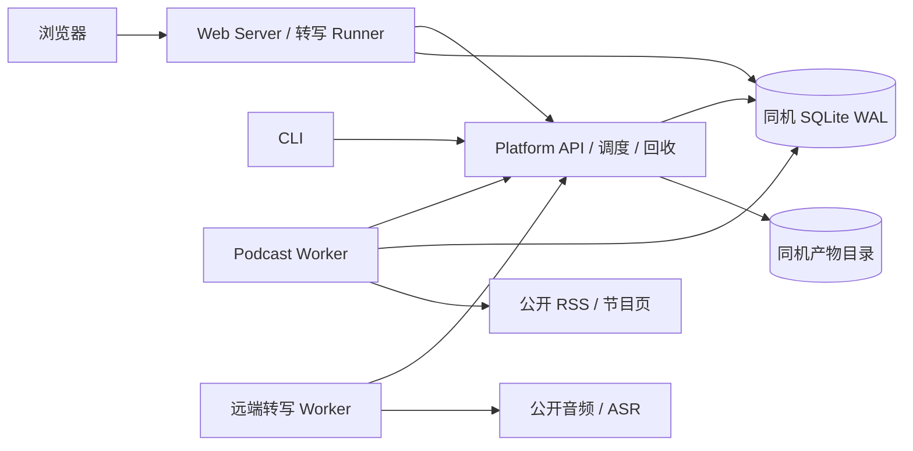

# Taskbase 当前项目规范与验收审查

| 项目 | 内容 |
| --- | --- |
| 文档版本 | 0.3 |
| 状态 | 当前功能范围、调度语义及 Web 入库职责已确认；R-03～R-05 已修复；生产运维验收暂缓 |
| 审查日期 | 2026-11-09 |
| 修复复核日期 | 2026-11-10；仅 R-03、R-04、R-05 |
| 范围决策日期 | 2026-11-10；维护者确认 Q-01～Q-03，Q-04 暂缓 |
| 工程版本 | `taskbase/package.json`：`yuxun@0.6.0` |
| 审查基点 | HEAD `0ae415f17e307de0d14e6b7d2de26a28deb92d6a` 加审查开始时的未提交工作区内容；不是该提交本身的发布验收 |
| 适用范围 | `taskbase/`、对应 CI、原始需求与现有文档；旧实现只查历史 |
| 读者 | 所有者、后续开发者、Worker 接入者、部署维护者 |

## 1. 文档定位与结论

本文集中记录现有工程的契约、证据和差距；使用步骤、架构流程和部署细节分别由已有文档维护。初次审查仅修改文档；2026-11-10 根据用户“修复 3、4、5”的授权落实三项修复，计划与验收契约见 [修复计划](../taskbase/tasks/plan.md)。后续若同时建设多个独立能力，应先审阅能力划分，再分别编写功能规格。

**当前发布范围已确认为现有的任务平台、播客采集、人工选择的 Web 转写队列和 Markdown 阅读/下载链路。** `app_state`、单任务内“定时拉取→转写”不列为本轮交付要求；原始需求保留供追溯。调度与超时沿用当前规则，稿件入库以 Web 队列为准，生产 HTTPS、备份及恢复目标验收暂缓。决定与适用边界见 12.2。

初审在沙箱外、Node `v24.19.0` 下运行完整自动测试，结果为 **49 通过、0 失败、0 跳过**；类型检查与两个前端模块的语法检查通过。修复后的完整验证结果见 11.1。测试通过不代表所有需求均已覆盖，也不代表线上部署通过验收。

### 1.1 证据与阅读规则

- **实现**：已从当前源码、配置或测试文件确认存在。
- **已验证**：本轮实际执行了对应检查并读取完整结果。
- **部分满足**：已有实现，但能力、场景或证据未覆盖完整要求。
- **未实现**：未发现对应表、接口或执行链路。
- **未核验**：没有在本轮执行相应环境或外部系统的验证。
- 当前范围、调度语义和入库职责以 12.2 的维护者决定为准；其他建议和协作边界不因这四项决定自动视为全面批准。原始 AC 对照继续保留历史要求及实现差异。

文档分工：

| 资料 | 职责 |
| --- | --- |
| [原始独立需求](personal-task-platform-requirements.md) | 保留 FR、NFR、D、AC 的原始含义；不是当前已实现清单 |
| 本文 | 当前工程契约、验证基线、原始 AC 对照、已确认与暂缓的决策 |
| [架构](../taskbase/docs/architecture.md) | 组件与流程解释 |
| [Web](../taskbase/docs/web.md) / [CLI](../taskbase/docs/cli.md) | 面向使用者的操作步骤 |
| [对外 API](../taskbase/docs/api.md) | 已入库转写稿和队列的只读接口 |
| [运维](../taskbase/docs/operations.md) / [HTTPS](../taskbase/docs/https.md) | 备份、恢复、清理与部署切换 |
| 带日期的审计、产品审阅与方案文档 | 当时的证据或提案；不能单独证明当前状态与线上状态 |

维护者已明确接受当前功能作为本轮发布范围。原始需求中的 D-06、D-08、AC-12、AC-13 保留追溯，其中与当前范围或调度语义的差异按 12.2 处理；不据此把原始全部需求标记为已实现。

## 2. 目标、用户与范围

### 2.1 目标

为一位所有者提供常驻的个人远程任务控制面。所有者通过 Web 或 CLI 提交、查看、关闭和重试任务；应用 Worker 通过 HTTP 领取并执行任务，保存检查点与最终产物。

当前业务是播客：登记节目与 RSS，采集单集元数据，人工选择音频转写，阅读或下载稿件。采集与转写使用两个独立 App，转写计算可在 Mac 上完成。

2026-11-10 确认按以下现有能力范围交付。Web 队列负责选择、顺序与稿件入库，CLI 保持任务控制、单集提交和产物下载能力；不要求 CLI 直接决定或自动触发统一稿件库入库。新增 `app_state`、采集后自动转写或生产运维验收应另行安排。

### 2.2 当前能力范围

| 能力 | 当前行为 | 主要依据 |
| --- | --- | --- |
| 身份 | 单所有者初始化、密码登录、用户 Token、App 级 Worker Token | [Store](../taskbase/src/store.ts)、[平台 HTTP](../taskbase/src/server.ts) |
| 任务控制 | 定义注册、幂等提交、租约、心跳、进度、事件、日志、检查点、终态、关闭与新任务重试 | 同上、[Worker SDK](../taskbase/src/worker-sdk.ts) |
| 调度 | 五字段 cron、IANA 时区、重叠跳过、超出宽限窗口的漏跑跳过、手动触发 | [cron](../taskbase/src/cron.ts)、Store |
| 播客 | RSS/Atom 或小宇宙公开页采集，按日期过滤并 upsert 元数据 | [播客 Worker](../taskbase/src/podcast/worker.ts)、[播客存储](../taskbase/src/podcast/store.ts) |
| 内容管理 | 订阅/候选/忽略、单集库、搜索筛选、服务端分页、单集身份别名 | 播客存储、[身份迁移](../taskbase/src/podcast/identity.ts)、[Web Server](../taskbase/web/server.ts) |
| 转写 | 音频下载、转码、切片、ASR、检查点、Markdown 上传与结果提交 | [转写 Worker](../taskbase/src/transcription/worker.ts) |
| Web 队列 | 持久化顺序、串行提交、响应丢失恢复、成功结果入库补偿、取消 | [队列](../taskbase/src/transcription/queue.ts)、[Runner](../taskbase/src/transcription/runner.ts) |
| 客户端 | 原生 Web、CLI、Mac launchd Worker 管理 | [前端](../taskbase/web/public/app.js)、[CLI](../taskbase/src/cli.ts)、[Mac 管理](../taskbase/scripts/mac-agent.ts) |
| 数据保护 | 在线备份、校验、隔离恢复演练、默认预览的清理脚本 | [备份](../taskbase/scripts/backup.ts)、[清理](../taskbase/scripts/maintenance.ts) |

### 2.3 当前未提供的能力

平台没有 `app_state` KV/CAS、通用工作流引擎、任务定义版本/快照、多用户权限、对象存储、完整多产物交付与大文件流式传输。播客没有自动 RSS 发现或采集后自动转写；CLI 不直接上传本机音频。文章抓取转 Markdown、Blog 发布和 MLX Provider 均不属于当前已实现能力。

“规模可到数十个应用、每天数百任务”来自原始需求假设；本轮未做负载测试，不能据此给出容量、延迟或可用性承诺。

## 3. 技术栈与运行约束

| 项 | 当前选择 | 约束 |
| --- | --- | --- |
| 运行时 | Node.js；`engines.node >=24.0.0`；CI 使用 24 | 直接执行 `.ts`；本轮验证版本为 24.19.0，不代表每个 24.x/更高版本都已验证 |
| 语言 | TypeScript `5.9.3` | `strict`、`NodeNext`、`erasableSyntaxOnly`、`noEmit` |
| Node 类型 | `@types/node 25.5.0` | 类型版本高于 CI 运行时；类型检查不能代替 Node 24 运行验证 |
| HTTP/数据库 | `node:http`、`node:sqlite` | 常驻进程；本地 SQLite WAL；不是无状态函数部署模型 |
| XML | `fast-xml-parser ^5.12.0`，锁定 5.12.0 | 一个直接生产依赖，仍有传递依赖 |
| 前端 | HTML/CSS/JavaScript | 无框架、无打包器；TS 检查不覆盖前端 JS |
| ASR | Whisper CLI 默认 `small`；FunASR、ElevenLabs 适配器 | 音频路径依赖 `ffmpeg`、`ffprobe`；Provider 外部环境单独配置 |
| 测试 | `node:test`、`node:assert/strict` | 临时数据库、HTTP fixture、替身 Provider；部分测试使用真实 ffmpeg |

依据：[package.json](../taskbase/package.json)、[锁文件](../taskbase/package-lock.json)、[tsconfig](../taskbase/tsconfig.json)、[CI](../.github/workflows/taskbase.yml)。

## 4. 项目结构与依赖边界

```text
AGENTS.md                       项目协作约束
spec/                           原始需求与当前规范
.github/workflows/taskbase.yml   CI 定义
taskbase/                       所有开发命令的工作目录
  src/main.ts                   平台 API 入口
  src/store.ts                  平台任务、身份、租约、调度持久化
  src/server.ts                 平台及 Worker HTTP 接口
  src/schema.ts / cron.ts        声明校验、时间调度
  src/config.ts / env.ts         公共配置与环境变量兼容
  src/worker-sdk.ts / process.ts Worker 协议与可取消子进程
  src/cli.ts                    CLI 入口
  src/podcast/                  采集、领域存储、身份迁移
  src/transcription/            ASR、转写执行、存储、队列与 Runner
  web/main.ts / server.ts        Web 会话、业务接口、平台代理
  web/public/                   页面、交互、分页、样式
  scripts/                      安装、Mac 服务、种子、备份、清理、页面检查
  test/                         *.test.ts 与解析 fixture
  docs/                         使用、架构、审计、部署文档
  deploy/tencent/               systemd / nginx 模板
  deploy/funasr/                可选 ASR 服务部署材料
  .data/                        默认本地数据库与 artifacts/（不入库）
```



- API、Web、Podcast Worker 依赖同一台机器上的持久磁盘与同一数据库路径。Podcast Worker 直接写领域表，不能只配置远端 API URL 就任意搬离数据主机。
- 转写 Worker 通过平台上传文字稿和产物，不直接写服务端 SQLite，可以远程部署。
- 转写 Runner 随 Web 常驻运行。关闭 Web 会停止继续推进队列，不会自动关闭已经提交到平台的任务。
- 当前以单 API、单 Web 实例为运行边界；WAL 不提供多个 Runner 的领导者选举或分布式锁。
- 平台 HTTP 路由不包含播客业务路由，但 `Store.listTasks({ summary: true })` 有 `podcast-tools` 输出摘要分支；“平台完全不感知领域”在此处存在耦合例外。
- 旧版根目录 `apps/`、`packages/` 不得重新成为当前实现入口。历史见 [迁移审计](../taskbase/docs/legacy-migration-audit.md)。

## 5. 可执行命令与配置

以下命令均从 `taskbase/` 执行；多个常驻进程分别使用终端或进程管理器。命令中的 `<...>` 为需要替换的值，不是默认凭据。本轮没有执行安装、初始化、清理应用或线上部署。

### 5.1 安装和本地启动

```sh
npm ci
node --version

# 首次初始化；密码至少 12 字符，通过环境安全注入
export TASKBASE_OWNER_PASSWORD='<至少12字符的独立密码>'
npm run bootstrap

# 终端 A：平台 API，默认 127.0.0.1:3333
npm run server

# 终端 B：Web，默认 127.0.0.1:3334
# 自动推进转写队列需要 Web 服务端也持有有效 Owner 凭据
export TASKBASE_OWNER_USERNAME='owner'
export TASKBASE_OWNER_PASSWORD='<与初始化相同的密码>'
npm run web

# 终端 C：在 Web 注册播客应用后，使用该 App 的 Token
export TASKBASE_WORKER_TOKEN='<podcast-tools Worker Token>'
npm run worker:podcast

# 终端 D：注册转写应用；配置对应 ASR 工具或服务
export YUXUN_WORKER_TOKEN='<transcription-tools Worker Token>'
npm run worker:transcription
```

API、Web、Podcast Worker 应使用同一 `TASKBASE_DATA_DIR`（默认当前工作目录下的 `.data`），且数据目录预先由初始化建立。反向代理与 TLS 配置见已有部署文档。

### 5.2 CLI 与检查命令

```sh
# 无需全局安装即可运行
npm run cli -- --help
npm run cli -- help --all
npm run cli -- login
npm run cli -- status
npm run cli -- transcribe 'https://example.com/audio.mp3' --no-wait

# 可选：安装全局命令，会写用户安装目录
npm run install:global
yuxun --help

# 工程检查
npm run typecheck
node --check web/public/app.js
node --check web/public/pagination.js
npm test

# 需要本机 Chrome；使用独立 profile、临时数据库
npm run smoke:web
```

没有 `build`、`lint`、独立格式化或覆盖率门槛脚本；不要把不存在的命令写入验收。`tsc --noEmit` 只检查类型，不生成发布目录。

### 5.3 数据维护命令

```sh
# 备份和恢复目的目录必须尚不存在；请为每次操作选择新目录
node scripts/backup.ts create .data .backups/review-example
node scripts/backup.ts verify .backups/review-example
node scripts/backup.ts rehearse .backups/review-example /tmp/taskbase-restore-review-example

# 默认只预览；实际删除须依据预览和备份状态决定
node scripts/maintenance.ts .data
```

### 5.4 配置契约

下表的 `TASKBASE_*` 均兼容同名 `YUXUN_*` 新别名，优先级统一为 `显式参数 > YUXUN_* > TASKBASE_* > 默认值`。新别名已设置为空字符串时不会回退旧值；数值空串采用默认值，空秘密仍按未配置处理。CLI 的旧目录迁移读取保留旧路径语义，不属于活动配置覆盖。

| 配置 | 默认值/语义 |
| --- | --- |
| `TASKBASE_DATA_DIR` | `.data`；DB 为 `taskbase.sqlite`，产物位于 `artifacts/` |
| `TASKBASE_HOST` / `TASKBASE_PORT` | `127.0.0.1` / `3333` |
| `TASKBASE_WEB_HOST` / `TASKBASE_WEB_PORT` | `127.0.0.1` / `3334` |
| `TASKBASE_URL` | `http://127.0.0.1:3333`；Web/Worker/CLI 的平台入口 |
| `TASKBASE_WEB_SESSION_TTL_MS` | `2592000000`，30 天 |
| `TASKBASE_LEASE_MS` | `60000`；默认 Worker 心跳 15000 ms |
| `TASKBASE_SWEEP_MS` / `TASKBASE_SCHEDULER_MS` | 均为 `5000` |
| `TASKBASE_SCHEDULE_GRACE_MS` | `300000`，5 分钟 |
| `TASKBASE_MAX_ARTIFACT_BYTES` | `5242880`，5 MiB |
| `YUXUN_PUBLIC_URL` / `TASKBASE_PUBLIC_URL` | 配置时必须是 HTTPS；默认使 Web Cookie 带 `Secure`，不会自动申请证书 |
| `TASKBASE_TRANSCRIPT_API_TOKEN` | 可选只读 API Token；不是 Worker Token |
| `TASKBASE_OWNER_USERNAME` / `TASKBASE_OWNER_PASSWORD` | 用户名默认 `owner`；密码无默认值，bootstrap 和 Web 队列使用相同配置 |
| `TASKBASE_WORKER_TOKEN` | Worker 凭据，无默认值 |
| `TASKBASE_HEARTBEAT_MS` / `TASKBASE_POLL_MS` | 默认 `15000` / `2000` ms；Demo 轮询默认 `1000` ms；须为正安全整数 |
| `TRANSCRIPTION_PROVIDER` | 默认 `whisper`；可选 `funasr`、`elevenlabs` |
| `TRANSCRIPTION_CHUNK_SECONDS` | 默认 `600`；切片应保持正数且恢复期间不变 |
| `TRANSCRIPTION_ALLOW_INSECURE_HTTP` | 默认关闭；设为 `1` 会允许 HTTP 和私网，仅供隔离测试 |

API/Web 直接使用 `config.ts` 已校验的端口；bootstrap、Web 服务凭据、三个 Worker 和 Mac pair 使用共享读取规则。Mac 路径及 Node 选择支持 `YUXUN_MAC_AGENT_DIR`、`YUXUN_LEGACY_AGENT_DIR`、`YUXUN_LAUNCH_AGENTS_DIR`、`YUXUN_MAC_AGENT_LOG`、`YUXUN_NODE_BIN`，均回退对应 `TASKBASE_*`。密码和 Token 按消费边界读取，不加入公共 `config` 对象。

## 6. 当前行为契约

### 6.1 身份、注册与客户端边界

- 初始化只允许一个所有者；无默认密码，密码至少 12 字符，使用 scrypt。用户名可配置，不保证一定为 `owner`。
- 用户 Token 有效期 90 天；平台 `api_tokens`、`worker_tokens` 保存哈希。Worker Token 按 App 隔离，轮换后旧 Token 立即失效，没有双 Token 宽限期。
- manifest 注册在事务内覆盖更新；此次未出现的任务定义会被停用。定义无版本/快照；完成时按当前输出 schema 校验。在途任务兼容性需要部署窗口控制。
- Web 登录后保存 `tb_session`：HttpOnly、SameSite=Lax、Path=/；默认 30 天，并在 SQLite `web_sessions` 持久化 Owner Token 与 CSRF 值。数据库备份属于含凭据的数据。
- 日常页面请求不使用 Owner Token；注册/轮换时会把一次性 Worker Token 返回浏览器供所有者配对。它不应存入 localStorage 或普通日志，不能宣称“Worker Token 从不进浏览器”。
- 平台代理及业务写接口要求 Session 和 CSRF；登录/登出是独立路径，登出当前没有同样的 CSRF 校验。CSP 禁止内联脚本；这不等同于完整安全审计。
- 登录有限流；未提供全 API 通用限流、密码修改、统一设备踢出和细粒度 RBAC。

### 6.2 任务、尝试与恢复

```text
queued / recovering → running → succeeded
                             → failed（Worker 主动失败）
running → recovering（租约过期，尝试未耗尽）
queued / recovering / running → closed（超时、关闭或尝试耗尽）
failed / closed → retry → 新 queued 任务
```

1. `POST /v1/tasks` 使用 `{ task: "app_id/task_key", input: {...} }`；input 必须是 JSON 对象，序列化后 UTF-8 不超过 65536 字节，超限返回 413 `INPUT_TOO_LARGE`；输入按受控 JSON Schema 子集校验，不是完整 JSON Schema 标准实现。新建、手动重试、调度创建/更新/立即执行/定时触发统一在 Store 校验；旧数据超限也不能绕过。结果与检查点不套用输入限额，平台 JSON 请求体仍为 8 MiB。CLI 文件、stdin、内联输入另有 64 KiB 原始字节检查。
2. `Idempotency-Key` 长度 1–128；同所有者、App、任务、键与规范化后相同输入返回原任务；不同输入返回 409 `IDEMPOTENCY_CONFLICT`。重用返回 200，新建返回 202。
3. 按 App 最大并发领取，Worker 空轮询返回 204。每次领取产生 `attempt_id`；更新使用 `X-Attempt-Id`，旧租约写入返回 409 `STALE_ATTEMPT`。
4. `task_id + step_key` 保存不可变结果；相同值可重复确认，不同值返回 `STEP_CONFLICT`。这是同一任务内恢复机制，不能替代跨任务 `app_state`。
5. 默认排队和执行各 1 小时，定义允许 1 秒至 6 小时；manifest 默认最大尝试数为 3，当前播客和转写声明均为 2。
6. 恢复重新领取时，会重新计算执行 deadline；进入 `recovering` 也重新计算排队 deadline。因此 6 小时是单次领取的执行预算上限，不是整个任务跨 Attempt 的总耗时上限。
7. 主动失败不自动重试；人工关闭立即终态并拒绝迟到结果，没有取消握手。SDK 心跳失败会中止工作；下载和 ASR/ffmpeg 支持取消，停止不保证瞬时完成。
8. 手动 retry 创建新任务，记录 `retry_of_task_id`，保留原任务；不复制旧任务检查点，也没有修改输入的 retry 接口。
9. 任务历史使用 `(created_at, id)` 游标，`limit` 为 1–100，默认 20；事件/日志每批最多 100，以 `after` 递增读取。

### 6.3 cron 调度

- 五字段：分、时、日、月、周；支持数字、`*`、列表、区间、步长和 IANA 时区。不是六字段/秒级 cron。
- 同一 `schedule_id` 有 `queued/running/recovering` 任务时跳过；不是同 App+task 的全局互斥。
- 扫描时距离计划时间不超过 5 分钟，仍可能创建任务；超过才记 `skipped_missed`。所以“停机错过的一概不跑”不是准确描述。
- 调度与任务对计划时间有唯一约束；跳过、创建或失败后向未来推进。停用后仍可手动 `run-now`；手动触发也检查重叠。
- Worker 获得 `schedule_id` 与 `planned_fire_time`，没有原始 FR-STATE-06 要求的上次触发/成功时间。
- API 支持修改 cron、时区、输入和启停；当前 Web 页面提供创建、启停、run-now、历史和删除，没有这些字段的编辑 UI，也没有多次未来触发预览。
- “每节目一个 schedule”是使用约定；创建接口没有按节目去重的唯一约束，可以为同一节目创建多个 schedule。

上述 grace 窗口和按 Attempt 重算执行预算已于 2026-11-10 确认为当前正式语义，见 Q-02。

### 6.4 播客采集与身份

- `podcast-tools/shows/collect` 批量采集；`podcast-tools/show/sync` 单节目同步，后者允许平台调度。两者只保存元数据，不下载音频。
- 已登记 RSS 时只走 RSS 分支；RSS 抓取失败记失败，不会自动改走公开页。没有 RSS 才走小宇宙 `__NEXT_DATA__` 页面。
- RSS/Atom 列表获取后仍按 `since` / `until` 过滤。未提供范围时默认为当前 UTC 日期往前一年，起止日期均包含；无有效发布时间的单集会被过滤掉。
- RSS 分支写 `coverage_status=full`，表示来源分支的覆盖标记，不证明 RSS 本身包含所有历史，也不表示未经过日期过滤。页面分支依据页面数量与总数量写 `partial/full`。
- 批量采集若全部节目失败，任务为 `failed`；部分节目失败仍可能 `succeeded`，必须同时检查输出 `failed`、每节目结果和采集记录。
- 单集通过同节目内来源身份或相同音频 URL 关联，RSS/公开页切换保留规范 ID 与旧 ID 别名；没有任意内容相似度去重保证。
- 候选进入订阅列表以“已有单集或成功/partial 采集”判断；仅失败不算订阅。忽略影响默认批量范围，不能等同于停用已有 schedule。
- 服务端有节目标题/RSS PATCH 接口，当前 UI 没有完整编辑、删除和暂停更新流程。

### 6.5 转写与队列

- `transcription-tools/episode/transcribe` 要求公开音频 URL；排队 1 小时、单次执行 6 小时、最多 2 次 Attempt、要求最终产物，不允许 cron 直接调度。
- 默认音频下载上限 500 MiB、默认仅 HTTPS；公开 RSS 允许 HTTP 但仍拒绝私网。安全抓取逐跳检查 URL/DNS/IP，固定已验证地址，限制字节数与超时。
- 转为 16 kHz 单声道 WAV，默认 600 秒切片，逐片保存 `asr-chunk-N`。恢复复用已确认 ASR 结果，但仍需重新下载、转码和切片；没有持久化原始音频缓存。
- 跨 Attempt 不应修改源音频、切片长度、Provider 或模型；检查点没有对这些参数的完整指纹校验。
- Worker 提交包含 `text/segments/provider/model/artifact_id` 的结果和 Markdown；临时目录在执行结束路径清理，进程遭强制杀死后的残留不由该 finally 保证清除。
- 正常 Web UI 的单集转写与批量选择均进入持久化队列。Runner 一次跟踪一项，持久化幂等键与原提交输入；丢失响应后复用原键，不另建重复任务。
- 平台成功后，Runner 先获取结果、保存 `transcription_transcripts`，再标记队列 `done`；入库失败保留 `saving` 阶段并继续补偿。恢复推进依赖 Web 服务端有效 Owner 凭据。
- 取消与推进串行，平台确认关闭后才标记取消；关闭失败保留任务关联。任务已成功则尝试入库。10 分钟未被 Worker 领取时，Runner 尝试关闭并暂停队列。
- 暂停阻止后续提交，不等同于关闭正在执行的任务；重启保留队列 active/paused 状态。
- 兼容接口 `POST /api/podcast/episodes/:id/transcribe` 仍直接创建平台任务；CLI 转写同样绕过 Web 队列。这些任务不自动保证进入稿件表；单集阅读有最近 100 个转写任务中的结果回退，不能代替完整入库同步。

### 6.6 接口、分页与产物

| 接口边界 | 认证 | 关键约束 |
| --- | --- | --- |
| `/v1/*` 用户管理接口 | Owner Bearer Token | 任务、应用、调度、最终产物 |
| `/v1/worker/*` | App 级 Worker Token；执行写入另需 Attempt | 不得调用所有者接口或写其他 App |
| `/api/platform/*` | Web Session；写操作 CSRF | 服务端代理 `/v1/*` |
| `/api/podcast/*`、`/api/transcription/*` | Web Session；写操作 CSRF | 领域数据、队列和阅读 |
| `/api/v1/queue`、`/api/v1/transcripts*` | 专用只读 Token 或 Owner Token | GET；专用 Token 不赋予平台管理权限 |
| `/health`、`/api/health` | 无登录 | 健康探测不等同于 Worker/ASR 就绪 |

列表契约不同，不应混用：

- 任务：不透明 `cursor` + `next_cursor`；`summary=1` 不传完整结果，播客任务保留计数摘要。
- 节目/队列：`page` + `limit` + `total/pages`；节目接口不传 `page` 时仍有兼容全列表模式。
- 单集库：`limit/offset`；前端默认 50。节目弹窗同样分页，服务端最多 100。
- 转写稿：`cursor` 实为数字 offset，列表只含元数据与片段数；全文由详情或 Markdown 接口读取。并发新增时 offset 分页不是一致性快照。
- Worker“在线”按 App 最近 90 秒访问判断，空闲领取轮询也更新；不是每个 Worker 进程的独立健康检查，不能证明模型就绪。

最终产物是单个 `artifact_id`。上传/下载使用内存缓冲；上传上限取 `min(平台全局上限, 当前任务定义 artifact_policy.max_bytes)`，未声明定义上限时采用全局值，平台默认 5 MiB。读取正文前检查 App/Attempt 和租约；声明长度或实际流量超限返回 413，不创建文件/元数据。Store 写入时再次验证当前定义，防止读取期间定义调小或租约失效。下载校验字节数与 SHA-256，只开放成功任务的最终产物。

日志、进度说明、失败/关闭原因、播客与队列错误、API/Web 错误响应、Worker 控制台诊断使用统一脱敏：移除 HTTP(S) URL 的用户信息、查询及片段，隐藏常见密码/Token/Cookie 字段；明确秘密命名的环境变量值长度不少于 4 字符时也按原值替换。脱敏先于诊断截断。保留错误码和任务/请求 ID，不改写业务输入、ASR 正文或检查点。历史日志不会自动清理；未知字段、URL 路径中的不透明秘密或任意自由文本不构成完整秘密扫描保证。

## 7. 数据、保留与恢复边界

| 数据 | 存储/责任 |
| --- | --- |
| 用户、Token 哈希、应用/定义、任务/Attempt/Step/Event、调度/运行、产物索引 | `src/store.ts` 管理的平台表 |
| 节目、单集、采集记录、身份别名、迁移记录 | `podcast_*`，由 PodcastStore 管理；身份迁移会协调已有稿件与队列关联 |
| 文字稿 | `transcription_transcripts`；服务端为正文与阅读索引来源 |
| 队列、启停和错误状态 | `transcription_queue`、`transcription_queue_state` |
| 浏览器会话 | `web_sessions`；含可用 Owner Token，不能当作普通业务数据公开 |
| 最终文件 | 数据目录下 `artifacts/<id>` |

备份工具使用 SQLite 在线 backup API，检查完整性、外键、数据库及产物哈希。快照包含所有已建表；产物按快照的 `artifacts` 索引复制。备份目录 700、文件 600，拒绝覆盖目的目录；数据库与文件必须一起保留。

`rehearse` 恢复到新目录，验证数据库可读写和产物内容，不启动 API、调度器或 Worker。当前测试没有验证恢复后真实调度时间推进、HTTPS 下载、Web 登录、稿件阅读或生产磁盘故障。

清理默认只预览：结束任务的 log 事件保留 30 天；活动任务日志、其他事件、任务、步骤、结果保留；索引仍引用的产物不删。只删除超过 7 天且无索引引用的 UUID 产物文件。不会自动 VACUUM。

[运维文档](../taskbase/docs/operations.md)提出每天备份、14 份日备份与 8 份周备份、每月恢复演练；这些是运维策略，不代表已安装自动化或实现 RPO/RTO 保证。本轮没有核验线上计划、异机副本和权限。

## 8. 代码风格与协作边界

### 8.1 当前代码风格

现有源码主要采用 ESM、显式 `.ts` 后缀、两空格缩进、单引号和分号；函数/变量使用 camelCase，类/类型使用 PascalCase，常量使用 UPPER_SNAKE_CASE，数据库/API 字段多使用 snake_case。HTTP 边界先验证未知值，再交给领域存储；数据库值使用占位符绑定。

真实示例，节选自 [src/config.ts](../taskbase/src/config.ts)：

```ts
function positiveInt(value: string | undefined, fallback: number, name: string): number {
  if (value === undefined || value === '') return fallback;
  const parsed = Number(value);
  if (!Number.isSafeInteger(parsed) || parsed <= 0) {
    throw new Error(`${name} 必须是正整数`);
  }
  return parsed;
}
```

当前没有自动格式化器/ESLint 规则，部分 Web/CLI 代码使用 `any`；本文不把建议风格描述成工具已强制执行。平台错误响应示例为 `{ "error": { "code": "INVALID_INPUT", "message": "...", "request_id": "..." } }`；Web 错误正文不统一携带 request_id，但响应头有 `x-request-id`。

### 8.2 始终遵守（Always）

- 从 `taskbase/` 运行工程命令；保留使用者已有工作区改动。
- 修改行为时同步规格、使用说明与有意义的验收证据；区分已验证与未核验。
- 验证接口输入、任务定义和状态迁移；保持租约、幂等、检查点、身份别名及终态约束。
- 修改涉及持久化的数据时说明迁移、旧数据兼容和备份/恢复路径。
- 提交前运行与改动有关的类型、语法和测试检查；测试失败说明原因，不删除证据。

### 8.3 事先确认（Ask first）

以下范围若已获当前任务授权，无须重复请求；否则先提供可审阅变更与影响说明：

- 改变原始验收范围、单用户边界、任务状态语义或公开接口兼容性。
- 采用新的数据库/存储基础设施、增加直接依赖或改变 CI/发布要求。
- 执行生产迁移、数据删除、恢复覆盖、部署、凭据轮换或公开服务配置变更。

### 8.4 禁止（Never）

- 把密码、Token、Cookie、第三方密钥或生产备份写入仓库/普通日志；任务输入也不能携带第三方凭据。
- 绕过 App/Attempt 隔离，改写已确认检查点，或删除失败测试来获得通过结果。
- 把历史截图、替身 Provider 测试或部署模板当作线上验收证明。
- 重引入归档平台目录，或对当前工程、原始需求与历史报告混用“已完成”。

## 9. 测试策略与本轮记录

### 9.1 检查层次

| 层次 | 现有覆盖 | 重要限制 |
| --- | --- | --- |
| 静态 | TS strict；前端两模块语法 | 没有前端类型检查、lint 或覆盖率阈值 |
| 纯逻辑 | schema、cron/闰年/DST、RSS/页面解析、切片合并 | 不替代所有时区、日期和源站的穷尽测试 |
| 存储/HTTP | 任务闭环、幂等与凭据隔离、恢复/超时/重试、Web Session、分页 | 主要使用临时库与本机 HTTP |
| 故障与补偿 | 丢失提交响应、入库失败、旧身份迁移、取消失败、心跳中止/子进程退出 | 不等同于真实服务器断电或网络分区演练 |
| Provider | Whisper 替身命令；FunASR/ElevenLabs 替身响应 | 没有本轮真实模型质量、付费调用、速度或成本证据 |
| 运维 | WAL 在线备份、损坏与覆盖拒绝、隔离恢复、清理预览/应用 | 没有恢复后完整服务业务验收 |
| 浏览器 | `smoke:web`：登录、主要页面、弹窗与翻页/跨页选择 | 本轮未运行；本次仅审阅脚本与 CI 定义 |

测试路径：`test/base.test.ts`、`cron.test.ts`、`podcast*.test.ts`、`transcription*.test.ts`、`cancellation.test.ts`、`pagination.test.ts`、`web*.test.ts`、`operations.test.ts`。新测试应验证公共行为、不变量或真实故障，不为本次文档改动另造实现镜像测试。

### 9.2 本轮验证结果

| 命令/环境 | 结果 |
| --- | --- |
| Node 24.19.0：`npm run typecheck` | 退出 0 |
| `node --check web/public/app.js` | 退出 0 |
| `node --check web/public/pagination.js` | 退出 0 |
| 沙箱外 Node 24.19.0：`npm test` | 退出 0；49/49 通过，无跳过 |
| 沙箱内 Node 25.6.0 和 24.19.0：`npm test` | 4 个 HTTP 相关测试文件触发 Node 原生 `execution_async_id` 断言；同一工作区在沙箱外通过。记录为环境相关现象，未完成 Node 内部根因归因 |
| CI、生产 HTTPS、真实外部 RSS/ASR、生产备份恢复、浏览器 smoke | 本轮未核验 |

CI 定义使用 Node 24，依次安装依赖/ffmpeg，执行类型、前端语法、完整测试、Chrome smoke。工作区中的 workflow 尚未提交；本轮没有查看 GitHub 执行记录。

## 10. 原始 MVP 验收追踪

编号保留 [原始需求第 12 章](personal-task-platform-requirements.md#12-mvp-验收标准) 的含义，不用当前实现反向改写通过条件。本表用于追溯原始基线；当前发布范围按第 2 章和 12.2 执行，原始缺口不自动成为本轮新增实施任务。

| AC | 本轮判定 | 证据、差距或必要限定 |
| --- | --- | --- |
| AC-01 远端 HTTPS + CLI/Worker | 未核验 | 有部署/TLS 模板，本轮未验证真实入口与远端凭据链路 |
| AC-02 App 多任务/覆盖更新 | 已验证主要行为 | `base.test.ts`；覆盖注册与 schema，未删历史；无定义版本 |
| AC-03 CLI 提交/观察/结果/下载 | 部分满足 | CLI 实现存在；底座 HTTP 闭环有测试，CLI 自动测试主要验证帮助/参数；本轮未另跑真实 CLI+Worker 全流程 |
| AC-04 中断恢复/检查点/旧尝试隔离 | 已验证主要行为 | `base.test.ts`、`cancellation.test.ts`；用租约/进程 fixture，不代表生产断电演练 |
| AC-05 幂等与冲突 | 已验证 | `base.test.ts`、`transcription-runner.test.ts` |
| AC-06 cron 唯一触发/重启不重复 | 部分满足 | 数据库唯一约束与调度测试存在；本轮没有独立的 API 进程重启调度用例 |
| AC-07 同 Schedule 重叠跳过 | 已验证 | `base.test.ts` |
| AC-08 漏跑不补 | 当前语义已确认；与原始字面有差异 | Q-02 接受默认 5 分钟 grace：窗口内可执行，超出后跳过；不再待决 |
| AC-09 超时关闭/释放槽位 | 已验证主要行为 | `base.test.ts`；预算按 Attempt 重算，未验证任务总耗时上限 |
| AC-10 人工关闭/迟到拒绝 | 部分满足 | API 与底座测试通过；操作者保存在 `tasks.closed_by`，普通任务响应/事件未完整暴露该字段 |
| AC-11 新任务重试/原记录保留 | 已验证 | `base.test.ts` |
| AC-12 单任务“定时拉取→转写” | 未实现；本轮范围外 | Q-01 接受两个 App + 人工选择 + Web 队列，不要求本轮补齐原始单任务串行链路 |
| AC-13 `app_state`/CAS/跨次去重 | 未实现；本轮范围外 | Q-01 接受现有范围；无对应平台表/API，领域表/Step 不能替代原始要求 |
| AC-14 定义更新无快照/部署兼容 | 部分满足 | 覆盖与无版本已实现；未做真实部署窗口在途兼容验证 |
| AC-15 原因可查/无敏感泄漏 | 部分满足 | 有终态、事件、请求日志；2026-11-10 已修复通用诊断脱敏并通过回归，历史数据和未知秘密格式不在自动清理保证内 |
| AC-16 数据+产物完整恢复 | 部分满足 | 在线快照/隔离读写/产物校验有测试；无 `app_state`，未验收恢复后调度与授权下载 |
| AC-17 用户/Worker/App 隔离 | 部分满足 | 当前任务权限隔离有测试；要求中的 AppState 隔离尚不存在 |

结论：自动测试基线通过，维护者已确认按现有功能范围交付。原始 AC-01～AC-17 的差异保留追溯；范围确认不等同于原始要求全部实现或生产环境已验收。

## 11. 审查发现与风险

优先级保留初审时的影响判断。P1 表示可能导致验收误判、数据/安全契约失效或关键流程缺口；P2 表示维护与功能完整性问题。R-03～R-05 已修复；12.2 的后续决定已明确 R-01/R-06 的范围边界，并暂缓 R-02/R-07 的生产验收。范围调整或暂缓不等于代码修复，其他发现继续保留。

| ID | 级别 | 发现与影响 | 依据/验证情况 |
| --- | --- | --- | --- |
| R-01 | P1 | **范围已确认**：按现有能力交付，`app_state` 和单任务采集转写不作为本轮补齐要求；原始 MVP 差异仍保留 | Q-01；平台路由/表、两个 manifest、AC-12/13 |
| R-02 | P1 | **生产验收暂缓**：TLS 模板和历史部署记录不证明线上安全，保留未核验状态 | Q-04；`docs/https.md`、部署模板 |
| R-03 | P1 | **已修复**：初审缺少通用脱敏，签名 URL 可能进入日志/事件；现于传输、持久化和诊断输出边界脱敏，转写无标题时用 task_id | `src/redact.ts`、SDK/Store、API/Web、应用存储；`redaction.test.ts` 与 Web 代理错误测试通过。历史数据未自动迁移 |
| R-04 | P1 | **已修复**：初审上传忽略任务定义上限，API/CLI 输入限制不一致；现上传取全局/定义较小值，Store 统一执行 64 KiB 对象输入约束 | `limits.test.ts`：声明/chunked/精确边界/权限隔离/无副作用、旧输入重试与调度、较大结果/检查点；CLI 内联测试通过 |
| R-05 | P2 | **已修复**：初审新旧别名优先级不统一；现统一读取，入口不再覆盖已校验端口，Worker 数值启动前校验 | `env.test.ts`：9 个真实入口/本机服务测试覆盖新别名、冲突、旧初始化回退、凭据、Mac pair 和 CLI；见 5.4 |
| R-06 | P1 | **入库职责已确认**：以 Web 队列/Runner 为准，不要求 CLI/兼容直提自动入库；100 条回退仍是兼容读取边界，不能代替稿件库 | Q-03；Web 兼容路由、CLI、Runner；任务成功不等于只读转写 API 可见 |
| R-07 | P1 | **生产验收暂缓**：现有恢复演练仅覆盖文件/数据库一致性，生产完整业务恢复及 RPO/RTO 不在本轮验收范围 | Q-04；`operations.test.ts`、备份工具；保留未验证项 |
| R-08 | P2 | Web 缺 cron/节目完整编辑 UI、节目删除/暂停；同节目多个 schedule 未被约束，忽略不停止调度 | `web/public/app.js`、Web/Store 路由 |
| R-09 | P2 | 多 Web 实例的 Runner 无分布式协调；领域摘要进入平台 Store，身份迁移跨领域更新 | Runner、`Store.listTasks`、`podcast/identity.ts`；当前单实例边界内记录限制 |
| R-10 | P2 | 文档混淆历史与当前、RSS 来源覆盖与历史全量；一次性 Worker Token 展示也不符合“从不进浏览器”字面承诺 | 本轮修订 README/架构/Web，并为历史报告标注适用时间 |

### 11.1 R-03～R-05 修复验证（2026-11-10）

- 环境：沙箱外 Node `v24.19.0`，仅临时 SQLite/文件目录与本机假服务；未部署线上、未调用真实 ASR 服务。
- 完整测试：`node --test test/*.test.ts`，68 通过、0 失败、0 跳过；比初审新增 19 个测试，并扩展既有 Web 代理测试。
- 类型检查：`npm run typecheck` 退出 0；工作区检查 `git diff --check` 退出 0。
- 先以失败测试复现日志/载荷泄漏、大小限制及入口配置缺陷，再修复并通过回归。保留既有未提交改动，本轮不自动提交。
- 历史含秘密数据未自动重写，线上 TLS、备份验收与其他发现仍按原状态处理。

### 11.2 GitHub 提交前复核（2026-11-10）

维护者明确要求提交到 GitHub 后，重新执行 `node --test test/*.test.ts`（Node v24.19.0）：68/68 通过、0 失败/跳过；`npm run typecheck`、两个前端模块的 `node --check` 和 `git diff --check` 均通过。`node scripts/smoke-web.ts` 使用本机独立无头 Chrome、临时库和独立 profile，验证登录、总览、调度、应用、节目/单集、转写历史、跨页选择及队列/任务翻页通过。该检查仅证明本机 fixture 场景，生产验收仍按 Q-04 暂缓。

## 12. 成功条件与范围决策

### 12.1 初次文档交付的成功条件（历史记录）

- [x] 只审查当前 `taskbase/`，保留既有未提交改动，不改运行代码。
- [x] 覆盖目标、技术栈、可执行命令、目录、真实代码风格、测试策略与三层协作边界。
- [x] 将主要行为关联到源码/测试，并保留原始 AC 编号和未满足项。
- [x] 记录本轮实际验证环境、测试数、失败现象和未核验范围。
- [x] 纠正文档中的关键事实偏差，给历史报告添加状态提示，并从现有导航链接本文。
- [x] 维护者已确认当前发布范围、调度语义、Web 入库职责及生产验收暂缓，见 12.2；这些决定可作为后续工作的范围基线。

### 12.2 四项决策记录（2026-11-10）

以下依据维护者在本次会话中对四项问题的逐条答复记录。

| ID | 状态 | 确认内容与后续边界 |
| --- | --- | --- |
| Q-01 | 已确认 | 本轮按现有“任务底座 + 播客采集 + 人工选择的 Web 转写队列 + 阅读/下载”交付；不新增 `app_state` 或单任务采集转写要求，保留原始需求追溯 |
| Q-02 | 已确认 | 沿用当前规则：默认 5 分钟 grace 内可执行，超过则跳过；重新领取按 Attempt 重算执行预算，6 小时为单次 Attempt 上限，恢复排队也重算截止时间 |
| Q-03 | 已确认 | 入库以 Web 队列/Runner 为准，由 Web 流程决定选择、顺序和入库完成；CLI 保留提交/查看/下载能力，不因 CLI 任务成功自动要求进入稿件库；兼容直提沿用现状 |
| Q-04 | 暂缓 | 本轮先不处理生产 HTTPS、实际备份频率、异机副本与 RPO/RTO；保留现有工具及未核验状态，后续启动生产验收时再确定目标 |

四项均已有处理决定：3 项确认、1 项暂缓，本轮没有等待答复的范围问题。本轮只同步规范和使用说明，未改变运行行为、未执行部署；前次 R-03～R-05 修复及验证记录见 [任务清单](../taskbase/tasks/todo.md)和 11.1。
