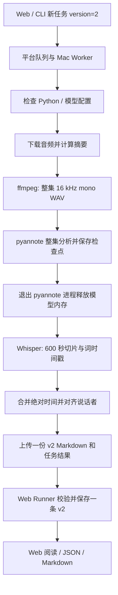

# 本地说话者转写 v2 开发方案

日期：2026-11-11。状态：**方案已批准，P1–P6 已实现并通过自动验证；P0 真实模型验收尚未完成，未部署**。

依据：[功能规格](transcription-v2.md)。用户已确认方案为本地 Whisper + 独立本地说话者模型；新任务只保存 v2，旧稿保留为 v1。性能与质量目标仍待真实模型实测，不能作为已达成结论；实施结果见 [进度记录](../taskbase/tasks/transcription-v2-progress.md)。

## 1. 最终效果和范围

| 场景 | 预期行为 |
| --- | --- |
| 已有转写稿 | 保留原 ID、正文、时间戳和下载链接，标为 v1 |
| 后续新任务 | 默认生成带说话者的 v2，每个任务只存一份稿件 |
| 单集只有 v1 | 默认继续可读 v1；用户可点击“生成 v2”，创建新任务并保留 v1 |
| 单集同时有 v1/v2 | 默认显示 v2，可以切换阅读和下载 v1 |
| 同版本多次转写 | 各次结果保留，默认选择该版本最新成功入库的一份 |
| 说话者不确定 | 在对应片段显示“说话者未确定”，不根据正文猜姓名 |
| 模型未安装或分析失败 | v2 任务失败并提示原因，不存成 v1，不把普通稿标成 v2 |

支持单人、双人和多人轮流讲话；编号在同一集内一致，跨单集不对应同一人物。首期不做真实姓名识别、人工改名、重叠人声拆轨、云端说话者服务和旧稿批量升级。

## 2. 一小时音频要多久

### 已核实的运行条件

- 本机为 Apple M4，10 核 CPU、16 GB 统一内存。
- 代码默认`whisper` CLI、`small`模型、`cpu`设备、600秒一片。后续检查发现本机实际`worker.env`覆盖了可执行文件，使用`mlx-whisper-compat`，且该脚本忽略词时间参数；方案的标准Whisper基准与该在用配置必须区分，不能据此推算当前MLX耗时。
- 方案编写时仅安装了Whisper/PyTorch；开发期间已在临时独立环境安装pyannote4.0.7并通过导入/解码检查。用户授权后，community-1权重已下载且离线加载通过；自然对话质量仍未验收。沙箱中的MPS探测不可作为主机GPU可用性的验收结论。
- pyannote 官方 README 的 community-1 速度示例使用 NVIDIA H100，不能换算成本机 M4 速度。项目旧文档的 MLX/FunASR 估算同样不能套用到当前实现。

### 估算方法

第一版顺序执行两个模型，以减少 16 GB 内存压力：

`总分钟数 = 下载转码分钟数 + Whisper（含词时间戳）分钟数 + 整集 pyannote 分钟数 + 对齐上传分钟数`

**已有510秒样本计时，但尚无1小时整集实测，因此不能给出可信的“固定几分钟”。** CPU首测及用户批准后的MLX/MPS复测见[实测记录](../taskbase/docs/transcription-v2-benchmark-20261111.md)。以下是方案初拟时的公式预算示例，不是本机实测或预测：

| 假设场景 | Whisper 含词时间 | pyannote | 其余合计 | 一小时音频总耗时 |
| --- | ---: | ---: | ---: | ---: |
| 场景 A | 20 分钟 | 5 分钟 | 1 分钟 | 26 分钟 |
| 场景 B | 40 分钟 | 10 分钟 | 2 分钟 | 52 分钟 |
| 场景 C | 60 分钟 | 20 分钟 | 3 分钟 | 83 分钟 |

词时间戳也有额外计算量，因此“旧版耗时 + pyannote 耗时”会漏算一部分开销。六个切片目前串行处理，不能除以六。模型首次下载耗时、排队等待与冷启动单列，不能混进稳定处理速度。

### 第一阶段的实际计时

1. 使用用户选定的公开或已授权 10 分钟双人中文样本，先测原版 Whisper，再测开启 word timestamps，再测 pyannote；记录模型加载和推理时间。
2. 使用完整 60 分钟样本复测整集路径；短片可估 ASR 倍率，但 pyannote 整集聚类、说话者人数及内存可能带来非线性开销，不能只乘六。
3. 权重缓存后做三次正式计时；记录中位数、最小/最大耗时与峰值内存。固定 CPU/设备、线程、模型版本、音频摘要，说明前台其他负载和是否发生交换。
4. 输出 v1、v2 分阶段耗时与额外耗时对比。首期以稳定运行且无内存不足为硬门槛；暂定“缓存后 1 小时音频 ≤60 分钟”为评估目标，未实测前不作交付承诺。

若实测超出可接受耗时，先在此检查点提交结果，评估线程、模型驻留等优化。切换 MLX/faster-whisper 属于另一个实现决策，不在本方案中默默更换。

### 用户批准后的加速扩展

CPU首测后，用户已批准按优化方案执行：新增显式可选的MLX Whisper后端，并验证community-1的MPS设备。默认后端和设备仍为CLI/CPU；不直接修改在用Worker配置，不覆盖用户现有全局兼容脚本。

- `TRANSCRIPTION_WHISPER_BACKEND=mlx`时调用项目内`taskbase/scripts/mlx-whisper.py`；`TRANSCRIPTION_MLX_PYTHON`必须为独立环境Python绝对路径，固定`mlx-whisper==0.4.3`和`opencc-python-reimplemented==0.1.7`。
- MLX必须传递`word_timestamps`并保留词起止、简体正文和词文本；请求词时间但全部缺失时明确失败，不能把不支持的旧兼容脚本当作有效配置。
- 标准CLI与MLX的后端、执行路径及模型配置进入ASR检查点身份；Worker只接受已支持的本地Whisper提供商。
- 自检按所选后端检查依赖；MLX不要求额外安装标准Whisper CLI。基准记录实际后端和设备，依次测试两个模型，不让MLX和pyannote同时推理。
- 本机短样本MPS测试通过后，重跑用户510秒样本并记录三次耗时和峰值RSS；1小时音频和自然多人质量仍独立验收，不由短样本推断达标。

## 3. 处理流程



pyannote 分析完整音频，以整集声纹聚类保持说话者身份。Whisper 可以切片，不能把每片模型返回的 speaker_0 简单认为是同一个人。

## 4. 模型与本地集成

实现固定 `pyannote.audio==4.0.7`、`pyannote/speaker-diarization-community-1`；真实 Mac 环境仍需安装并记录准确 Python/依赖版本。模型 main 在运行前解析到实际 revision，参与检查点身份并写入结果。首期默认 CPU，MPS 仅在完整兼容和质量检查后作为可选配置，不自动启用。

- TypeScript 调用独立 `scripts/diarize.py`，使用现有 `runProcess` 的进程组取消、超时机制；JSON 结果写临时文件，不依赖可能夹杂进度输出的 stdout。
- Python 使用独立虚拟环境，避免升级 PyTorch 时破坏现有 Whisper。全局 CLI 安装需带上桥接脚本和 requirements，并使用配置的 Python 绝对路径。
- Hugging Face Token 从环境或官方本地凭据读取，不放入进程参数、检查点、稿件或日志。关闭 pyannote 遥测。
- 首次下载前，用户在 Hugging Face 接受模型使用条款；不替用户自动接受。缓存后验证断网本地推理，离线缺文件时明确报错。
- 仅允许 community-1 或已校验的本地模型目录；本地配置需验证为说话者 pipeline，不接受会上传音频的 precision 云端服务。
- doctor 区分“依赖可导入”“模型已缓存”“真实推理已通过”；import 成功不能标为功能可用。doctor 默认不下载大模型。
- 首期 v2 仅验收本地 Whisper。若现有 Worker 配置为 FunASR/ElevenLabs，在执行前提示切换 Whisper，不默默改配置或把其他路径当作已验收的 v2；原适配器代码和历史稿件保留。

建议配置：

| 配置 | 建议默认 / 用途 |
| --- | --- |
| `TRANSCRIPTION_DIARIZATION_PYTHON` | 专用虚拟环境 Python 的绝对路径，v2 必须可执行 |
| `TRANSCRIPTION_DIARIZATION_MODEL` | `pyannote/speaker-diarization-community-1` 或本地路径 |
| `TRANSCRIPTION_DIARIZATION_DEVICE` | `cpu` |
| `TRANSCRIPTION_DIARIZATION_NUM_SPEAKERS` | 不设置，自动估计人数；可显式指定正整数 |
| `TRANSCRIPTION_DIARIZATION_OFFLINE` | 缓存后可设 `1`，禁止权重联网获取 |
| `HF_TOKEN` | 模型授权，不进入服务端任务输入 |

不增加“关闭说话者后仍生成 v2”的开关；需要回退旧系统时走明确的版本回滚流程。

## 5. 对齐规则和数据准确性

1. Whisper v2 开启 `--word_timestamps True`，在内部结果保留原始词文本及起止时间；`mergeChunks` 同时偏移片段和词时间。
2. pyannote 返回区间需满足时间为有限非负数、end > start。按首次出现生成 `speaker_1`、`speaker_2`；同说话者重复区间先取并集。
3. 对每个词计算与各说话者区间的交集时长。主导者至少覆盖词时长 50%，且比第二名多覆盖词时长的 20% 才赋标签；否则为未知。零时长/无效词不按除法判定，回退整段规则。阈值是首轮工程建议，需要真实样本验证，不是模型置信度。
4. 连续同标签词合成一个片段；切换标签时断开。保留原有语序、标点和空格，整篇 `text` 不做改写；词重建不能还原原段文本（仅允许比较时忽略首尾空白）则回退原段，按同样交集规则分配或标为未知。
5. 不按字符比例切句，不向最近说话者强行填空，不根据“主持人：”等文字推断声纹。v2 可含少量未知片段，但必须有成功的模型分析和至少一个有效说话者标签。
6. 第一版不把全量词明细写入最终稿件，避免把结果及检查点推到现有 8 MiB 请求上限。词明细只在单块检查点中保存，最终只存对齐后的片段。分析区间检查点也检查序列化大小，超限明确失败，禁止截断后继续。

## 6. 服务端存储和兼容迁移

### 数据结构

在现有 `transcription_transcripts` 增量新增：

| 列 | 规则 |
| --- | --- |
| `version INTEGER NOT NULL DEFAULT 1` | 仅允许 1/2；历史记录自然归为 v1，新记录由调用方显式传入 |
| `diarization_json TEXT` | v1 为 NULL；v2 记录 provider、model、revision、设备、包版本等非秘密运行信息 |

`segments_json` 的片段增加可选 `speaker_id`，保留现有 JSON 存储。`task_id` 继续 UNIQUE，不重建表，不复制或删除旧稿，不把一个已有 v1 task 更新成 v2。每次 v2 重转使用新 task_id；同任务的入库补偿保持幂等并拒绝版本变化。

迁移放在事务中检查现有列后执行，重复启动和多进程迁移有并发测试。保存层必须验证整数版本、片段结构、元数据以及 v2 至少一个有效标签，不能只信 Worker 声明 `version:2`。

### 读取和列表规则

- `getByEpisode(id, version?)`：指定版本只在该版本中取最新；未指定按 version DESC、created_at DESC、id DESC 选择。
- `getByTask/getById` 返回准确记录，包含 version/diarization；下载按 transcript_id 对应版本，绝不在下载时临时拼凑另一份稿。
- 历史列表保留每个任务的独立记录，增加版本筛选，不因默认阅读优先 v2 而隐藏 v1 历史。摘要不读取正文和全部片段。
- 单集库中的稿件 ID/版本与阅读页采用相同优先级；单集已转写计数继续按 episode 去重，不能因为两版本变成两集。
- 新 v2 任务只查询已有 v2 去重；仅有 v1 不跳过。同一集处于 pending/running 时不重复入队；旧 done 队列项可在主动生成 v2 时使用新 request_key 重新入队。默认不自动批量重跑已有 v1。
- 按版本去重必须同时修改 Web 入队检查和 Runner 执行前的二次检查，避免入队成功后又被旧“任意稿件存在”条件跳过。

## 7. 输入、结果、恢复与升级

任务输入增加可选 `version`，当前 Web、CLI、新队列提交均显式填 `2`；新版 Worker 对未提供版本的直接任务默认按 v2 执行。产品不提供新建 v1 的入口，历史任务输入保留原样。

任务输出增加 `version:2`、`diarization`，原来的 text、segments、provider、model 等字段保留。旧结果无 version 按 v1 解析。队列已冻结的 submission_json 和幂等键不重写；尚未提交的 pending 项按新默认创建 v2，已有 submission_json/平台 task_id 的项沿用原输入找回任务和结果。

所有确定性结果契约错误统一处理：版本不匹配、非法版本、v2 缺分析元数据/有效标签、片段结构非法、同 task_id 版本冲突，均拒绝入库，将队列项 `markFailed`（status=failed、phase=NULL），保留 task_id，设置 paused=1 和明确错误。仅设置 paused 不足以停止当前实现对 running 项的处理。此规则同时覆盖 `tick → save` 和 `cancel(succeeded) → save`；Runner 重启不得把该 failed 项自动恢复为 saving。用户修复配置后明确重试，才使用新 request_key 创建新任务。网络/临时数据库故障继续保留 saving 补偿，不与确定错误混淆。

检查点采用版本化命名与内容指纹：

- 基础指纹：音频 SHA-256、语言、Whisper 模型/运行配置、chunkSeconds、word timestamps。
- 说话者指纹：基础音源摘要 + pyannote 模型/revision、设备、人数参数、桥接格式版本。
- 对齐算法变化可复用原始 ASR/说话者分析，再重新对齐；模型或音源变化不能复用对应旧结果。
- 原 `asr-chunk-N` 无指纹检查点只供历史路径兼容，不能直接作为 v2 词时间检查点。
- 取消、超时和心跳失效会中止下载/ffmpeg/Whisper/Python，等待退出再清理目录。有效已保存检查点支持新 Attempt 恢复。

维持当前单任务并发1、单 Attempt 最长6小时及现有调度规则。整集说话者分析和各 ASR 块顺序运行，避免双模型同时驻留。记录各阶段耗时和进度，不显示未经计时支持的完成时间。

## 8. API、页面与导出

不改变 `/api/v1` 路径；这是 API 版本，与稿件 v1/v2 分开。

| 接口 | 调整 |
| --- | --- |
| `GET /api/v1/transcripts?version=1或2` | 支持版本筛选，摘要包含版本 |
| `GET /api/transcription/transcripts?version=1或2` | Web 历史列表同样支持筛选 |
| `GET /api/podcast/episodes/:id/transcript?version=1或2` | 指定版本读取；未指定优先 v2；无该版本返回 transcript:null |
| `GET /api/v1/transcripts/:id` | JSON 增加 version、diarization 和片段 speaker_id |
| 原有两个 Markdown 下载接口 | 保持路径，导出对应稿件版本和标签 |
| 现有队列入队、兼容直接提交、CLI transcribe | 新建均显式请求 version:2；CLI 入库仍由既有规则决定 |

非法 version 参数返回400。单集读取响应增加 `available_versions`（例如 `[1,2]`），以摘要查询提供切换选项；选择的稿件对象仍包含准确 transcript_id，下载不再按 episode 临时择稿。历史平台结果回退路径也携带版本信息；指定版本时不得返回另一个版本。已入库的稿件为权威来源；回退不改变 CLI 不直接决定入库的规则。

阅读页建议：

```text
某集播客                         [下载 Markdown] [复制当前稿件]
版本：[v2 · 说话者稿 ▼]          2 位说话者

00:00:12—00:00:18  说话者 1
今天我们讨论……

00:00:18—00:00:25  说话者 2
我的理解是……
```

只存在 v1 时显示“v1 · 原始转写稿”和“生成 v2”入口；同时存在时切换稿件版本。v1 继续沿用原文阅读。v2 页面、复制和 Markdown 使用同一编号，复制不再丢失说话者信息；内容使用安全 DOM 文本节点，不能直接插入未经处理的 HTML。

## 9. 实施顺序和检查点

各任务先添加可失败的行为测试，再实现，再跑对应验证；不修改与该任务无关的未提交内容，不自动提交或部署。

| 阶段 | 主要文件 | 交付与通过条件 |
| --- | --- | --- |
| P0 本机可行性/计时 | `scripts/diarize.py`、Python requirements、基准结果文档 | 真实双人音频可推理；10分钟/60分钟阶段计时与内存记录；依赖隔离不影响 Whisper |
| P1 版本存储 | `store.ts`、存储测试 | 旧库两次迁移不变；v1/v2并存；同任务重复保存幂等；版本错误拒绝 |
| P2 本地分析适配 | `diarization.ts`、桥接脚本、Node/Python测试 | 统一编号、区间验证、缺模型错误、离线缓存和进程取消通过 |
| P3 ASR 与对齐 | `asr.ts`、`worker.ts` 的 mergeChunks、对齐测试 | 词时间跨块正确，文本无丢字重排；主导/重叠/未知及英文空格通过 |
| P4 任务与入库 | `manifest.ts`、`worker.ts`、`runner.ts`、集成测试 | 新任务默认v2，只存一份；旧结果兼容；版本不匹配暂停；检查点恢复通过 |
| P5 入队和选择 | `web/server.ts`、`queue.ts`、`podcast/store.ts`、`cli.ts`、对应测试 | v1单集可主动生成v2；按版本去重；单集摘要与默认稿一致；新旧任务输入幂等 |
| P6 展示与交付 | `markdown.ts`、Web页面/样式、smoke脚本、文档 | 阅读/复制/下载版本与编号一致，旧稿可访问，真实浏览器检查通过 |

原定 P0 后检查速度、质量和安装成本。实施时缺少用户模型授权和音频样本，依赖最初安装遇网络/TLS失败，因此先实现可通过替身验证的 P1–P6，并保留 P0 作为生产启用前门槛；后续官方PyPI重试已完成隔离依赖安装及导入/解码检查。此调整及代价已记入进度记录。不得以自动测试代替真实模型验收。

## 10. 验收清单

- 存储：从真实旧 schema 的临时库迁移；ID/正文/产物均不变；并发迁移、版本筛选分页、默认版本、幂等及拒绝篡改版本。
- 算法：单人、2人交替、3人、同声说话、静音间隔、相似声音、非法时间、中文标点和英文空格；跨600秒仍编号一致。
- 恢复：音源/模型/分块/语言变更隔离检查点；续跑不重复成功块；取消能结束模型子进程；超限不留下半份结果；tick及cancel成功任务路径遇到无效结果后都退出running/saving，重启和暂停期间不无限重读。
- 端到端：替身双人结果经 Worker→平台→Runner→数据库→API→Web→Markdown；核对正文、版本、说话者和时区/时间戳。
- 真实质量：至少一份人工标注的双人样本、一份3人样本及完整1小时节目；单人片段不能乱分出大量说话者。人工标注样本中非重叠语音的“未知+错误标签”时长占比≤10%作为首轮目标；映射标签后按时长计算，并单独报告重叠部分。目标未达成需披露并调整，不以替身测试代替。
- 性能：报告原版、开启词时间、完整v2三组计时及峰值内存；首次下载单独报告。速度与质量目标以本机实测决定最终交付结论。

现有自动检查从 `taskbase/` 运行：

```bash
npm run typecheck
node --test test/*.test.ts
node --check web/public/app.js
python3 -m unittest discover -s test -p '*_test.py'
node scripts/smoke-web.ts
git diff --check
```

2026-11-11 验证：Node 全套85/85、Python4/4、类型和前端语法检查通过；Chrome 登录、分页、v1/v2切换、双人阅读、安全文本和带标签复制通过。独立审查发现的普通升级绕过去重、沿用旧音源问题已补失败回归并修复；另验证重新配对保留模型环境配置。上述自动回归使用替身模型。用户授权后，真实community-1权重下载与离线加载通过，46.819秒合成双人样本识别出2人并生成v2稿；Whisper漏转其中一个声音，整体质量尚未通过，且没有自然对话质量/1小时性能验收结论，详见实施记录。

用户进一步提供510秒真实音频，标准Whisper small/CPU与community-1/CPU首轮生成v2稿，v2阶段之和27分23秒，峰值RSS约2.39GiB；稿件仅有1个主标签及未知片段，尚无人工参考标注。前60秒分阶段测量将主要耗时定位为CPU声纹提取。当前速度未达预期，不将本轮当作P0通过或1小时速度承诺，完整证据见[首测报告](../taskbase/docs/transcription-v2-benchmark-20261111.md)。

## 11. 升级、失败与回退

1. 暂停 Web 提交，等待旧 Worker 当前任务结束；备份数据库和相关产物，记录旧运行版本。此处不自动中断在途任务。
2. 安装并验收本地 Python 环境与模型；用户自行完成第三方条款授权。先跑真实样本，再让服务接生产队列。
3. 部署服务端增量迁移和新版任务 manifest，然后更新全局 CLI 运行时及 Mac Worker。旧 manifest 会拒绝新增 version 字段，必须先更新契约再恢复新任务。
4. 核对新 Worker 能领取v2任务，完成一集、检查Web/下载后恢复队列。`npm run install:global` 更新复制式CLI；配置保留，Worker在空闲时重启。
5. v2失败不会删除v1；用户仍可阅读旧稿。版本不匹配属于确定错误，修复Worker后新建重试；暂时的结果读取/网络/入库错误继续沿用Runner补偿。
6. 回滚先暂停新任务并处理在途v2；不能仅回滚一半组件，让旧Worker领取v2。新增列可以保留，但旧版Web默认选择规则不识别v2，应使用保留v2读取支持的兼容回滚版本，或在维护窗口恢复发布前备份并归档发布后新增数据。禁止直接让旧保存逻辑覆盖已有v2记录。

## 12. 审查时最值得关注的决策

用户已确认的两项不再重复提问：本地模型方案；新任务只存v2、旧稿保留v1。

已落实顺序执行以控制内存、v2失败不自动降级、旧稿不自动批量升级、默认优先v2和未知片段允许存在。下一验收重点为真实模型安装、双人/三人标注样本及整集1小时计时；未通过之前不恢复生产队列。

参考：pyannote 官方 [README](https://github.com/pyannote/pyannote-audio)、[community-1 模型](https://huggingface.co/pyannote/speaker-diarization-community-1)；项目现状见 `taskbase/src/transcription/` 和 `taskbase/docs/cli.md`。
