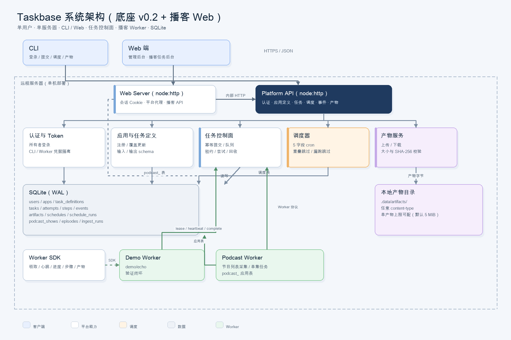
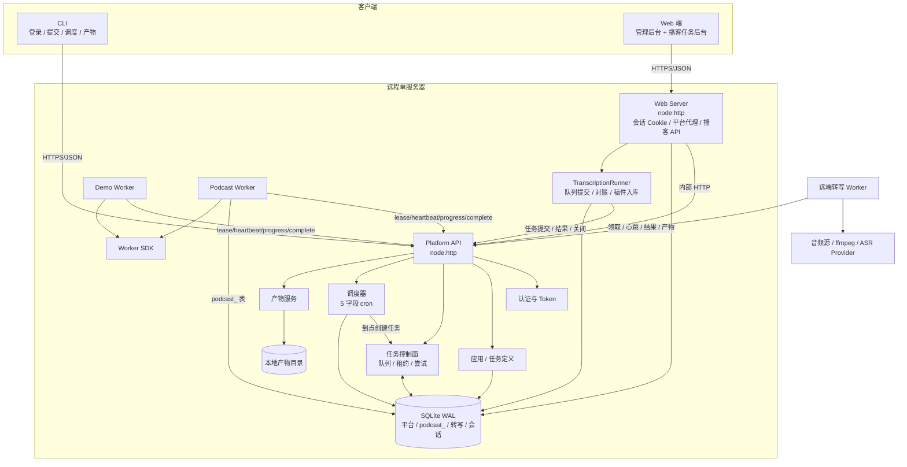
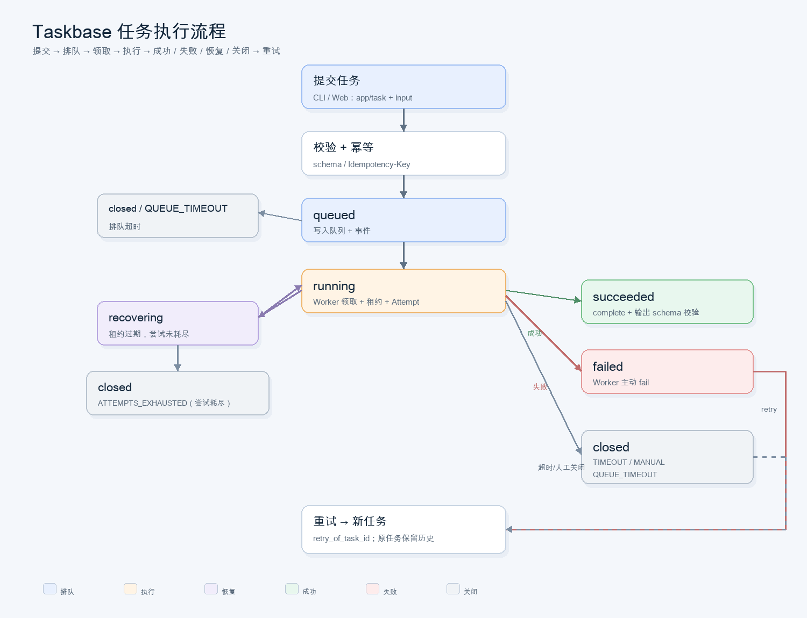
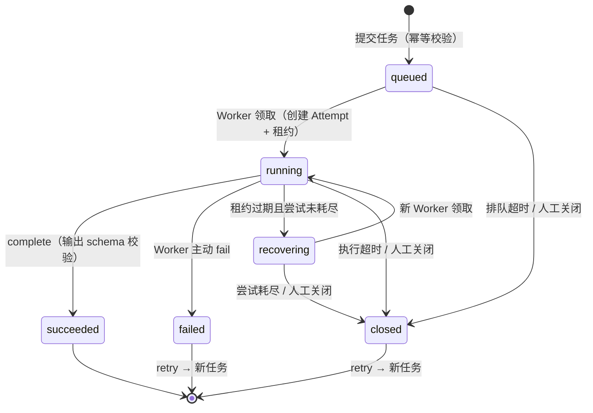
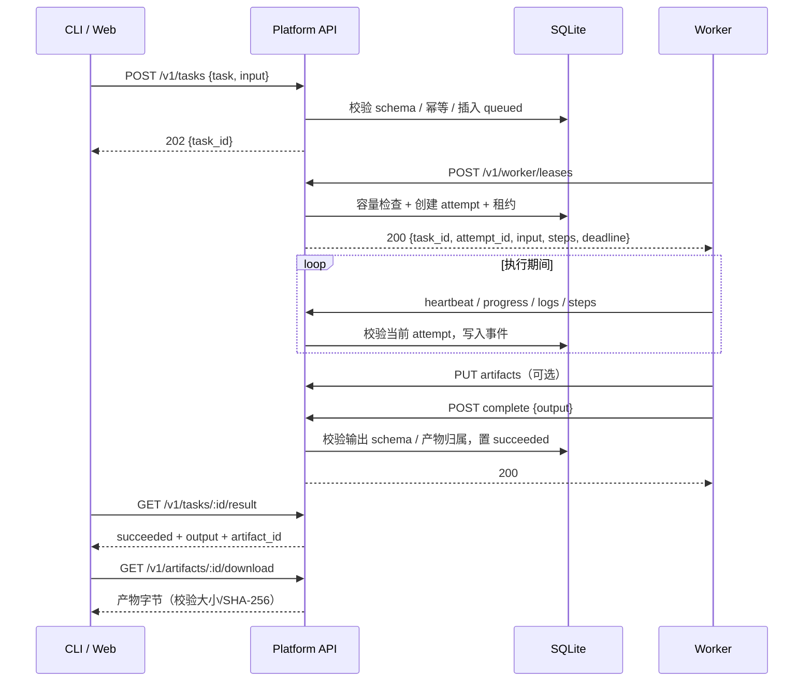
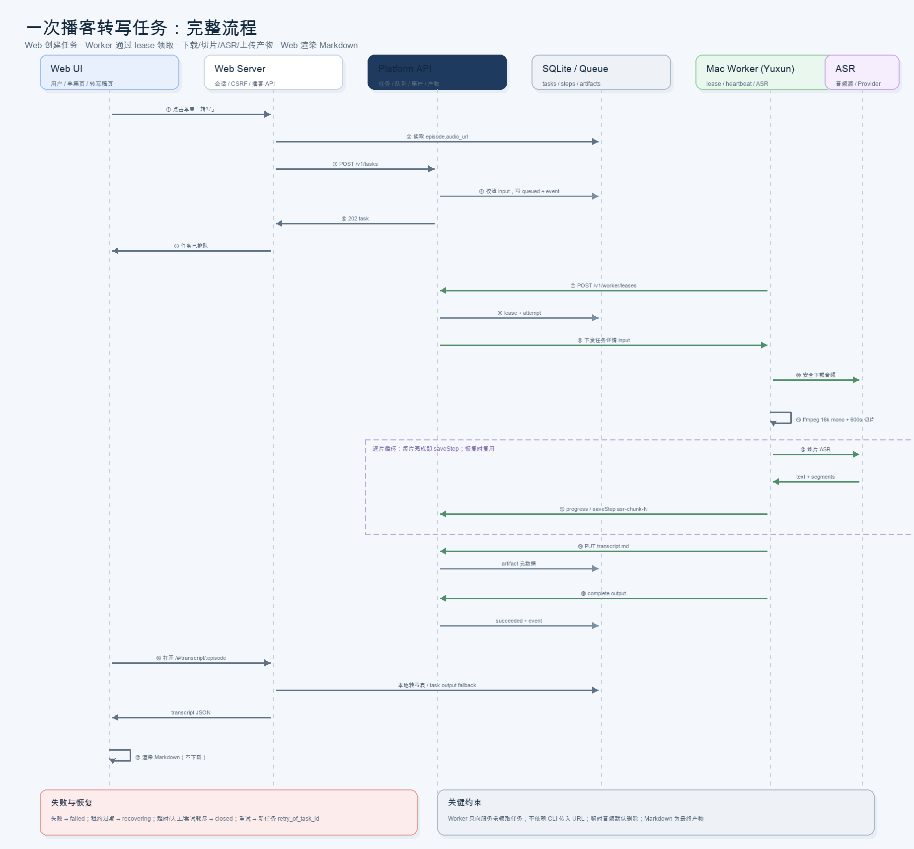
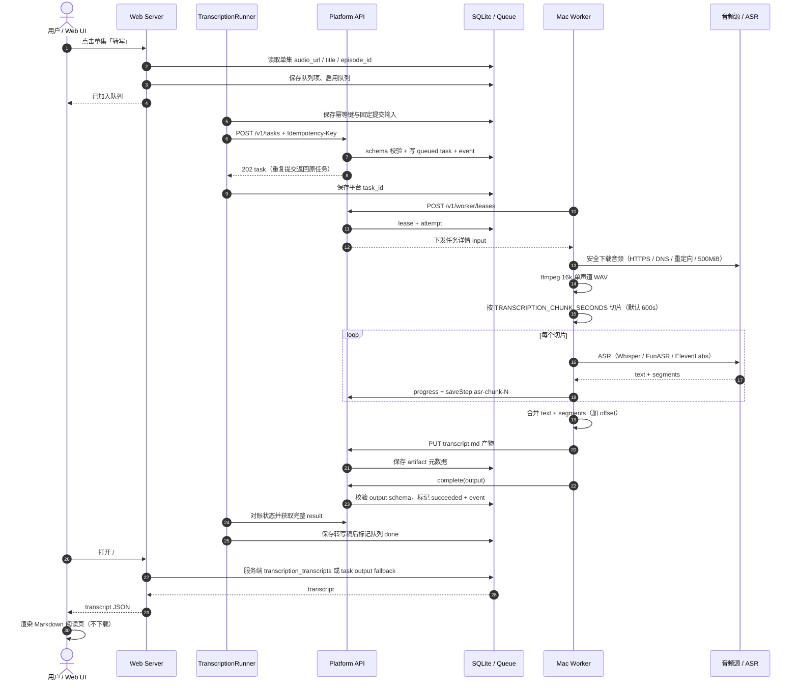
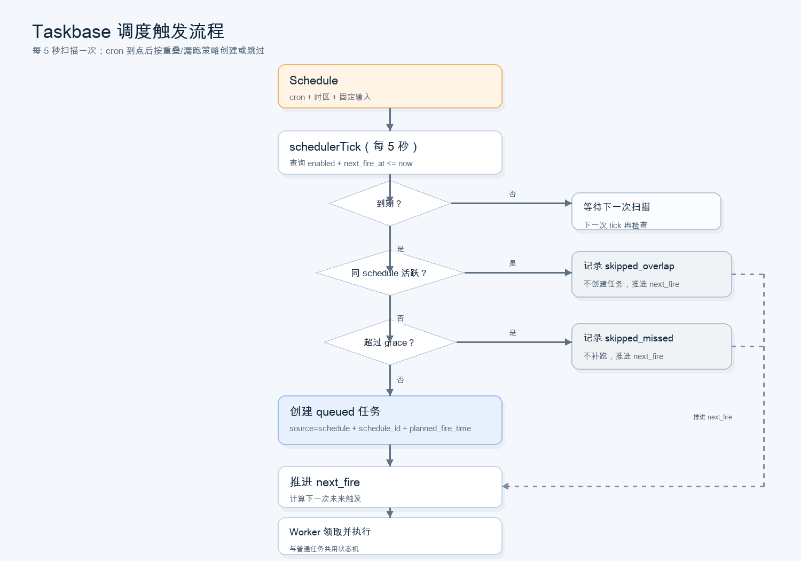
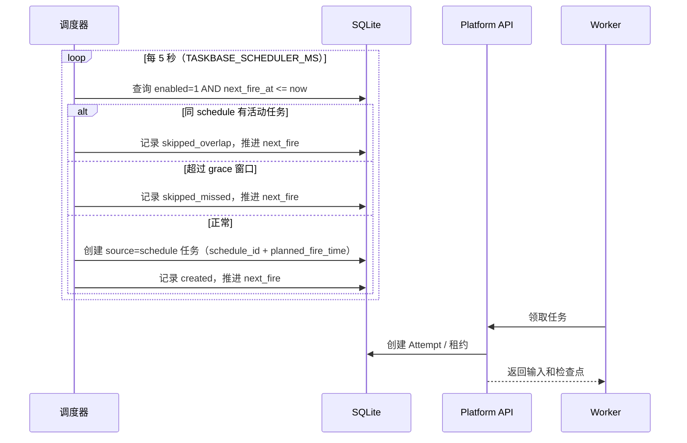

# Taskbase 系统架构与流程

本文描述当前 `taskbase/` 独立工程的实现架构、Web 端、任务生命周期和调度流程。图分为可编辑的 Mermaid 源码和渲染后的 PNG（`docs/diagrams/`）。

更新：2026-11-10。当前契约、证据和范围决定见[项目规范与验收审查](../../spec/taskbase-current-spec.md)。维护者已确认按现有功能交付，沿用当前 grace/Attempt 规则，稿件入库以 Web 队列为准，生产运维验收暂缓。采集仅保存节目/单集元数据；下载音频由独立转写 Worker 完成。

## 1. 系统边界

Taskbase 是一个**单用户、单服务器**的任务平台：

- 平台负责任务控制面：认证、应用/任务定义、队列、租约、事件/日志、产物元数据、cron 调度。
- 播客应用负责领域数据：`podcast_shows` / `podcast_episodes` / `podcast_ingest_runs` 与单集别名，由应用自己迁移；平台不读取这些表。平台任务摘要目前有 `podcast-tools` 专用分支，仍存在领域耦合。
- Web 端包含**平台管理后台**和**播客任务后台**，日常请求使用 Web 会话 Cookie，不持有平台 Owner Token。注册/轮换操作会一次性展示 Worker Token，供所有者配对。
- Podcast Worker 负责抓公开节目页并写入列表；当前不下载音频、不转录。
- 转写 Runner 随 Web 服务常驻，管理顺序、平台任务关联与稿件入库补偿；远端转写 Worker 负责下载/ASR/结果回传。
- 所有状态保存在同一个 SQLite 文件，产物保存在本地目录。

## 2. 架构图



- [系统架构 PNG](diagrams/architecture.png)
- [任务执行流程 PNG](diagrams/task-flow.png)
- [调度触发流程 PNG](diagrams/schedule-flow.png)

PNG 为历史渲染资产，本轮未重新生成；当前结构和执行语义以文字、Mermaid 与项目规范为准。页面截图未纳入 Git。

Mermaid 源码：



## 3. 组件职责

| 组件 | 当前实现 | 职责 |
| --- | --- | --- |
| CLI | `src/cli.ts` | 登录、应用注册、任务、调度、日志、产物下载 |
| Web UI | `web/public/` | 平台管理后台 + 播客任务后台；原生 HTML/CSS/JS |
| Web Server | `web/server.ts` | 登录会话、CSRF、平台 API 代理、播客领域 API、静态页面 |
| Platform API | `src/server.ts` | 认证、路由、Worker 协议、产物传输、调度扫描 |
| Store | `src/store.ts` | SQLite 持久化、幂等、队列、租约、尝试、回收、调度 |
| Cron | `src/cron.ts` | 5 字段 cron 解析、时区、下次触发计算 |
| Schema | `src/schema.ts` | 输入/输出 JSON Schema 子集与 manifest 校验 |
| Podcast Store | `src/podcast/store.ts` | `podcast_` 表、节目/单集 upsert、采集记录 |
| Podcast Parser | `src/podcast/parser.ts` | 小宇宙公开页 `__NEXT_DATA__` 解析 |
| RSS Parser | `src/podcast/rss.ts` | RSS 2.0 / Atom 解析、时间/时长/音频元数据 |
| Podcast Worker | `src/podcast/worker.ts` | RSS 优先、页面回退、日期过滤、partial 标记 |
| Transcription Store | `src/transcription/store.ts` | `transcription_transcripts` 文字稿表 |
| Transcription Queue / Runner | `src/transcription/queue.ts`、`runner.ts` | 持久化队列、幂等提交、对账、取消与入库补偿 |
| Whisper Provider | `src/transcription/asr.ts` | 本地 `whisper` CLI 转写、segments 解析 |
| Transcription Worker | `src/transcription/worker.ts` | 下载/ffmpeg/ASR/Markdown/产物上传 |
| Worker SDK | `src/worker-sdk.ts` | 领取、心跳、进度、日志、步骤、产物、完成/失败 |
| Demo Worker | `src/worker-demo.ts` | 验证端到端任务闭环 |
| SQLite | `.data/taskbase.sqlite` | 平台表 + 播客应用表 |
| 产物目录 | `.data/artifacts/` | 最终产物文件 |

## 4. 部署拓扑

当前为单机部署：

```text
浏览器 ──HTTP(S)──▶ Web Server ──HTTP──▶ Platform API
                         │                  │
                         └── SQLite ◀───────┘
                              ▲
                              │ lease / heartbeat
                    Podcast Worker / Demo Worker
```

- Platform API 默认 `127.0.0.1:3333`；Web 端默认 `127.0.0.1:3334`。
- Web 端与 Platform API 是**两个独立进程**；Web 端通过内部 HTTP 调平台，不直接写平台任务表。
- Web 端和 Podcast Worker 直接打开同一个 SQLite 文件访问领域表；它们须与 API 使用同一数据目录。WAL 允许同机多连接，但不代表多个 Web Runner 可以安全并行推进。
- 转写 Worker 可位于 Mac，通过 HTTP 上传结果与产物，不直接访问服务端数据库。Web 进程停机时队列不再继续提交，已提交的平台任务可继续执行。
- 反向代理/TLS 由部署层负责；配置 `YUXUN_PUBLIC_URL=https://域名` 后 Web Cookie 默认带 `Secure`，也可显式设置 `TASKBASE_WEB_COOKIE_SECURE=1`。切换步骤见 [HTTPS](https.md)。

## 5. Web 端

Web 页面按以下职责组织：

- 总览、应用、调度与平台任务。
- 内容库：订阅列表、候选节目；单集库：单集、转写列表。
- 任务：转写队列与采集任务；转写稿提供独立阅读页。

关键设计：

- 登录使用平台用户名/密码；Web Server 调平台登录接口，拿到 Owner Token 后保存在服务端 SQLite Session，浏览器只持有会话 ID。
- 浏览器日常使用 `tb_session` HttpOnly Cookie 和 CSRF Token；Owner Token 不进浏览器。一次性 Worker Token 会在注册/轮换时展示，不应持久化到浏览器存储。
- Web Server 的 `/api/platform/*` 是**带会话鉴权的平台 API 代理**；非 GET 请求必须带 `X-CSRF-Token`。
- 播客领域 API 由 Web Server 直接读 `podcast_` 表；提交采集/同步任务时再调平台任务 API。
- Session 默认 30 天，Web 重启后继续有效；退出会删除数据库中的会话。
- 队列自动推进另需 Web 服务端有效的 `YUXUN_OWNER_USERNAME` / `YUXUN_OWNER_PASSWORD`（兼容 `TASKBASE_OWNER_*`），不能仅依赖浏览器会话。对应别名统一遵循 `显式参数 > YUXUN_* > TASKBASE_* > 默认值`。
- 列表在 SQL 中筛选分页，任务/转写列表读取摘要；详情单独读取全文。
- Web 端没有独立框架/构建步骤；静态资源由 `web/server.ts` 白名单提供，CSP 禁止内联脚本。

平台 Store 统一校验任务/调度 input 为 JSON 对象且序列化 UTF-8 不超过 64 KiB，重试和触发也重新检查。HTTP 产物上传先验证 App/Attempt，再按全局和当前定义上限的较小值读取，Store 在写入时再次检查定义；结果和检查点保留 8 MiB HTTP 空间。

`src/redact.ts` 在 SDK 上报、Store/应用错误持久化、API/Web 错误响应及 Worker 控制台边界脱敏诊断文字，先脱敏再截断。不改写任务输入、ASR 正文和检查点，也不自动清理历史含秘密数据；具体规则与边界见[当前规范](../../spec/taskbase-current-spec.md#66-接口分页与产物)。

主要 Web API：

```text
POST /api/login
POST /api/logout
GET  /api/me
*    /api/platform/*          # 平台 API 代理
GET  /api/podcast/overview
GET  /api/podcast/shows
POST /api/podcast/shows
GET  /api/podcast/shows/:id/episodes
GET  /api/podcast/shows/:id/runs
GET  /api/podcast/runs
POST /api/podcast/collect
POST /api/podcast/shows/:id/sync
POST /api/podcast/shows/:id/schedule
GET  /api/podcast/schedules
POST /api/podcast/register
GET  /api/podcast/episodes/:id/transcript
POST /api/podcast/episodes/:id/transcribe
POST /api/transcription/register
GET  /api/podcast/episodes
GET  /api/transcription/queue
POST /api/transcription/queue
POST /api/transcription/queue/start
POST /api/transcription/queue/pause
GET  /api/transcription/transcripts
GET  /api/v1/queue                 # Bearer，只读
GET  /api/v1/transcripts           # Bearer，只读
```

## 6. 任务生命周期





关键语义：

- **至少一次执行**：恢复后允许重新执行；检查点（task_steps）保证复用已确认步骤。
- **尝试隔离**：只有当前 `attempt_id` 可以写入；旧 Attempt 返回 409 `STALE_ATTEMPT`。
- **幂等**：相同用户 + App + 任务 + 幂等键 + 输入返回原任务；输入不同返回 409。
- **超时**：排队超时 / 执行超时均进入 `closed`，原因 `QUEUE_TIMEOUT` / `TIMEOUT`。
- **预算**：恢复后重新领取会重算执行 deadline；6 小时是单次 Attempt 的配置上限，不是整个任务总耗时上限。恢复排队同样重新计算截止时间。
- **关闭**：人工关闭立即置 `closed`，清租约并拒绝后续写入；不做 Worker 取消握手。
- **重试**：不修改原任务，创建新任务并记录 `retry_of_task_id`。

## 7. 任务执行时序



## 8. RSS 采集流程

```text
Web 添加栏目（页面 URL + 可选 RSS URL）
  → Podcast Worker 领取 collect/sync 任务
  → 有 rss_url：fetchFeed → parseFeedXml → 日期过滤（默认最近一年）→ upsert source=rss（coverage=full）
  → 无 rss_url：抓公开页 → 解析页面提供的列表（通常15集）→ 日期过滤 → upsert source=page
  → 写 podcast_ingest_runs
  → Web 展示已入库集数、RSS 总集数、覆盖状态
```

当前只使用已登记 RSS，不自动发现页面 `<link>`、Apple Podcasts 或 Podcast Index。没有 RSS 才走公开页；已登记 RSS 抓取失败会记失败，不自动回退。RSS 的 `full` 仅是来源覆盖标记，仍经过日期过滤，且 Feed 本身可能不含全部历史。[RSS 来源与首批栏目](rss-sources.md)中的 Apple 搜索和入库集数是历史调研记录。

## 9. 转写流程

### 一次播客转写任务的完整流程



下方 Mermaid 已包含当前队列提交与入库步骤，PNG 本轮未重新生成。



失败与恢复：

- Worker 主动失败 → `failed`
- 租约过期 → `recovering`
- 人工关闭/执行超时/排队超时/尝试耗尽 → `closed`
- 重试 → 新任务，记录 `retry_of_task_id`

```text
Web 转写队列 → “开始”
  → 服务端按顺序创建 transcription-tools/episode/transcribe
  → Transcription Worker 领取
  → 下载音频 → ffmpeg 16k mono → Whisper CLI → segments
  → 生成 transcript.md → 上传平台产物
  → complete
  → Web 写入服务端 transcription_transcripts
  → 转写稿查看/下载
```

- 默认 `whisper` CLI + `small` 模型；可用 `TRANSCRIPTION_WHISPER_MODEL` 改 `medium`。
- 产物是 Markdown；Worker 不写本地数据库，临时音频和中间文件用完即删。
- 服务端是唯一数据源：任务队列、转写稿、产物都以服务端为准。
- 稿件入库以 Web 队列为准，由 Runner 从平台结果保存稿件后确认完成；CLI 与兼容直提保持任务提交/结果读取能力，本轮不要求成功后自动入库。单集阅读可在最近 100 个转写任务中回退读取结果；只读转写 API 仅查询已入库稿件。
- 临时音频默认删除；音频下载上限 500 MiB；执行超时 6 小时。
- 切片恢复复用 ASR 检查点，仍会重新下载、转码和切片；恢复期间不要变更音频内容、切片参数或模型。
- Web 队列通过独立 `TranscriptionRunner` 串行推进，提交前保存幂等键；响应丢失后用同键找回平台任务，稿件入库成功后才标记完成。
- 取消与队列推进串行；平台确认关闭后才标记取消。Worker 在心跳失效或退出时中止下载、ASR 和 ffmpeg 进程组。
- 单集 ID 与采集来源解耦；公开页与 RSS 的相同身份/音频记录合并，旧 ID 保留为别名，转写与在途任务继续关联。
- 兼容接口 `POST /api/podcast/episodes/:id/transcribe` 仍直接创建平台任务；上图描述当前页面正常走队列的路径。

## 10. 调度流程





调度语义：

- 每个 schedule 独立：cron、时区、固定输入、启停、下次触发时间。
- 重叠：同 schedule 有未结束任务时跳过，不排队、不重复创建。
- 漏跑：超过 5 分钟 grace 窗口不补跑，记录 `skipped_missed`，推进到下一次未来触发。
- `run-now`：手动触发一次；若已有活动任务则返回 `skipped=overlap`。
- 调度任务与手动任务共用任务状态机、Worker 协议、事件、产物和恢复机制。

## 11. 失败、恢复、超时与重试

```text
Worker 崩溃 / 网络中断
  └─ 租约到期 ──▶ 尝试未耗尽 → recovering → 新 Attempt（读取已确认 steps）
                └ 尝试耗尽 → closed / ATTEMPTS_EXHAUSTED

执行超过 execution_timeout_ms
  └─ closed / TIMEOUT（迟到结果被拒绝）

排队超过 queue_timeout_ms
  └─ closed / QUEUE_TIMEOUT

worker 主动 fail
  └─ failed（平台不自动重试）

人工关闭
  └─ closed / 可填原因；迟到写入被拒绝

failed / closed
  └─ retry → 新任务（retry_of_task_id），原任务保留历史
```

## 12. 数据

平台表：

| 表 | 用途 |
| --- | --- |
| `users` / `api_tokens` / `worker_tokens` | 单用户认证、CLI Token、应用级 Worker 凭据 |
| `apps` / `task_definitions` | 应用与可覆盖更新的任务定义 |
| `tasks` | 任务实例、状态、输入/输出、关闭原因、调度来源 |
| `task_attempts` | 每次尝试与租约历史 |
| `task_steps` | 不可变检查点，恢复时复用 |
| `task_events` | 状态、进度、步骤、日志、产物事件 |
| `artifacts` | 产物元数据 |
| `schedules` / `schedule_runs` | cron 调度与触发历史 |

播客应用表（应用自迁移，平台不读）：

| 表 | 用途 |
| --- | --- |
| `podcast_shows` | 节目 URL、标题、RSS、覆盖状态、最近同步 |
| `podcast_episodes` | 单集列表元数据（标题、发布时间、时长、音频地址等，不下载音频） |
| `podcast_ingest_runs` | 每次采集的区间、状态、新增/更新数量、错误 |
| `podcast_episode_aliases` / `podcast_migrations` | 规范单集身份、旧 ID 别名与迁移记录 |

Web 与转写表：

| 表 | 用途 |
| --- | --- |
| `web_sessions` | 会话、CSRF 与可用 Owner Token；数据库和备份须按含凭据数据保护 |
| `transcription_transcripts` | 已入库正文、时间段与产物关联 |
| `transcription_queue` / `transcription_queue_state` | 队列顺序、任务关联、提交/入库阶段及启停状态 |

## 13. API 能力

平台 API：

```text
POST /v1/auth/login
GET  /v1/apps
GET  /v1/apps/:app/tasks
POST /v1/apps
POST /v1/apps/:app/worker-token
POST /v1/tasks
GET  /v1/tasks
GET  /v1/tasks/:id
GET  /v1/tasks/:id/events
GET  /v1/tasks/:id/logs
GET  /v1/tasks/:id/result
POST /v1/tasks/:id/close
POST /v1/tasks/:id/retry
GET  /v1/artifacts/:id/download
POST /v1/schedules
GET  /v1/schedules
GET  /v1/schedules/:id
PATCH /v1/schedules/:id
DELETE /v1/schedules/:id
GET  /v1/schedules/:id/runs
POST /v1/schedules/:id/run-now
GET  /health
```

Worker API：

```text
POST /v1/worker/leases
POST /v1/worker/tasks/:id/heartbeat
POST /v1/worker/tasks/:id/progress
POST /v1/worker/tasks/:id/logs
POST /v1/worker/tasks/:id/steps
PUT  /v1/worker/tasks/:id/artifacts?name=...
POST /v1/worker/tasks/:id/complete
POST /v1/worker/tasks/:id/fail
```

## 14. 当前边界与下一步

已实现：

- 底座核心：任务闭环、恢复、超时、关闭/重试、产物、cron 调度。
- Web 管理后台：总览、任务、应用、调度。
- 播客任务后台：节目库、添加节目、一年范围采集、单节目同步、单集列表、采集记录、每节目 schedule。
- Podcast Worker：RSS 优先、小宇宙公开页回退、日期过滤、partial 标记、`podcast_` 表写入。
- 转写应用：本地 Whisper CLI、下载/转码/segments/Markdown 产物上传；Web 单集转写和转写稿查看。

未实现 / 下一步：

- RSS 自动发现 UI（当前已能手工填 RSS；Apple 搜索已用于离线调研）。
- 拉取入库后自动串联“单集 → 转写”；文章→Markdown。
- 平台 `app_state`、多产物/二进制大文件。多用户权限不属于原始范围，若需要须另行确认。
- 更细的权限（当前单用户；Session 已持久化）。
- 博客/文章发布（如果“博客”不是“播客”的笔误，需要另做领域层）。
