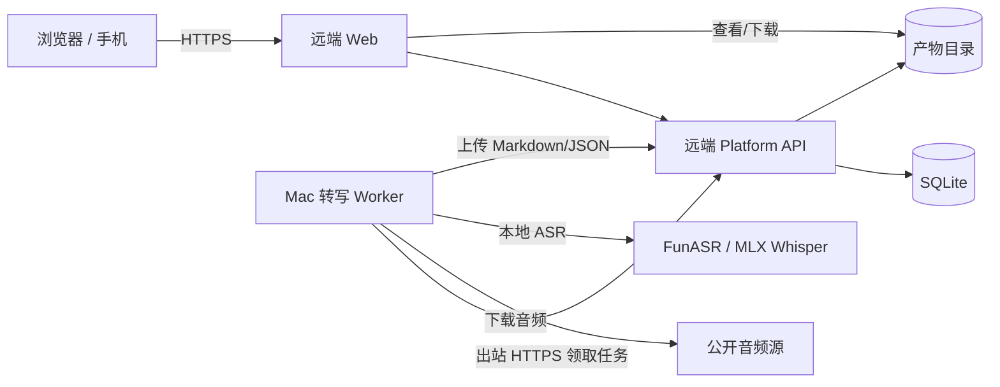

# 转写服务与远端平台方案评估

日期：2026-11-06  
目标：独立开发一个转写服务，配合远端服务做转写，并把生成的产物上传回远端 Web 服务。

## 1. 先区分两种方案

你的描述可能对应两种完全不同的架构，取舍差别很大：

### 方案 A：远端是“控制面 + 产物仓库”，转写在本机完成

```text
手机/浏览器 ──HTTPS──▶ 远端 Platform API / Web（常开）
                              ▲
                              │ 领取任务 / 上传产物
                              │（出站 HTTPS，不需要公网入口）
                       Mac 转写 Worker
                              │
                              └─ 本地 FunASR / MLX Whisper
```

- 远端负责：认证、任务、队列、调度、事件、产物存储。
- Mac 负责：下载音频、本地转写、切片/重试、上传文字稿。
- 产物上传到远端 Web 后，浏览器从远端下载。
- Mac 不需要公网 IP，不需要开放端口。

**这个方案最合理。**

### 方案 B：远端是“转写 API”，本机只是中间层

```text
Mac 转写服务 ──音频──▶ 远端 ASR 服务
        │                    │
        └──── 转写结果 ──────┘
                              │
                              ▼
                    远端 Web 产物服务
```

- 音频要上传两次：源 → Mac → 远端 ASR。
- 结果又要上传回远端 Web。
- 多一跳、多一份凭证、多一个故障点。
- 如果远端 ASR 和远端 Web 本来就同机/同内网，本机中间层通常是多余的。

**技术上可以做，但只有在以下情况才值得：**

- 本机需要先做音频下载、解密、转码、切片、降噪或格式转换；
- 远端 ASR 需要统一网关/密钥隔离，不能直接由平台调用；
- 本机网络能访问音频源，而远端服务器不能；
- 远端 Web 只接收最终产物，不负责调用 ASR。

否则更推荐把 Worker 放到远端 ASR 旁边，或者直接在远端平台内部调用 ASR。

## 2. 推荐目标架构（方案 A）



### 任务流

1. 用户在远端 Web 选择单集，提交 `transcription-tools/episode/transcribe`。
2. Mac Worker 通过 Worker Token 调用 `POST /v1/worker/leases` 领取任务。
3. Worker 下载音频到本地临时目录。
4. 本地 ASR 转写；按 chunk 上报进度和检查点。
5. 生成 Markdown / JSON 产物。
6. Worker 调 `PUT /v1/worker/tasks/:id/artifacts` 上传产物。
7. Worker 调 `complete` 提交输出；远端 Web 可下载。
8. Worker 删除临时音频（默认）。

## 3. 为什么转写服务应该是 Worker，而不是第二个平台

不建议再写一套“转写任务 API + 队列 + 租约 + 重试”，原因：

- 平台已经有任务队列、租约、心跳、恢复、事件、产物。
- 第二套任务系统会出现两个真相源，重试/超时/关闭语义不一致。
- 远端 Web 需要跨两套系统同步状态，排障困难。

正确做法：

- 转写服务 = 一个独立的 **Worker 进程**。
- 内部可以有独立的 ASR HTTP 服务，但对平台只暴露 Worker 协议。
- 失败、重试、关闭全部沿用现有任务状态机。

## 4. 产物上传注意事项

当前平台：

- 单个最终产物，任意 content-type；
- `TASKBASE_MAX_ARTIFACT_BYTES` 默认 5 MiB；
- 只有成功任务的最终产物可下载；
- 上传时必须属于当前 Attempt。

建议：

- 文字稿 Markdown 通常很小，可满足 5 MiB。
- 如果同时上传 `segments.json`，长音频可能超过 5 MiB；提高上限或只上传 Markdown。
- 上传前本地保留一份缓存，上传失败可重试；不要先删本地临时结果。
- 产物名安全处理，避免路径穿越/响应头注入。
- 产物元数据带 SHA-256；远端校验。
- 不要上传音频本身；只上传文字稿/JSON。

## 5. 远端 ASR 方案的关键问题

如果一定要“远端服务做转写”：

| 问题 | 影响 |
| --- | --- |
| 音频出境/上传 | 隐私、带宽、延迟 |
| 远端 ASR 限额 | 文件大小、时长、并发、超时 |
| 双重传输 | 源→Mac→ASR、结果→Web |
| 凭证 | ASR Key 放 Mac 还是远端？ |
| 失败重试 | ASR 超时/限流时谁来恢复 chunk？ |
| 成本 | 按分钟计费 + 远端存储 |
| 数据一致性 | ASR 结果、本地切片、远端产物三方对齐 |

如果远端 ASR 和远端平台在同一内网，**更简单的是把转写 Worker 直接部署在远端**：

```text
远端 Platform → 远端 Transcription Worker → 内网 ASR → 远端产物
```

这样不需要 Mac，也不需要双跳上传。

## 6. Mac 作为 Worker 的可用性

优点：

- Mac 有 M4 10 核/10 核 GPU/16GB，本地 ASR 性能好。
- 音频不出本机（如果本地 ASR）。
- 远端平台 7×24 常开，Mac 可休眠；任务在远端排队。
- Mac 只需出站 HTTPS，无需公网入口/Tailscale 入站。

风险：

- Mac 睡眠/关机时 Worker 不在线；任务排队超过上限会 `QUEUE_TIMEOUT`。
- 租约过期会进入恢复；需要检查点。
- 建议在 Mac 在线时再提交批量任务，或把 queue timeout 设为 6 小时。
- MacBook Air 无风扇，100 小时回填要分批。
- 本机 16GB 内存当前已有 Swap，跑 ASR 前关闭大程序。

## 7. 安全建议

- Mac 只保存 **transcription app 的 Worker Token**，不保存 owner token。
- 远端 Web/API 必须 HTTPS；Web 登录使用 HttpOnly Cookie + CSRF。
- Worker 只允许访问本 app 的任务/产物；当前 Worker Token 已按 app 隔离。
- 远端 ASR Key 不放在浏览器；如果放 Mac，使用环境变量/密钥管理，不进仓库。
- 日志中不打印完整音频 URL、Token、转写全文。
- 临时音频目录权限 0700，任务结束清理。
- 远端平台不要直接暴露 3333/3334 到公网；用反代 TLS 或 Tailscale。

## 8. 结论

### 推荐的方案

**远端平台（常开）+ Mac 转写 Worker（本地 ASR）+ 远端产物存储。**

这是合适且清晰的：

- 远端负责可靠控制面和产物；
- Mac 负责重计算；
- 出站 Worker 协议，不需要公网入口；
- 本地转写，隐私好；
- 产物上传回远端 Web，统一查看/下载。

### 不推荐作为首选

**Mac 中间层 + 远端 ASR + 远端 Web**：

- 多两跳网络；
- 多一个故障点；
- 音频要两次上传；
- 如果远端 ASR 和 Web 同机，直接让远端 Worker 调 ASR 更简单。

只有本机确实承担下载/转码/切片/密钥隔离等职责时，才值得保留这个中间层。

## 9. 落地建议

1. 新建 `transcription-tools` App，任务 `episode/transcribe`。
2. 把旧仓库的 `apps/podcast-tools` 转写 Worker 迁移到新底座。
3. Mac 上跑独立 ASR 服务（FunASR SenseVoiceSmall 或 MLX Whisper）。
4. Worker 用 Worker Token 出站轮询远端平台。
5. 产物先本地缓存，再上传远端；失败重试。
6. 长任务设置 2–6h 超时，chunk 级检查点。
7. 默认删除临时音频，只保留文字稿/JSON。
8. 远端 Web 增加转写状态、转写稿查看/下载。

这套方案可以独立开发转写服务，同时不破坏远端平台的队列、恢复和产物语义。
